# MuJoCo 소개: Gazebo · Isaac Sim 비교와 뷰어로 로봇 움직여 보기

## 1. MuJoCo 란

### MuJoCo 한눈에

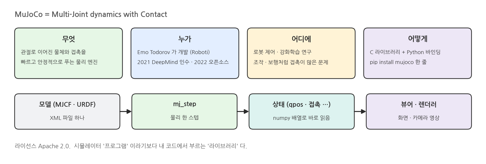{width=1000}

- 이름: Multi-Joint dynamics with Contact · 관절과 접촉을 푸는 물리 엔진
- Google DeepMind 가 관리하는 오픈소스 (Apache 2.0)
- 프로그램이 아니라 라이브러리 → 내 Python 코드가 물리를 한 스텝씩 돌림

### pip install mujoco 에 들어 있는 것

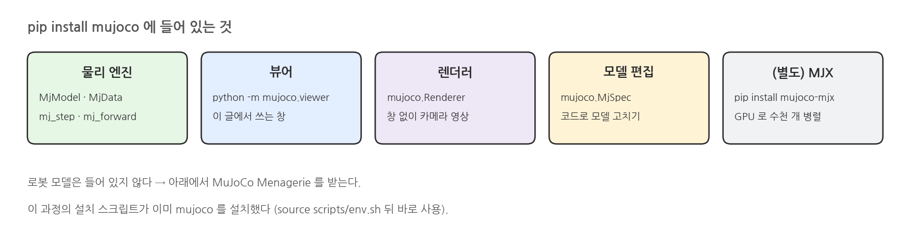{width=1000}

## 2. Gazebo · Isaac Sim 과 비교

### 세 시뮬레이터

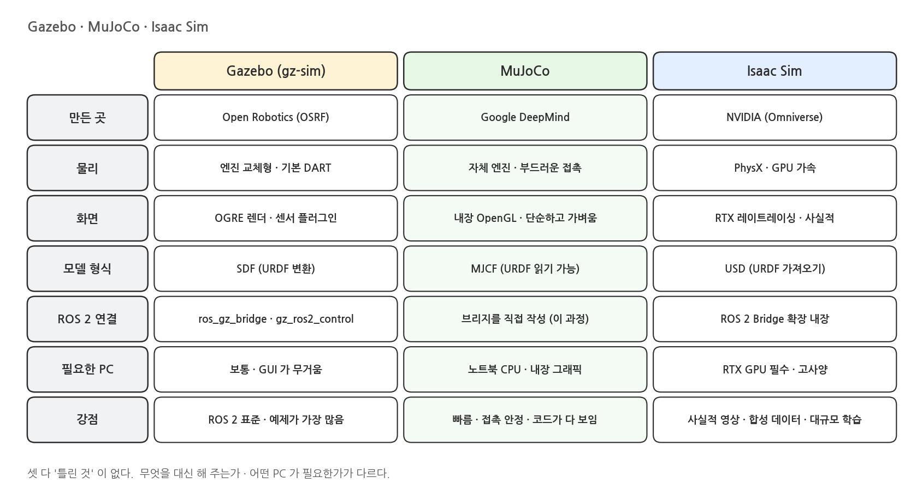{width=1000}

### 언제 무엇을 고르나

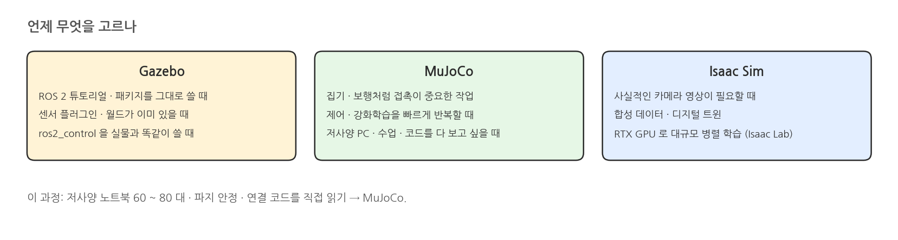{width=1000}

## 3. 로봇 모델 받기: MuJoCo Menagerie

### Menagerie 란

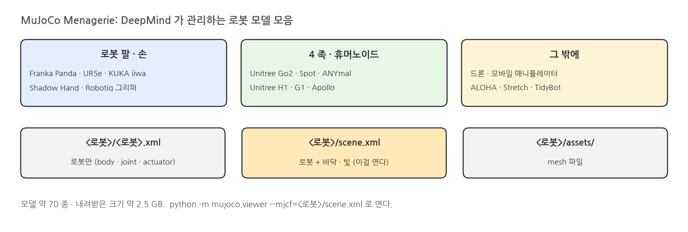{width=1000}

- mujoco 패키지에는 로봇 모델이 없음 → 공식 모델 모음을 따로 받음
- 로봇마다 폴더 하나 · 그 안의 `scene.xml` 을 엶

### 터미널 1: 모델 받기

```bash
git clone --depth 1 https://github.com/google-deepmind/mujoco_menagerie.git ~/mujoco_menagerie
ls ~/mujoco_menagerie/unitree_go2
```

### 실행 결과: 로봇 폴더 안

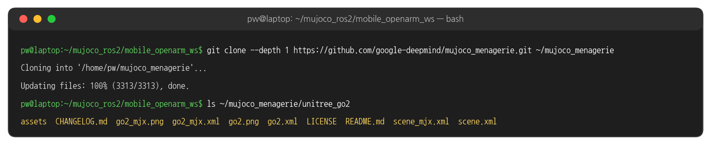{width=1000}

### 터미널 1: 어떤 로봇이 있나

```bash
ls -d ~/mujoco_menagerie/*/ | xargs -n1 basename | column -c 110
```

### 실행 결과: 로봇 목록

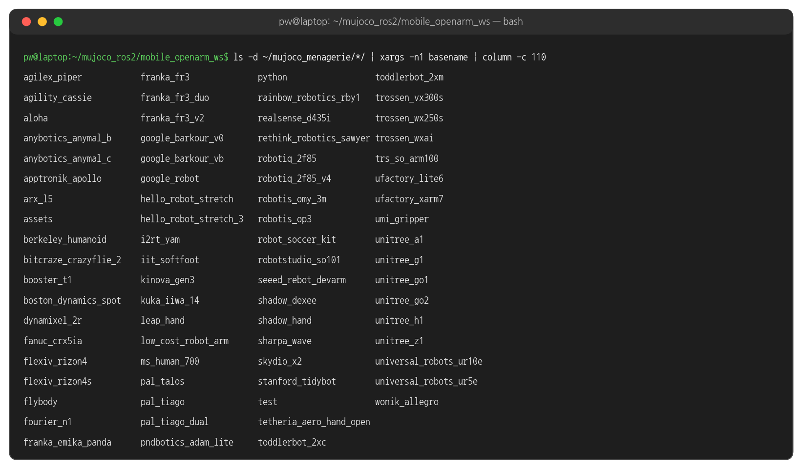{width=1000}

- 이 글에서 여는 것: `franka_emika_panda` (로봇 팔) · `unitree_go2` (4 족)

## 4. 첫 번째 로봇: Franka Panda

### 터미널 1: 뷰어로 열기

```bash
cd ~/mujoco_ros2/mobile_openarm_ws
source scripts/env.sh
python -m mujoco.viewer --mjcf=$HOME/mujoco_menagerie/franka_emika_panda/scene.xml
```

### 실행 결과: Panda 가 서 있는 뷰어

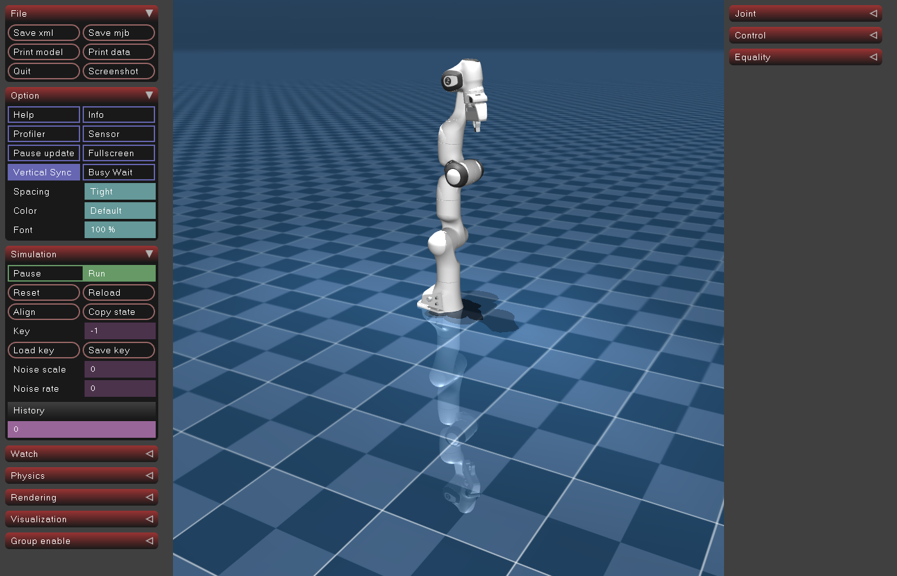{width=1000}

- 열자마자 물리가 돌고 있음 (왼쪽 Simulation 의 Run 이 켜진 상태)

### 화면 구성

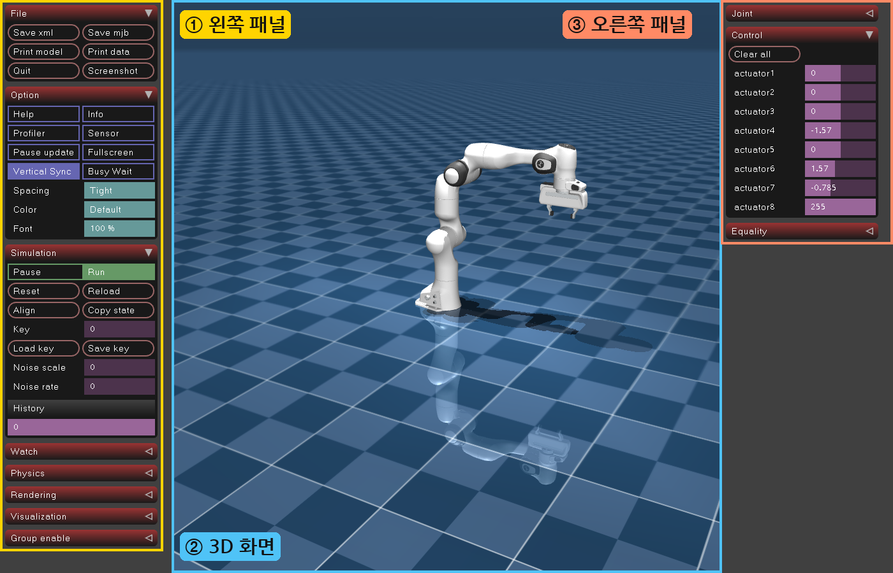{width=1000}

- ① 왼쪽 패널: 시뮬레이션을 멈추고 되돌리기 · 무엇을 그릴지
- ② 3D 화면: 마우스로 시점을 바꾸고 로봇을 밀기
- ③ 오른쪽 패널: 관절 · 액추에이터를 직접 조작

### 패널 안의 메뉴

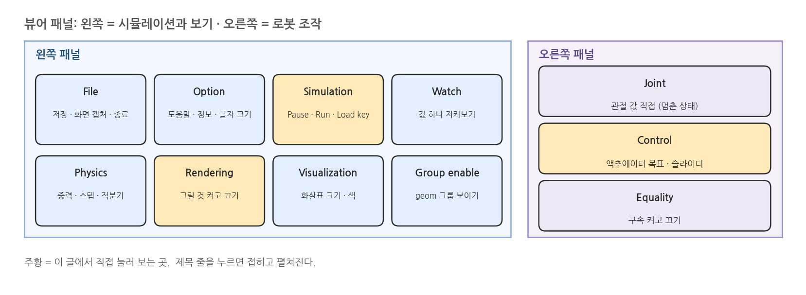{width=1000}

### 조작 1: 저장된 자세 불러오기 (Key · Load key · Reset)

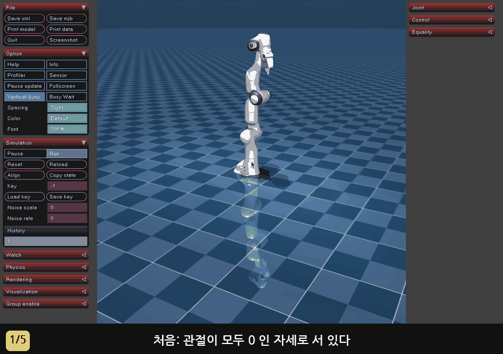{width=860}

- 키프레임 = 모델 파일에 저장해 둔 자세 · Panda 에는 `home` 하나 (0 번)
- Key 칸을 끌어 0 → Load key → 그 자세로 바뀜
- Reset → 처음 상태로

### 조작 2: Control 슬라이더로 관절 움직이기

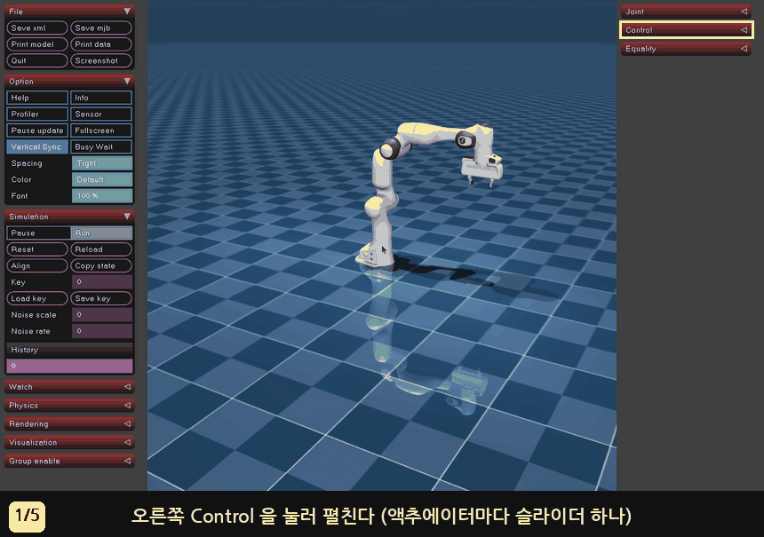{width=860}

- Control 의 슬라이더 하나 = 액추에이터 하나
- Panda 는 위치 액추에이터 → 슬라이더 값이 관절의 목표 각
- actuator1 ~ 7 = 팔 관절 · actuator8 = 그리퍼

### 조작 3: 마우스로 밀기 · 시점 바꾸기

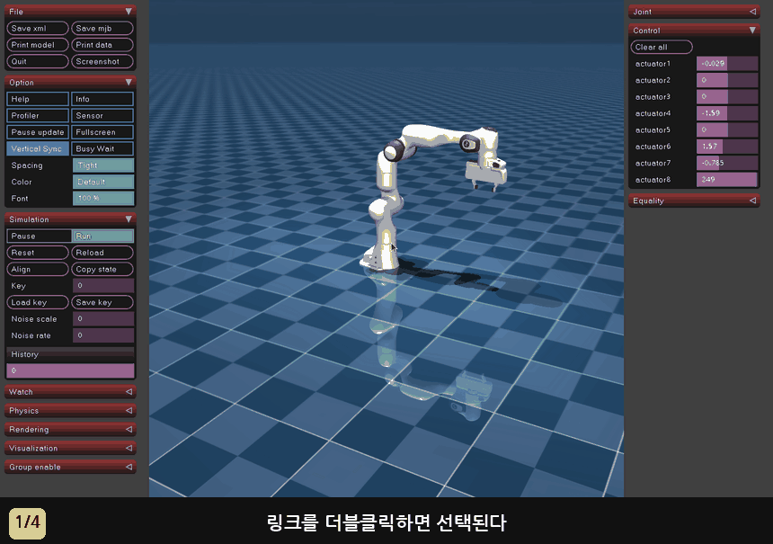{width=860}

- 더블클릭으로 링크 선택 → Ctrl + 오른쪽 끌기 = 힘으로 밀기 (빨간 화살표)
- 놓으면 위치 액추에이터가 목표 자세로 되돌림
- 빈 곳 왼쪽 끌기 = 시점 회전

### 마우스와 키 정리

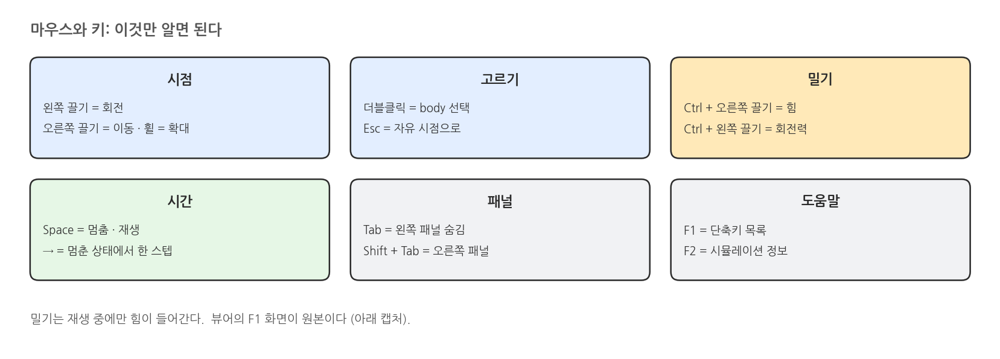{width=1000}

### F1: 뷰어의 단축키 화면

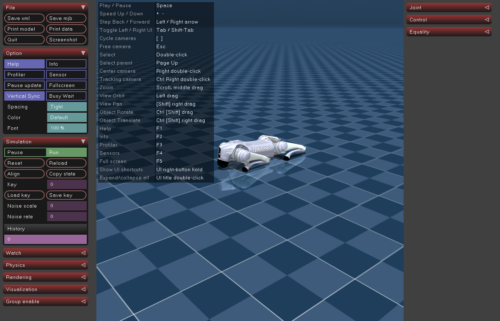{width=1000}

- 뷰어에서 F1 을 누르면 나오는 화면 · 다시 누르면 사라짐
- 끝내기: 창을 닫거나 File 의 Quit

## 5. 두 번째 로봇: Unitree Go2

### 터미널 1: 뷰어로 열기

```bash
python -m mujoco.viewer --mjcf=$HOME/mujoco_menagerie/unitree_go2/scene.xml
```

### 실행 결과: 주저앉은 Go2

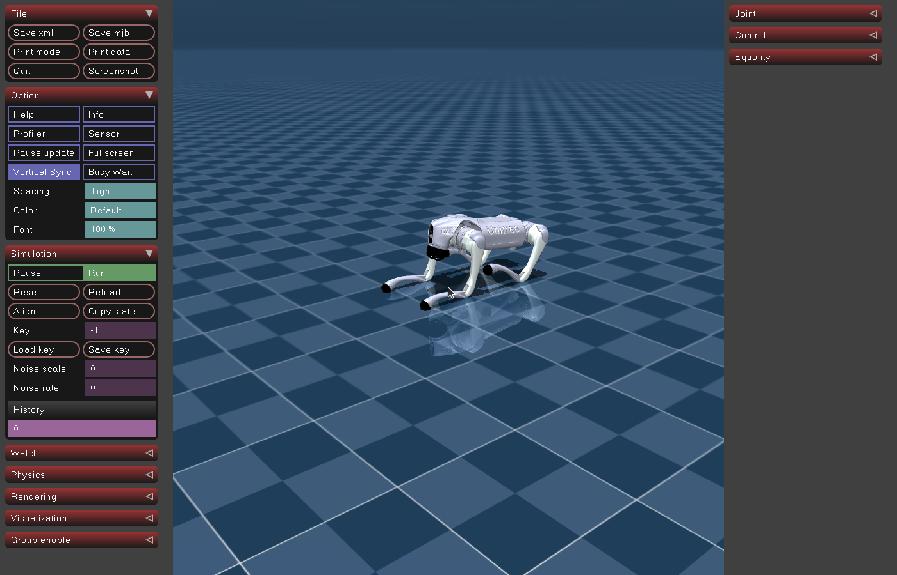{width=1000}

- 열자마자 물리가 돌아 다리가 접히며 주저앉음 → 고장이 아님
- Go2 는 토크 액추에이터 · 토크를 넣어 주는 제어기가 없기 때문

### 조작 4: 멈추고, 자세를 불러오고, 다시 돌리기 (Pause · Load key · Run)

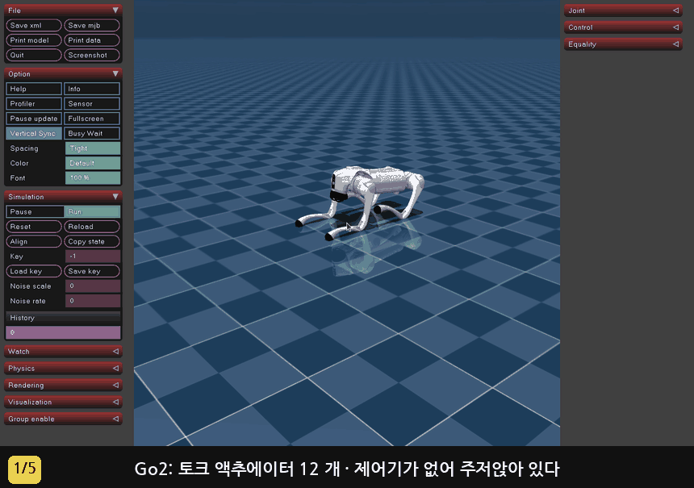{width=860}

- Pause (또는 Space) → 물리가 멈춤 · 화면 위에 PAUSE 표시
- 멈춘 상태에서 Load key → `home` 자세로 서 있음
- Run → 받쳐 주는 토크가 없어 다시 주저앉음

### 조작 5: 보이는 것 바꾸기 (Rendering)

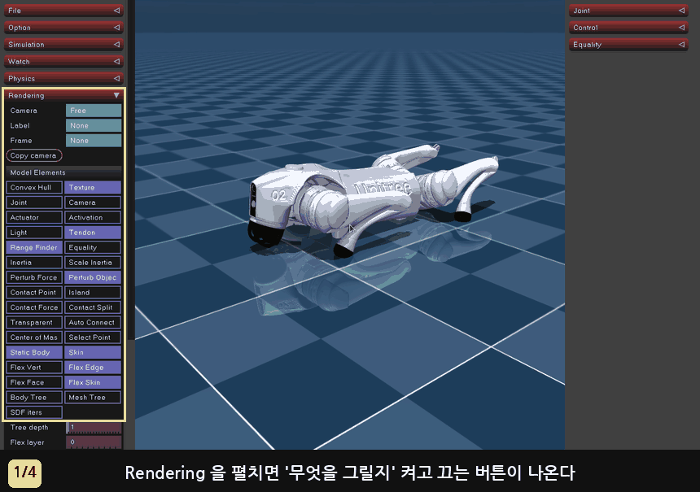{width=860}

- 왼쪽 패널의 다른 메뉴를 접고 Rendering 을 펼친 화면
- Contact Force = 접촉력 화살표 · Transparent = 반투명 · Joint = 관절 축
- 한 번 더 누르면 꺼짐

### 두 로봇의 차이

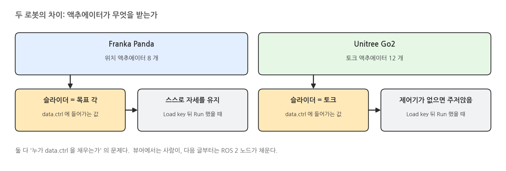{width=1000}

- 뷰어에서는 사람이 슬라이더로 `data.ctrl` 을 채움
- 다음 글부터는 ROS 2 노드가 그 값을 채움

### 해 볼 것

- Panda 의 Control 에서 actuator2 · actuator6 을 움직여 어느 관절인지 확인
- Go2 를 Pause → Load key 한 뒤 오른쪽 Control 을 펼쳐 슬라이더를 움직이고 Run → 다리가 어떻게 되는지 확인
- 목록에서 다른 로봇을 하나 골라 열어 보기 (예: `universal_robots_ur5e` · `unitree_h1`)
