# URDF에서 MuJoCo 모델로: URDF 읽기와 MJCF 변환

## 1. Gazebo 와 MuJoCo: 무엇이 다른가

### 두 시뮬레이터

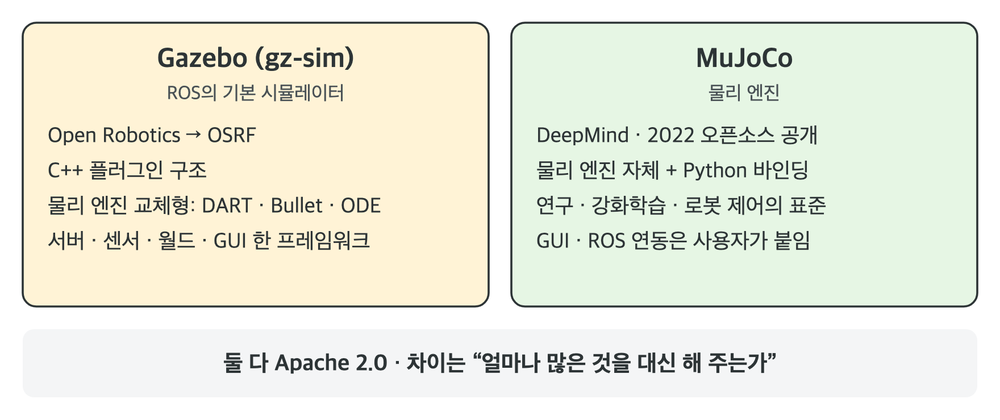{width=1000}

### 물리 연산 방식

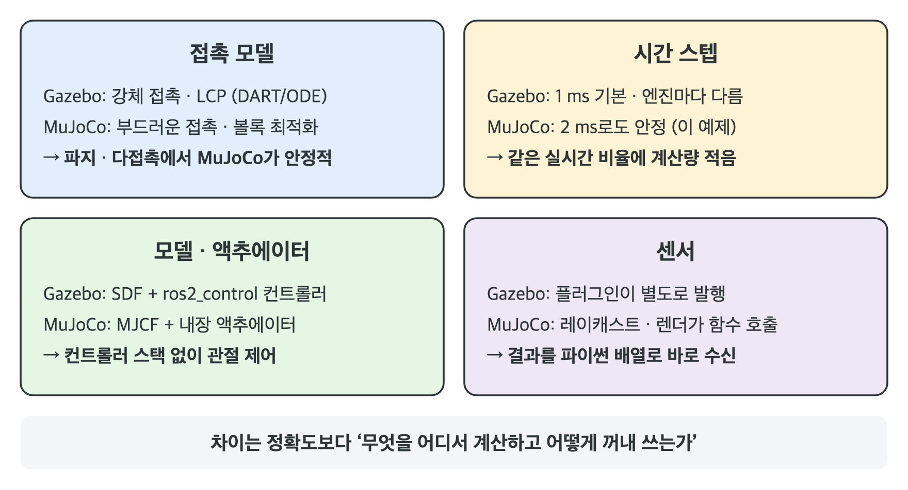{width=1000}

### 장단점

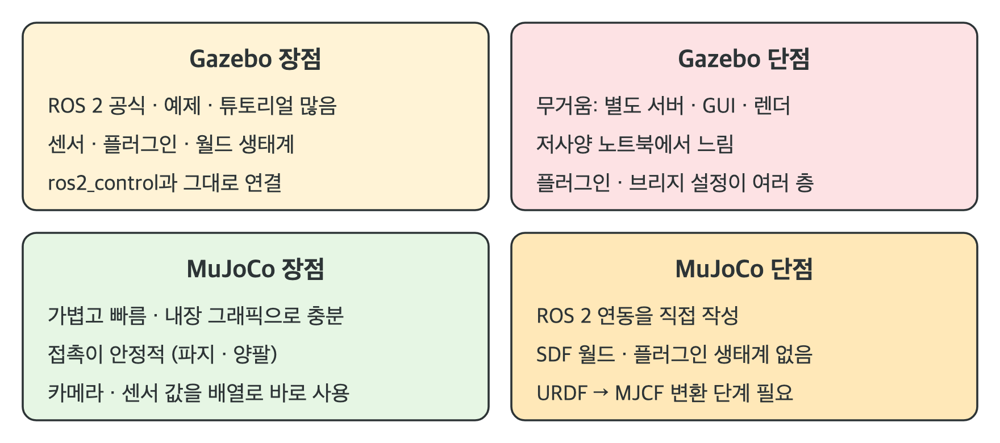{width=1000}

### 이 과정에서 MuJoCo를 쓰는 이유

{width=1000}

## 2. 큰 그림: URDF 를 가진 ROS 2 사용자가 할 일

### 세 단계

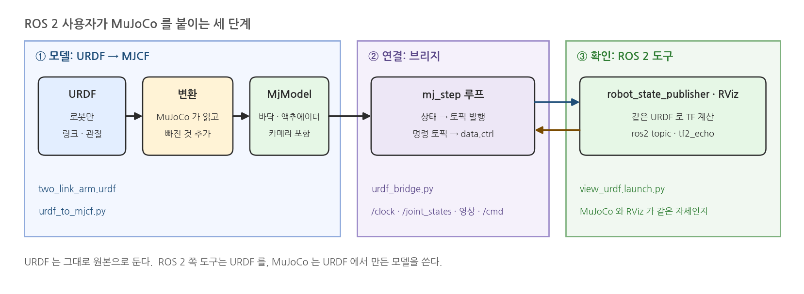{width=1000}

- 이 글 = ① 모델: URDF 를 MuJoCo 가 읽게 하고 빠진 것을 채움
- ② 연결 · ③ 확인은 다음 글

### 파일 넷

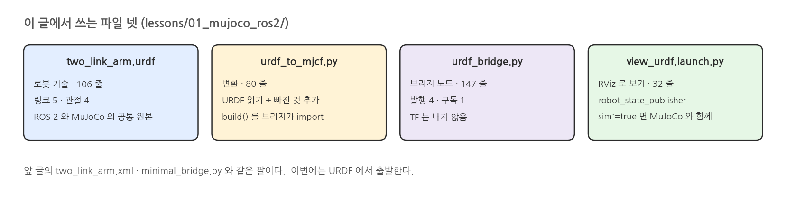{width=1000}

- 이 글에서 쓰는 것: `two_link_arm.urdf` · `urdf_to_mjcf.py` · `view_urdf.launch.py`
- `urdf_bridge.py` 는 다음 글

## 3. URDF: ROS 가 로봇을 적는 방법

### 링크와 관절의 트리

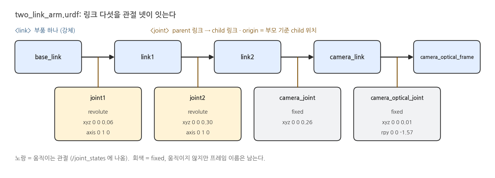{width=1000}

- `<link>` = 강체 하나 · `<joint>` = 두 링크의 관계
- 트리는 joint 의 `parent` · `child` 이름으로 만들어짐
- 움직이는 관절 2개만 `/joint_states` 에 나옴 · fixed 는 프레임만 만듦

### link 안의 세 가지

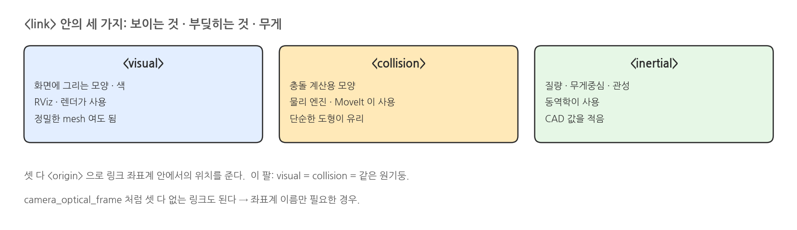{width=1000}

### link1 (코드) - two_link_arm.urdf 발췌

```xml
<!-- lessons/01_mujoco_ros2/two_link_arm.urdf -->
<link name="link1">
  <visual>
    <origin xyz="0 0 0.15"/>
    <geometry><cylinder radius="0.02" length="0.30"/></geometry>
  </visual>
  <collision> ... </collision>            <!-- visual 과 같은 원기둥 -->
  <inertial>
    <origin xyz="0 0 0.15"/>
    <mass value="0.40"/>
    <inertia ixx="0.00304" iyy="0.00304" izz="0.00008" ixy="0" ixz="0" iyz="0"/>
  </inertial>
</link>
```

- 링크 좌표계 원점 = 관절 위치 · 원기둥 중심은 `origin` 으로 0.15 m 위
- `cylinder` 는 중심 기준 · 길이 0.30 m → 관절에서 다음 관절까지
- 관성은 원기둥 공식 값: m(3r² + L²)/12 = 0.00304

### joint 의 속성

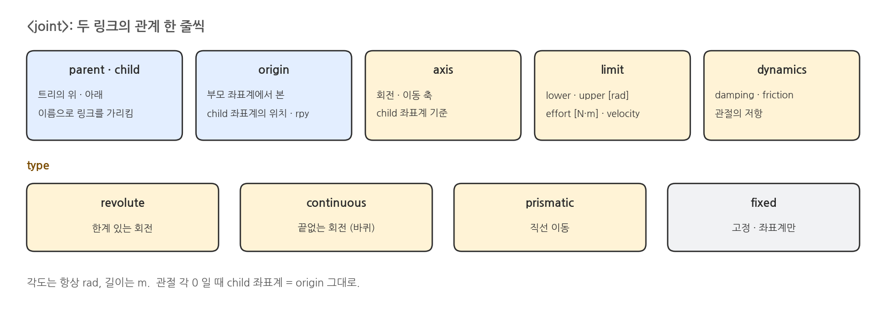{width=1000}

### joint1 (코드) - two_link_arm.urdf 발췌

```xml
<!-- lessons/01_mujoco_ros2/two_link_arm.urdf -->
<joint name="joint1" type="revolute">
  <parent link="base_link"/>
  <child link="link1"/>
  <origin xyz="0 0 0.06" rpy="0 0 0"/>
  <axis xyz="0 1 0"/>
  <limit lower="-1.57" upper="1.57" effort="20" velocity="3.0"/>
  <dynamics damping="0.5"/>
</joint>
```

- `origin`: base_link 원점에서 0.06 m 위에 link1 좌표계
- `axis 0 1 0`: y 축 회전 → 팔이 x-z 평면에서 움직임
- `name` 이 `/joint_states` 의 이름 · MuJoCo 의 joint 이름이 됨

### fixed 관절과 카메라 프레임

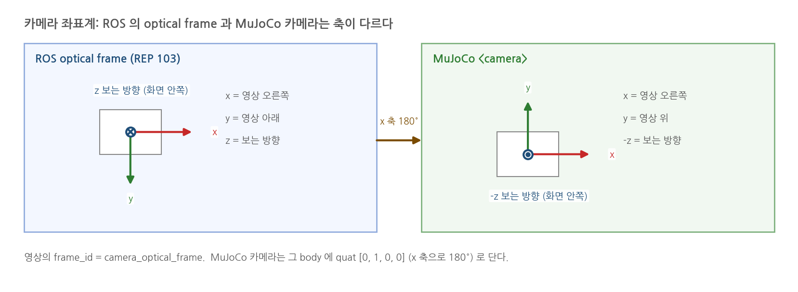{width=1000}

- `camera_link`: 카메라 몸체가 붙는 자리
- `camera_optical_frame`: 영상 좌표계 (z = 보는 방향) · 영상 메시지의 `frame_id`

### 카메라 프레임 (코드) - two_link_arm.urdf 발췌

```xml
<!-- lessons/01_mujoco_ros2/two_link_arm.urdf -->
<link name="camera_optical_frame"/>

<joint name="camera_joint" type="fixed">
  <parent link="link2"/>
  <child link="camera_link"/>
  <origin xyz="0 0 0.26" rpy="0 0 0"/>
</joint>
<joint name="camera_optical_joint" type="fixed">
  <parent link="camera_link"/>
  <child link="camera_optical_frame"/>
  <origin xyz="0 0 0.01" rpy="0 0 -1.5708"/>
</joint>
```

- 내용이 없는 `<link>` = 좌표계 이름만 필요한 링크
- `rpy 0 0 -1.5708`: z 축으로 -90° → 영상 오른쪽 = x, 아래 = y, 보는 방향 = z (팔 끝 방향)

### 터미널 1: URDF 검사

```bash
source scripts/env.sh
check_urdf lessons/01_mujoco_ros2/two_link_arm.urdf
```

### 실행 결과: check_urdf

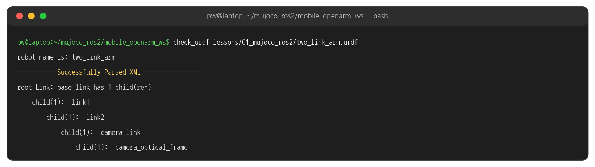{width=1000}

### 터미널 1: RViz 로 보기

```bash
ros2 launch lessons/01_mujoco_ros2/view_urdf.launch.py
```

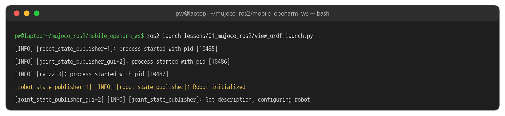{width=1000}

### 실행 결과: RViz 와 관절 슬라이더

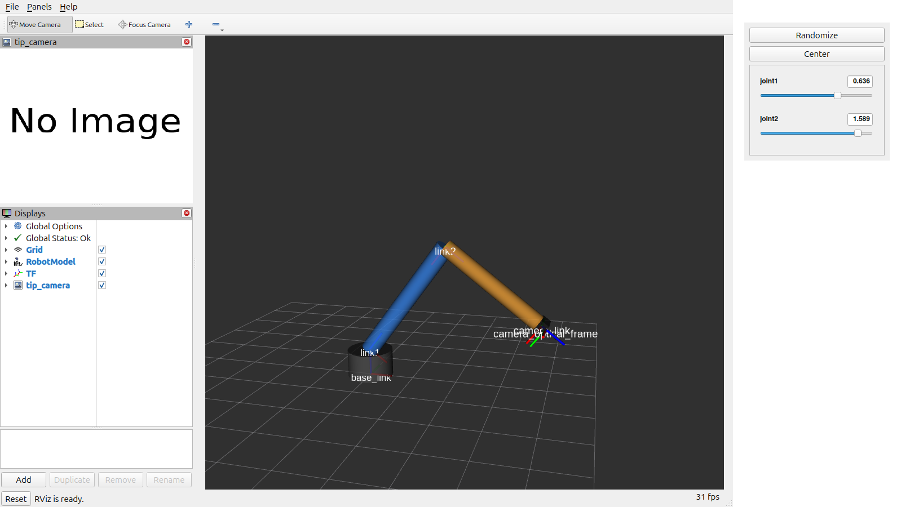{width=1000}

- 슬라이더 = `joint_state_publisher_gui` · 시뮬레이터가 없어 영상은 No Image
- 끝나면 터미널 1 에서 Ctrl+C

### view_urdf.launch.py (코드) - 노드 셋

```python
# lessons/01_mujoco_ros2/view_urdf.launch.py
urdf = (HERE / "two_link_arm.urdf").read_text()
return LaunchDescription([
    DeclareLaunchArgument("sim", default_value="false"),
    Node(package="robot_state_publisher", executable="robot_state_publisher",
         parameters=[{"robot_description": urdf}, sim_time]),
    Node(package="joint_state_publisher_gui", executable="joint_state_publisher_gui",
         condition=UnlessCondition(sim)),
    Node(package="rviz2", executable="rviz2", arguments=["-d", str(HERE / "two_link_arm.rviz")],
         parameters=[sim_time]),
])
```

- `robot_state_publisher`: URDF + `/joint_states` → `/tf` · `/robot_description`
- `sim:=true` → 슬라이더 노드를 띄우지 않음 · 세 노드 모두 `use_sim_time`

### URDF 에 없는 것

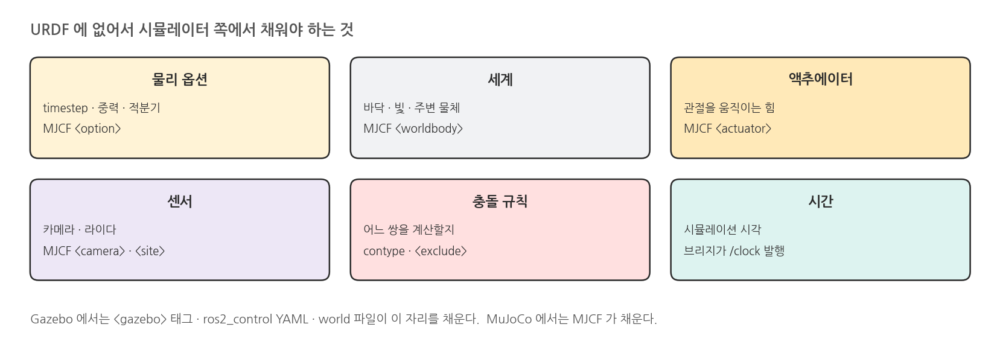{width=1000}

- URDF 는 로봇만 적음 → 시뮬레이션에는 이 여섯이 더 필요
- 다음 장에서 MuJoCo 쪽에 채움

## 4. URDF → MJCF: MuJoCo 가 읽게 만들기

### MuJoCo 는 URDF 를 바로 읽는다 (코드)

```python
# 예시 코드 (저장소 파일 아님)
import mujoco

model = mujoco.MjModel.from_xml_path("two_link_arm.urdf")   # MJCF 와 같은 함수
mujoco.mj_saveLastXML("as_mjcf.xml", model)                 # 읽은 결과를 MJCF 로 저장
```

- 읽는 파일: `lessons/01_mujoco_ros2/two_link_arm.urdf` · 위 코드는 설명용 최소 예, 실제 실행 코드는 `lessons/01_mujoco_ros2/urdf_to_mjcf.py` 의 `main()` 안 `--raw` 부분
- 별도 변환 도구 불필요 · `from_xml_path` 가 URDF · MJCF 를 모두 읽음
- 읽히는 것과 쓸 수 있는 것은 다름 → 아래에서 확인

### 터미널 1: URDF 를 그대로 읽은 결과 보기

```bash
python lessons/01_mujoco_ros2/urdf_to_mjcf.py --raw
```

### 실행 결과: body 3 · actuator 0 · camera 0

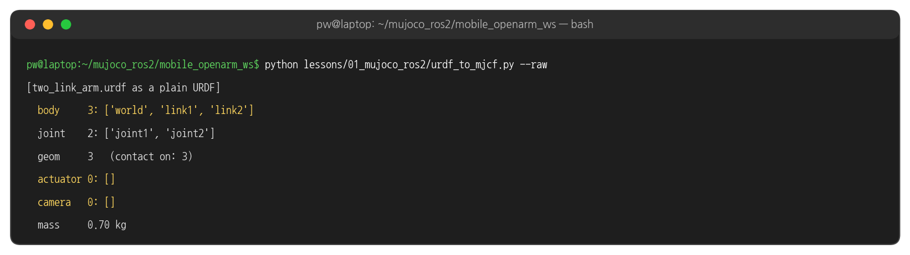{width=1000}

### 그대로 읽은 모델을 1 초 돌리면

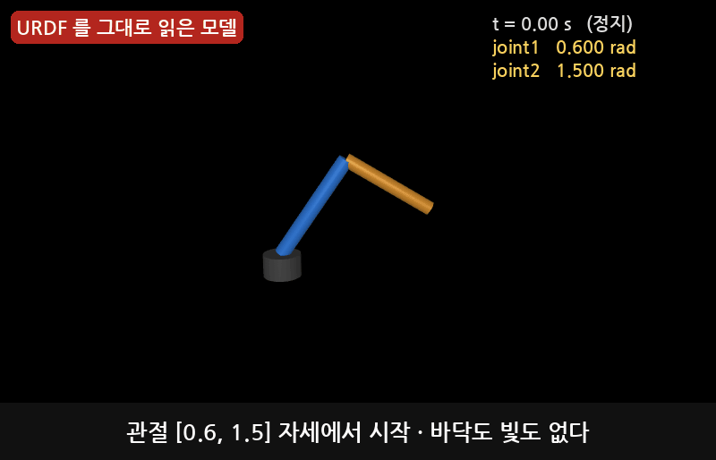{width=800}

- ① link1: base 원기둥과 충돌해 밀려남 (0.6 → 0.01 rad)
- ② link2: 잡아 주는 힘이 없어 처짐 → ③ 관절 한계 2.0 rad 에서 멈춤
- 뒷부분(초록): 같은 URDF 를 `urdf_to_mjcf.py` 로 변환한 모델 · 같은 자세를 버팀

### 문제 넷과 해결

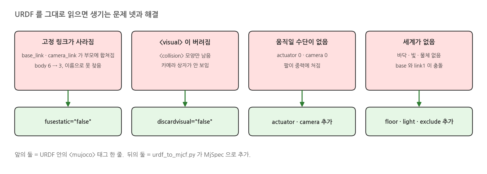{width=1000}

### MuJoCo 가 알아서 바꾸는 것

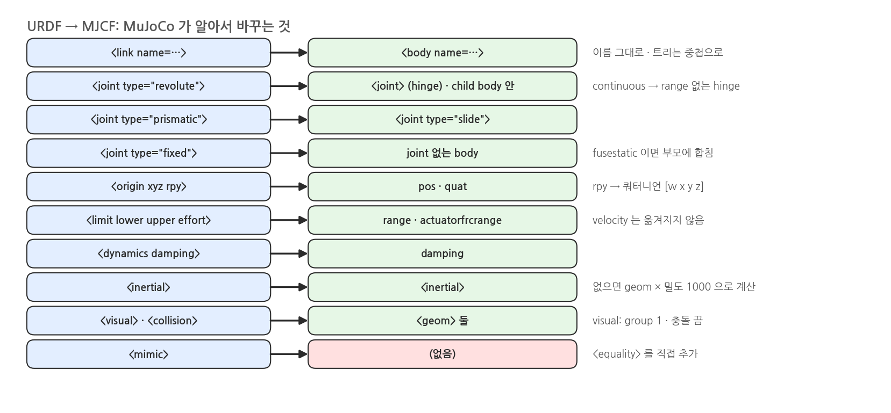{width=1000}

- 이름은 그대로 옮겨짐 → 브리지 · ROS 2 가 같은 이름 사용
- `velocity` 한계 · `<mimic>` 은 옮겨지지 않음 → 필요하면 직접 추가

### mimic: 한 관절이 다른 관절을 따라가게

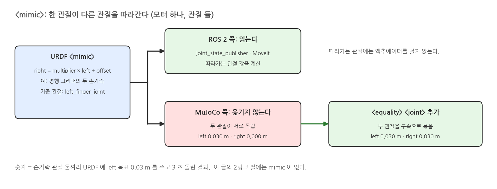{width=1000}

- URDF `<mimic>` = 따라가는 관절 = multiplier × 기준 관절 + offset
- MuJoCo 는 이 태그를 옮기지 않음 → 그대로 두면 한쪽 손가락만 움직임
- MJCF 의 `<equality>` 로 두 관절을 직접 묶음

### mimic (코드) - URDF 예시

```xml
<!-- 예시: 평행 그리퍼 (이 글의 2링크 팔에는 없음) -->
<joint name="right_finger_joint" type="prismatic">
  <parent link="palm"/>
  <child link="right_finger"/>
  <axis xyz="0 -1 0"/>
  <limit lower="0" upper="0.04" effort="10" velocity="1"/>
  <mimic joint="left_finger_joint" multiplier="1.0" offset="0.0"/>
</joint>
```

- `joint`: 기준 관절 이름 · `multiplier="-1"` 이면 반대 방향
- 축을 반대(`0 -1 0`)로 두고 multiplier 1 → 두 손가락이 함께 벌어지고 닫힘

### mimic → equality (코드) - MJCF 와 MjSpec

```xml
<!-- 예시 코드 (저장소 파일 아님) -->
<equality>
  <joint joint1="right_finger_joint" joint2="left_finger_joint" polycoef="0 1 0 0 0"/>
</equality>
```

```python
# 예시: 변환 스크립트에서 추가할 때 (저장소 코드 아님)
eq = spec.add_equality(type=mujoco.mjtEq.mjEQ_JOINT, objtype=mujoco.mjtObj.mjOBJ_JOINT,
                       name1="right_finger_joint", name2="left_finger_joint")
eq.data[:5] = [0.0, 1.0, 0, 0, 0]        # polycoef: offset, multiplier, 0, 0, 0
```

- `joint1` = 따라가는 관절 · `joint2` = 기준 관절
- `polycoef` 앞 두 값 = URDF 의 offset · multiplier
- 액추에이터는 기준 관절에만 · 창고 로봇 그리퍼가 이 방식

### URDF 안의 mujoco 태그 (코드) - two_link_arm.urdf 발췌

```xml
<!-- lessons/01_mujoco_ros2/two_link_arm.urdf -->
<robot name="two_link_arm">
  <mujoco>
    <compiler fusestatic="false" discardvisual="false"/>
  </mujoco>
  ...
```

- MuJoCo 만 읽는 태그 · `check_urdf` · `robot_state_publisher` 는 무시
- `fusestatic="false"`: fixed 로 붙은 링크를 body 로 남김 (`base_link` · `camera_link` · `camera_optical_frame`)
- `discardvisual="false"`: `<visual>` 모양도 geom 으로 남김

### 변환 스크립트의 흐름

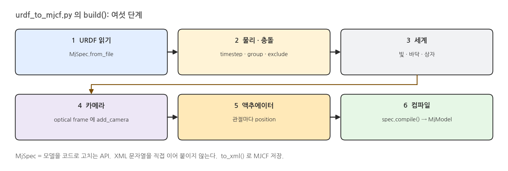{width=1000}

### 1 · 2 단계: 읽기 · 물리와 충돌 (코드) - build 함수

```python
# lessons/01_mujoco_ros2/urdf_to_mjcf.py
def build(urdf=URDF):
    spec = mujoco.MjSpec.from_file(str(urdf))               # 1. MuJoCo parses the URDF itself

    spec.option.timestep = 0.002                             # 2. physics options (URDF has none)
    for geom in spec.geoms:                                  #    <collision> shapes: keep contact, hide in the viewer
        if geom.contype:
            geom.group = 3
    spec.add_exclude(bodyname1="base_link", bodyname2="link1")
```

- `MjSpec`: 컴파일 전의 모델 · 요소를 코드로 더하고 고침
- `contype` 이 0 이 아닌 geom = `<collision>` 에서 온 것 → group 3 (뷰어 기본 숨김)
- `add_exclude`: 세계에 고정된 `base_link` 와 `link1` 의 충돌 제외 · 없으면 0.24 rad 에서 멈춤

### 3 단계: 세계 (코드) - build 함수

```python
# lessons/01_mujoco_ros2/urdf_to_mjcf.py
    # build 함수 (이어서)
    world = spec.worldbody                                   # 3. the world around the robot
    world.add_light(pos=[0.5, -0.5, 2.0], dir=[-0.3, 0.3, -1.0])
    world.add_geom(name="floor", type=mujoco.mjtGeom.mjGEOM_PLANE, size=[2, 2, 0.05], rgba=[0.8, 0.8, 0.8, 1])
    world.add_geom(name="red_box", type=mujoco.mjtGeom.mjGEOM_BOX, pos=[0.55, 0.08, 0.04],
                   size=[0.04, 0.04, 0.04], rgba=[0.9, 0.2, 0.2, 1])
    world.add_geom(name="blue_box", type=mujoco.mjtGeom.mjGEOM_BOX, pos=[0.62, -0.10, 0.03],
                   size=[0.03, 0.03, 0.03], rgba=[0.2, 0.3, 0.9, 1])
```

- `worldbody` 에 직접 넣은 geom = 움직이지 않는 환경
- box 의 `size` 는 반 길이 (URDF `<box size>` 는 전체 길이)

### 4 · 5 · 6 단계: 카메라 · 액추에이터 · 컴파일 (코드) - build 함수

```python
# lessons/01_mujoco_ros2/urdf_to_mjcf.py
    # build 함수 (이어서)
    spec.body("camera_optical_frame").add_camera(name="tip_camera", quat=[0, 1, 0, 0], fovy=60)

    for joint in spec.joints:                                # 5. one position actuator per joint
        act = spec.add_actuator(name=f"{joint.name}_pos", target=joint.name, trntype=mujoco.mjtTrn.mjTRN_JOINT)
        act.set_to_position(kp=KP[joint.name])
        act.ctrlrange, act.ctrllimited = joint.range, True   #    command limit = URDF <limit lower upper>

    return spec, spec.compile()                              # 6. MjModel
```

- 카메라: URDF 의 `camera_optical_frame` body 에 부착 · `quat [0, 1, 0, 0]` = x 축 180°
- 액추에이터: 관절마다 위치 제어기 · 목표 범위는 URDF `<limit>` 에서 온 `joint.range`
- `KP = {"joint1": 30.0, "joint2": 20.0}`: URDF 에 없는 값이라 스크립트에 둠

### 터미널 1: 변환 실행

```bash
python lessons/01_mujoco_ros2/urdf_to_mjcf.py
```

### 실행 결과: body 6 · actuator 2 · camera 1

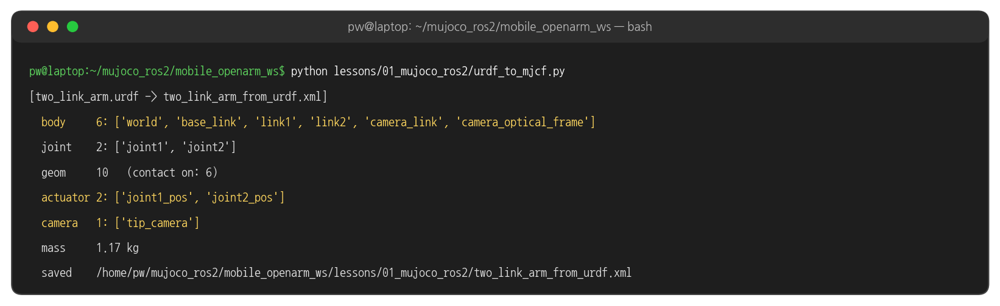{width=1000}

- body 이름 = URDF link 이름 다섯 + `world`
- mass 1.17 kg: `<inertial>` 이 없는 `base_link` 는 모양 × 밀도 1000 으로 계산 (0.47 kg · 고정이라 영향 없음)

### 저장된 MJCF (코드) - two_link_arm_from_urdf.xml 발췌

```xml
<!-- lessons/01_mujoco_ros2/two_link_arm_from_urdf.xml -->
<body name="link1" pos="0 0 0.06">
  <inertial pos="0 0 0.15" mass="0.4" diaginertia="0.00304 0.00304 8e-05"/>
  <joint name="joint1" pos="0 0 0" axis="0 1 0" range="-1.57 1.57" actuatorfrcrange="-20 20" damping="0.5"/>
  <geom size="0.02 0.15" pos="0 0 0.15" type="cylinder" contype="0" conaffinity="0" group="1" density="0" rgba="0.2 0.5 0.9 1"/>
  <geom size="0.02 0.15" pos="0 0 0.15" type="cylinder" group="3" rgba="0.2 0.5 0.9 1"/>
  <body name="link2" pos="0 0 0.3">
    ...
```

- joint 의 `origin` → child body 의 `pos` · joint 는 그 body 안으로
- cylinder `size`: 반지름 · 반 길이 (0.30 → 0.15)
- 첫 geom = visual (충돌 끔) · 둘째 geom = collision (group 3)

### 터미널 1: 저장된 MJCF 를 뷰어로 열기

```bash
python -m mujoco.viewer --mjcf=lessons/01_mujoco_ros2/two_link_arm_from_urdf.xml
```

### 실행 결과: 바닥 · 상자 · 서 있는 팔

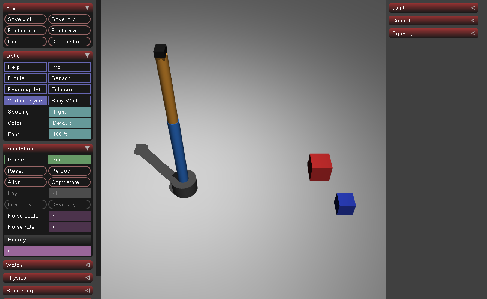{width=1000}

## 5. 내 로봇 URDF 를 올릴 때

### 자주 막히는 곳

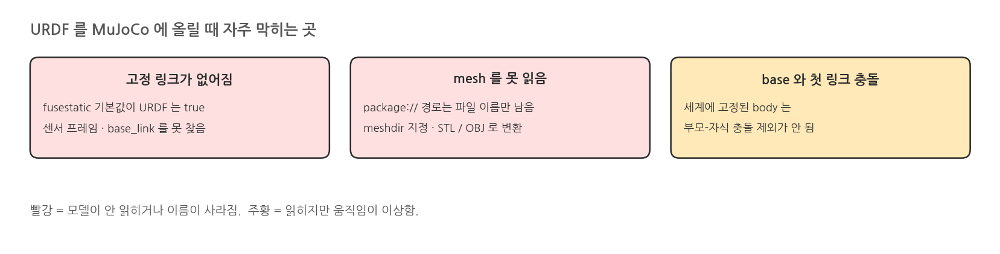{width=1000}

### mesh 가 있는 URDF (코드)

```xml
<!-- 예시 코드 (저장소 파일 아님) -->
<robot name="my_robot">
  <mujoco>
    <compiler fusestatic="false" discardvisual="false" meshdir="/path/to/my_robot/meshes"/>
  </mujoco>
  ...
  <mesh filename="package://my_robot/meshes/arm.stl"/>
```

- MuJoCo 는 `package://` 를 풀지 않고 파일 이름(`arm.stl`)만 남겨 `meshdir` 에서 찾음
- 읽는 형식: STL · OBJ → DAE 는 변환 필요
- 창고 로봇(OpenARM + Vic Pinky)의 변환 · mimic 처리는 [로봇 모델(Description): URDF/Xacro → MJCF 와 robot_state_publisher](https://pinkwink.atlassian.net/wiki/spaces/EDU/pages/3697442817) 글 참고

### 해 볼 것

- `two_link_arm.urdf` 에서 `<mujoco>` 태그를 지우고 `urdf_to_mjcf.py` 실행 → body 가 몇 개로 줄어드는지 확인
- `urdf_to_mjcf.py` 의 `KP` 값을 5 로 낮추고 다시 변환한 뒤 뷰어로 열기 → Control 슬라이더로 움직였을 때 팔이 얼마나 처지는지 확인
- `add_exclude` 줄의 효과는 다음 글에서 `/joint_states` 로 확인

### 다음 글

- 만든 모델을 ROS 2 에 연결: [MuJoCo 브리지: ROS 2와 무엇을 어떻게 주고받나](https://pinkwink.atlassian.net/wiki/spaces/EDU/pages/3782967367)
