# MuJoCo 브리지: ROS 2와 무엇을 어떻게 주고받나

## 1. 큰 그림: Gazebo 의 플러그인이 하던 일을 브리지가 한다

### Gazebo 와 MuJoCo 의 구조 비교

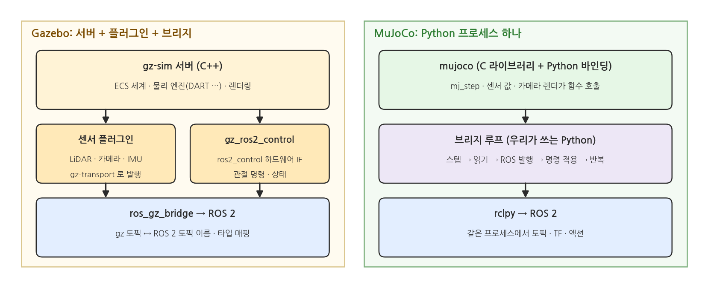{width=1000}

### Gazebo 와 MuJoCo 의 ROS 2 연동 방식

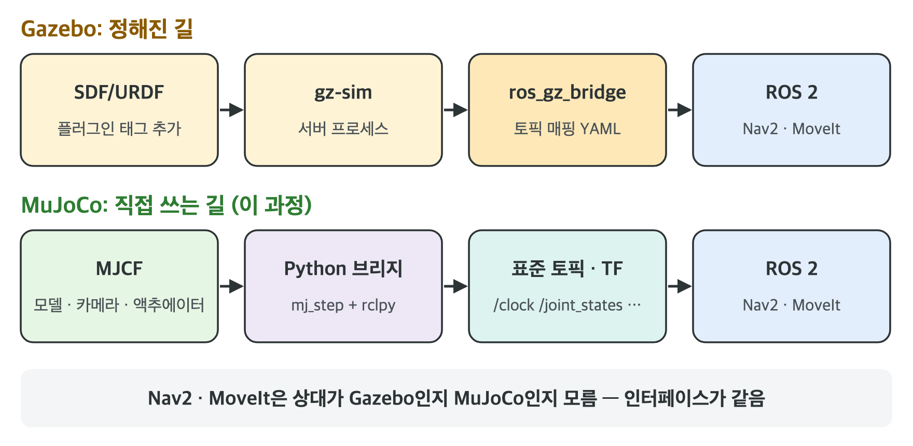{width=1000}

### 세 단계

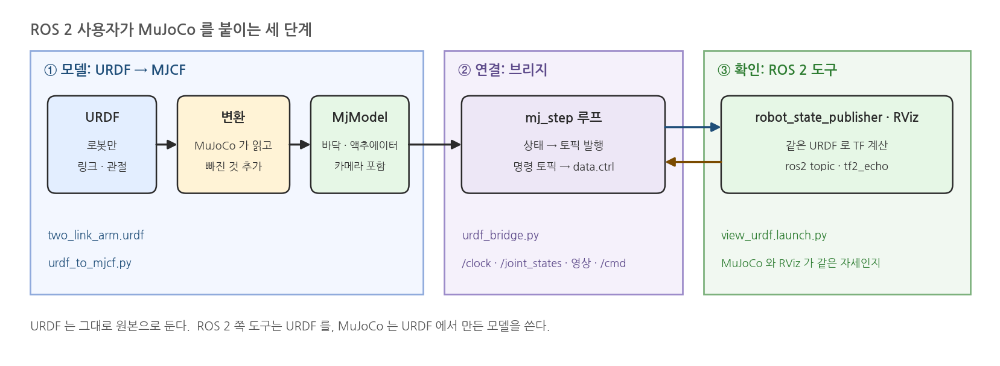{width=1000}

- ① 모델은 앞 글에서 끝남 → `urdf_to_mjcf.py` 의 `build()` 가 MjModel 을 돌려줌
- 이 글 = ② 연결: 브리지 노드가 물리를 돌리며 토픽을 주고받음
- 그리고 ③ 확인: ROS 2 도구가 본 값 = 시뮬레이터가 계산한 값

### 바뀌는 것은 /joint_states 를 내는 쪽 하나

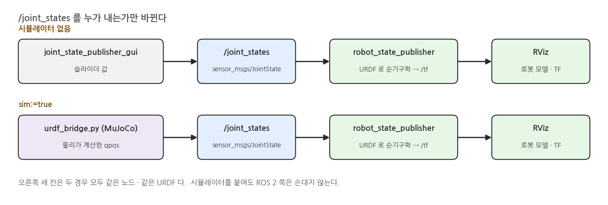{width=1000}

- URDF 를 RViz 로 볼 때: 슬라이더가 `/joint_states` 발행
- 시뮬레이터를 붙이면: MuJoCo 브리지가 `/joint_states` 발행
- `robot_state_publisher` · RViz · URDF 는 그대로

### 원본은 URDF 하나

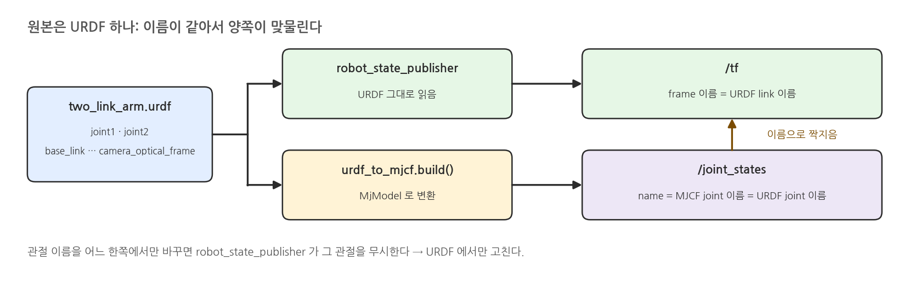{width=1000}

- 브리지는 저장된 XML 이 아니라 `build()` 를 직접 호출 → URDF 를 고치면 바로 반영

## 2. MuJoCo Python 기초: model · data · step

### model 과 data

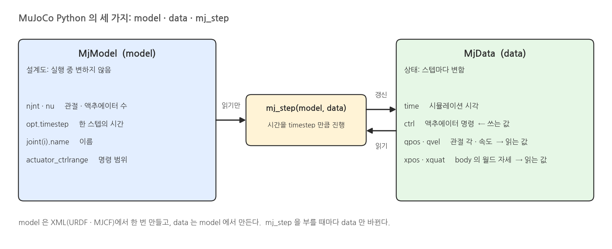{width=1000}

- `MjModel` = 설계도 (변하지 않음) · `MjData` = 상태 (스텝마다 변함)
- `mj_step` 한 번 = 시간이 `timestep` 만큼 흐름
- 쓰는 값은 `data.ctrl` 하나 · 나머지는 읽는 값

### ROS 2 없이 돌려 보기 (코드) - mujoco_basics.py

```python
# lessons/01_mujoco_ros2/mujoco_basics.py
model = mujoco.MjModel.from_xml_path(str(MJCF))    # model: the description, never changes
data = mujoco.MjData(model)                        # data: the state, changes every step
print(f"joints {model.njnt}  actuators {model.nu}  timestep {model.opt.timestep} s")

data.ctrl[:] = [0.6, 1.5]                          # write: target angle of each actuator [rad]
for i in range(1000):
    mujoco.mj_step(model, data)                    # advance time by one timestep
    if i % 250 == 249:                             # read: joint angles and a body position
        print(f"t {data.time:.1f} s  qpos {data.qpos.round(3)}  camera_link xpos {data.body('camera_link').xpos.round(3)}")
```

- 파일: `lessons/01_mujoco_ros2/mujoco_basics.py` · 읽는 모델: 앞 글에서 저장한 `two_link_arm_from_urdf.xml`
- 순서: 모델 읽기 → `ctrl` 에 쓰기 → `mj_step` 반복 → `qpos` · `xpos` 읽기
- 1000 스텝 × 0.002 s = 시뮬레이션 2 초 · 창 없이 계산만 함

### 터미널 1: 기초 루프 실행

```bash
python lessons/01_mujoco_ros2/mujoco_basics.py
```

### 실행 결과: 목표 각으로 움직인 관절

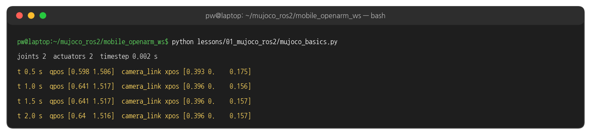{width=1000}

- `qpos` 가 0 에서 목표 `[0.6, 1.5]` 근처로 이동해 멈춤
- 0.6 이 아니라 0.64 인 이유: 위치 제어가 중력에 조금 밀림
- `xpos` = 같은 순간 `camera_link` 의 월드 위치 [m]

### 이 루프에 ROS 2 를 끼우면 브리지

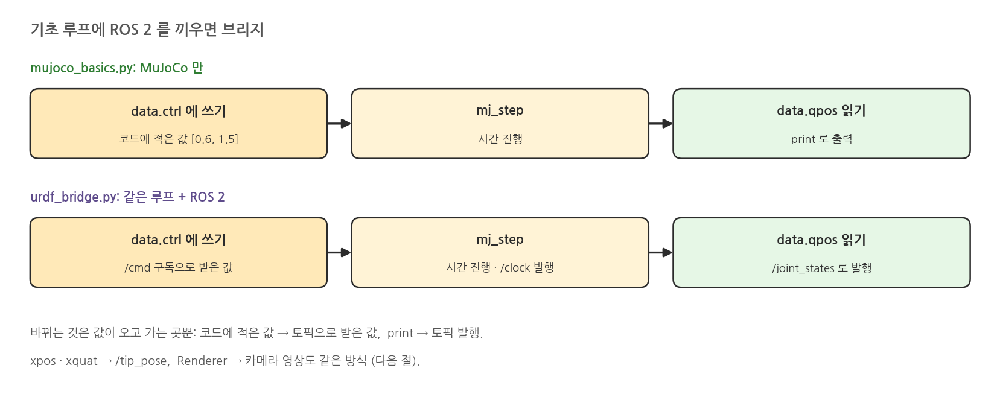{width=1000}

- 루프는 그대로 · 값이 오고 가는 곳만 토픽으로 바뀜
- `ctrl` ← `/cmd` · `qpos` → `/joint_states`
- 아래 3 장이 이 바뀐 부분의 설명

## 3. 브리지: 무엇을 어떤 방법으로 주고받나

### 주고받는 정보

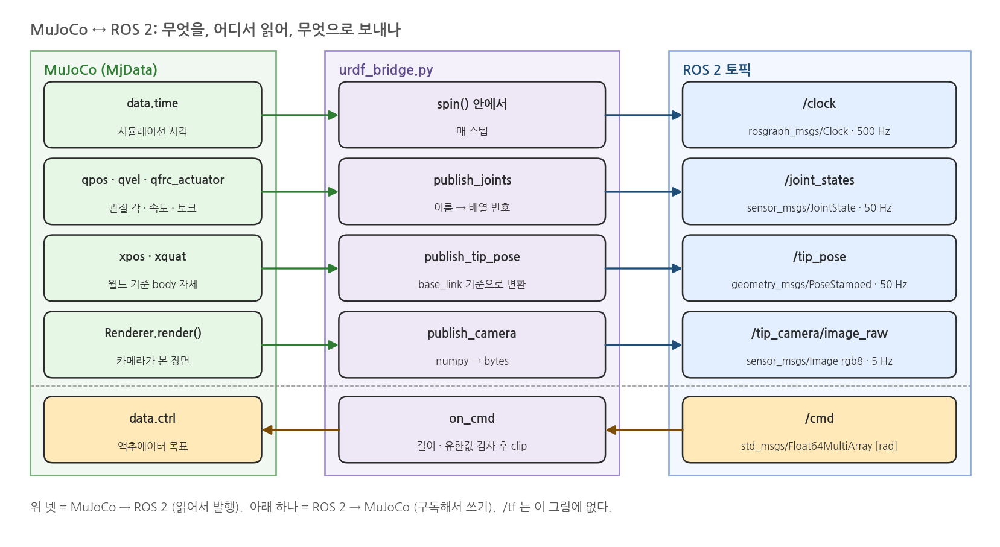{width=1000}

- 나가는 것 넷: 시각 · 관절 상태 · 끝점 자세 · 영상
- 들어오는 것 하나: 관절 목표
- 모두 토픽 · 한 프로세스가 물리와 ROS 2 를 함께 처리

### 자세를 보내는 두 길

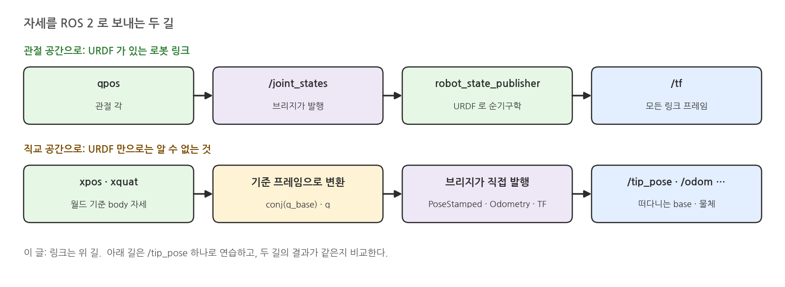{width=1000}

- 링크 TF: 브리지는 관절 각만 냄 → `robot_state_publisher` 가 URDF 로 계산
- 시뮬레이터만 아는 자세(주행 로봇의 위치 · 물체): 브리지가 `xpos` · `xquat` 에서 직접

### 코드 지도

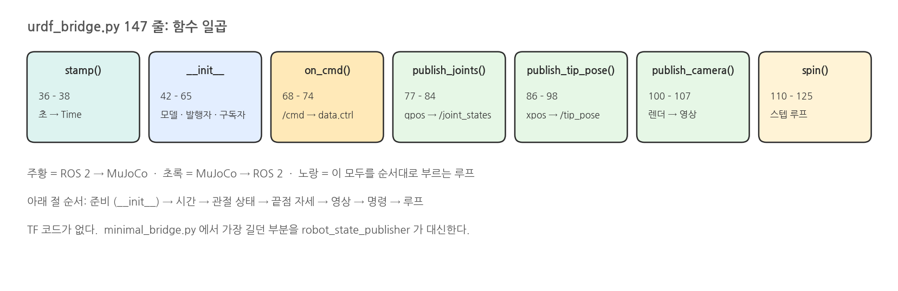{width=1000}

### 준비: 모델과 이름 (코드) - __init__ 함수

```python
# lessons/01_mujoco_ros2/urdf_bridge.py
super().__init__("urdf_bridge", parameter_overrides=[rclpy.Parameter("use_sim_time", value=True)])
_, self.model = build()                              # URDF -> MjModel
self.data = mujoco.MjData(self.model)
# joint names and array addresses, read from the model (nothing typed by hand)
self.joints = [self.model.joint(i).name for i in range(self.model.njnt)]
self.qadr = [int(self.model.joint(j).qposadr[0]) for j in self.joints]
self.vadr = [int(self.model.joint(j).dofadr[0]) for j in self.joints]
```

- `model` = 바뀌지 않는 것 · `data` = 매 스텝 바뀌는 상태
- 관절 이름을 모델에서 읽음 → URDF 에 관절을 더해도 이 코드는 그대로
- `qposadr` · `dofadr`: 그 관절이 `qpos` · `qvel` 배열의 몇 번째인지

### 준비: 발행자 · 구독자 · 렌더러 (코드) - __init__ 함수

```python
# lessons/01_mujoco_ros2/urdf_bridge.py
# __init__ 함수 (이어서)
self.clock_pub = self.create_publisher(Clock, "/clock", 10)
self.joint_pub = self.create_publisher(JointState, "/joint_states", 10)
self.image_pub = self.create_publisher(Image, "/tip_camera/image_raw", 2)
self.pose_pub = self.create_publisher(PoseStamped, "/tip_pose", 10)
self.create_subscription(Float64MultiArray, "/cmd", self.on_cmd, 10)

self.renderer = mujoco.Renderer(self.model, height=240, width=320)
self.state_period, self.camera_period = 1.0 / state_hz, 1.0 / camera_hz
```

- 토픽 이름 · 메시지 타입 = ROS 2 쪽과의 약속 · 실제 로봇 드라이버와 같게 두면 위쪽 노드를 그대로 씀
- `Renderer`: 창 없이 카메라 영상을 그림

### 시간: /clock (코드) - stamp 함수와 spin 발췌

```python
# lessons/01_mujoco_ros2/urdf_bridge.py
def stamp(t):
    """float seconds -> builtin_interfaces/Time"""
    return Time(sec=int(t), nanosec=int((t - int(t)) * 1e9))

# spin() 안에서 매 스텝
t = self.data.time
self.clock_pub.publish(Clock(clock=stamp(t)))     # 2. simulation time
```

- `use_sim_time` 노드는 `/clock` 을 시계로 씀 → 시뮬레이션이 느려져도 시간이 어긋나지 않음
- 모든 메시지의 `header.stamp` 도 같은 `data.time` 으로 찍음

### 관절 상태: /joint_states (코드) - publish_joints 함수

```python
# lessons/01_mujoco_ros2/urdf_bridge.py
def publish_joints(self, t):
    js = JointState()
    js.header.stamp = stamp(t)
    js.name = self.joints
    js.position = self.data.qpos[self.qadr].tolist()
    js.velocity = self.data.qvel[self.vadr].tolist()
    js.effort = self.data.qfrc_actuator[self.vadr].tolist()
    self.joint_pub.publish(js)
```

- `name` 순서 = `position` 순서 · 받는 쪽은 이름으로 찾음
- `qfrc_actuator`: 액추에이터가 낸 관절 토크 [N·m]
- 이 메시지 하나로 `robot_state_publisher` 가 모든 링크의 TF 계산

### 끝점 자세: 월드 기준 → base_link 기준 (코드) - publish_tip_pose 함수 앞부분

```python
# lessons/01_mujoco_ros2/urdf_bridge.py
def publish_tip_pose(self, t):
    b, c = self.model.body(BASE).id, self.model.body(TIP).id
    # xpos / xquat are world poses. Pose of the tip seen from the base: q = conj(q_base) * q_tip
    q_base_inv, q, p = np.zeros(4), np.zeros(4), np.zeros(3)
    mujoco.mju_negQuat(q_base_inv, self.data.xquat[b])
    mujoco.mju_mulQuat(q, q_base_inv, self.data.xquat[c])
    mujoco.mju_rotVecQuat(p, self.data.xpos[c] - self.data.xpos[b], q_base_inv)
```

- `xpos` · `xquat`: 모든 body 의 월드 기준 자세 · `mj_step` 이 계산해 둠
- ROS 2 는 "어느 프레임에서 본" 자세를 씀 → 기준 body 의 역회전을 곱함
- `mju_*` 함수: 결과를 첫 인자 배열에 씀

### 끝점 자세: 메시지 채우기 (코드) - publish_tip_pose 함수 뒷부분

```python
# lessons/01_mujoco_ros2/urdf_bridge.py
    # publish_tip_pose 함수 (이어서)
    msg = PoseStamped()
    msg.header.stamp, msg.header.frame_id = stamp(t), BASE
    msg.pose.position.x, msg.pose.position.y, msg.pose.position.z = p.tolist()
    o = msg.pose.orientation
    o.w, o.x, o.y, o.z = q.tolist()                      # MuJoCo quaternion order is [w, x, y, z]
    self.pose_pub.publish(msg)
```

- MuJoCo 쿼터니언 = `[w, x, y, z]` 배열 · ROS 메시지는 x · y · z · w 필드
- 필드 이름으로 대입 → 순서를 착각할 일이 없음
- `frame_id` = 기준 프레임 이름 (`base_link`)

### 영상: /tip_camera/image_raw (코드) - publish_camera 함수

```python
# lessons/01_mujoco_ros2/urdf_bridge.py
def publish_camera(self, t):
    self.renderer.update_scene(self.data, camera=CAMERA)
    rgb = self.renderer.render()                         # (240, 320, 3) uint8
    img = Image()
    img.header.stamp, img.header.frame_id = stamp(t), TIP
    img.height, img.width, img.encoding, img.step = rgb.shape[0], rgb.shape[1], "rgb8", rgb.shape[1] * 3
    img.data = rgb.tobytes()
    self.image_pub.publish(img)
```

- `update_scene` → `render`: 현재 상태를 `tip_camera` 로 그린 numpy 배열
- `frame_id` = `camera_optical_frame` → 영상 속 위치를 TF 로 다른 프레임에 옮길 수 있음
- 렌더는 물리 스텝보다 무거움 → 5 Hz

### 명령: /cmd → data.ctrl (코드) - on_cmd 함수

```python
# lessons/01_mujoco_ros2/urdf_bridge.py
def on_cmd(self, msg):
    q = np.asarray(msg.data, dtype=float)
    if q.size != self.model.nu or not np.all(np.isfinite(q)):
        self.get_logger().warn(f"/cmd ignored: need {self.model.nu} finite values, got {list(msg.data)}")
        return
    low, high = self.model.actuator_ctrlrange.T
    self.data.ctrl[:] = np.clip(q, low, high)            # the next mj_step moves the arm
```

- 콜백은 `data.ctrl` 에 목표만 씀 · 팔을 움직이는 것은 다음 `mj_step` 의 액추에이터
- 개수 · NaN 검사 후 경고 → 명령이 안 먹을 때 이유가 보임
- `ctrlrange` = URDF `<limit>` → 한계 밖 명령은 한계값으로

### 스텝 루프

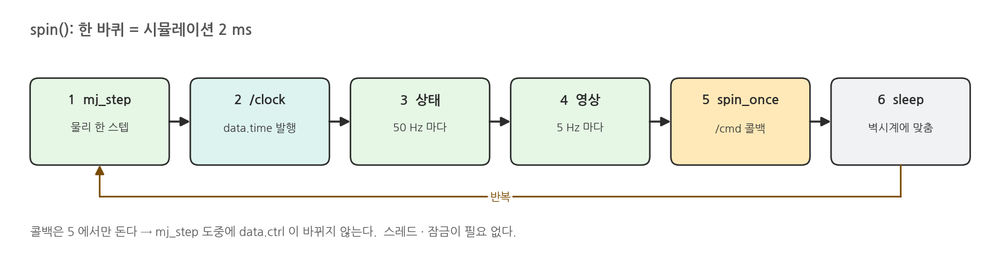{width=1000}

### 루프: 물리 · 시간 · 상태 · 영상 (코드) - spin 함수

```python
# lessons/01_mujoco_ros2/urdf_bridge.py
def spin(self):
    wall0 = time.monotonic()
    while rclpy.ok() and (self.viewer is None or self.viewer.is_running()):
        mujoco.mj_step(self.model, self.data)             # 1. physics step
        t = self.data.time
        self.clock_pub.publish(Clock(clock=stamp(t)))     # 2. simulation time
        if t >= self.next_state:                          # 3. joint states + tip pose
            self.publish_joints(t); self.publish_tip_pose(t); self.next_state += self.state_period
        if t >= self.next_camera:                         # 4. camera image
            self.publish_camera(t); self.next_camera += self.camera_period
```

- `mj_step` 을 부르지 않으면 세계가 멈춤 · 뷰어는 물리를 돌리지 않음
- 발행 주기는 시뮬레이션 시간 기준 (`t >= self.next_state`)

### 루프: 콜백 · 뷰어 · 실시간 (코드) - spin 함수

```python
# lessons/01_mujoco_ros2/urdf_bridge.py
        # spin 함수 while 루프 (이어서)
        rclpy.spin_once(self, timeout_sec=0)              # 5. /cmd callbacks run here, between two steps
        if self.viewer is not None:
            self.viewer.sync()
        lag = wall0 + t - time.monotonic()                # 6. keep pace with the wall clock
        if lag > 0:
            time.sleep(lag)
```

- `spin_once(timeout_sec=0)`: 기다리지 않고 도착한 콜백만 처리 → 콜백은 항상 스텝 사이
- `lag`: 시뮬레이션이 벽시계보다 앞선 만큼 쉼 · 지우면 낼 수 있는 최대 속도로 돎

## 4. 실행하고 확인하기

### 터미널 1: 브리지

```bash
source scripts/env.sh
python lessons/01_mujoco_ros2/urdf_bridge.py --viewer
```

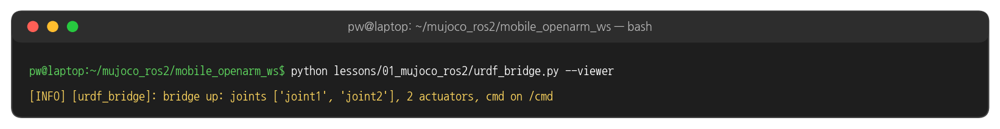{width=1000}

### 터미널 2: robot_state_publisher 와 RViz

```bash
source scripts/env.sh
ros2 launch lessons/01_mujoco_ros2/view_urdf.launch.py sim:=true
```

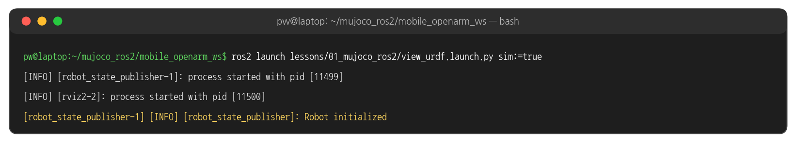{width=1000}

### 실행 결과: MuJoCo 와 RViz

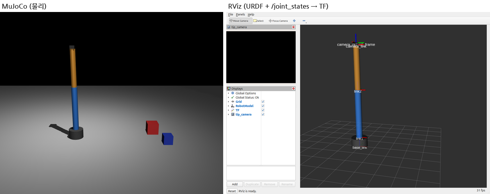{width=1000}

- 왼쪽: 물리가 도는 MuJoCo · 오른쪽: `/joint_states` 로 그린 RViz
- 팔이 수직이라 카메라는 하늘을 봄 → 영상이 검은 것이 정상

### 터미널 3: 토픽과 노드

```bash
source scripts/env.sh
ros2 topic list
ros2 node list
```

### 실행 결과: 토픽 10 · 브리지 노드 하나

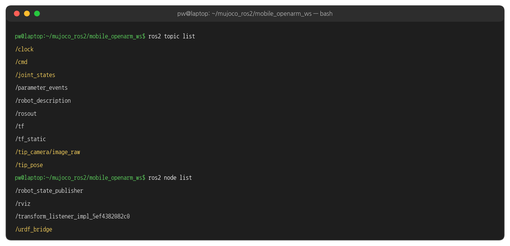{width=1000}

- `/tf` · `/tf_static` · `/robot_description` 은 `robot_state_publisher` 가 낸 것

### 터미널 3: /joint_states 를 누가 내고 누가 받나

```bash
ros2 topic info /joint_states -v | grep -E 'Node name|Endpoint type'
```

### 실행 결과: urdf_bridge → robot_state_publisher

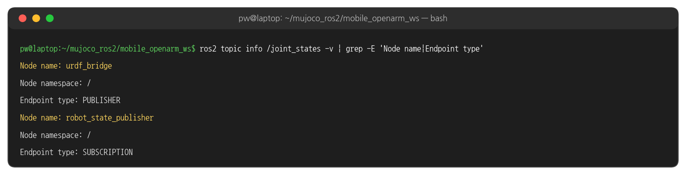{width=1000}

### 터미널 3: 주기와 시뮬레이션 시각

```bash
ros2 topic hz /joint_states
ros2 topic hz /tip_camera/image_raw
ros2 topic echo --once /clock
```

### 실행 결과: 50 Hz · 5 Hz · /clock

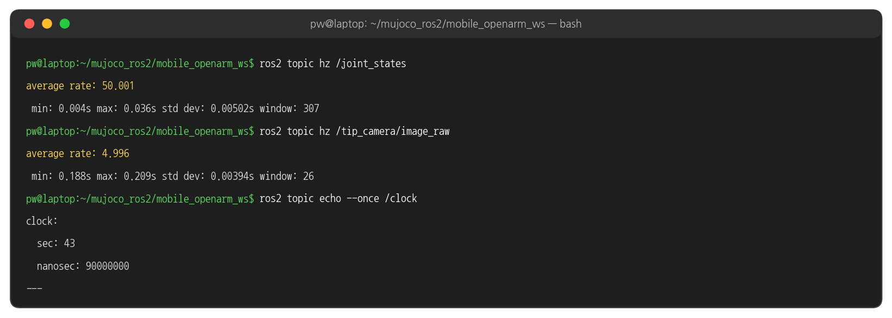{width=1000}

### 터미널 3: 관절 명령 보내기

```bash
ros2 topic pub -1 /cmd std_msgs/msg/Float64MultiArray "{data: [0.6, 1.5]}"
```

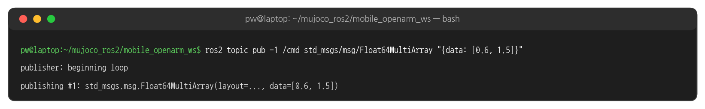{width=1000}

### 실행 결과: 같은 자세의 MuJoCo 와 RViz · 카메라 영상

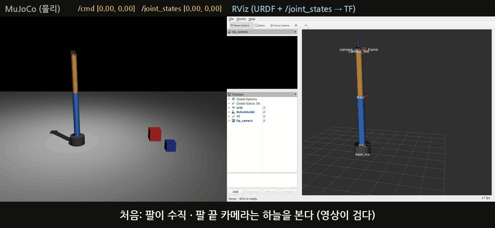{width=1000}

- MuJoCo 의 팔과 RViz 의 팔이 같은 자세 → URDF 와 변환된 모델이 같은 로봇
- RViz 왼쪽 위: MuJoCo 가 렌더한 팔 끝 카메라 영상 (빨강 · 파랑 상자)
- 움직이는 그림: 목표를 [0.0, 0.0] → [0.6, 1.5] 로 조금씩 바꿔 가며 두 창을 캡처한 것

### 터미널 3: 관절 상태 보기

```bash
ros2 topic echo --once /joint_states
```

### 실행 결과: position · velocity · effort

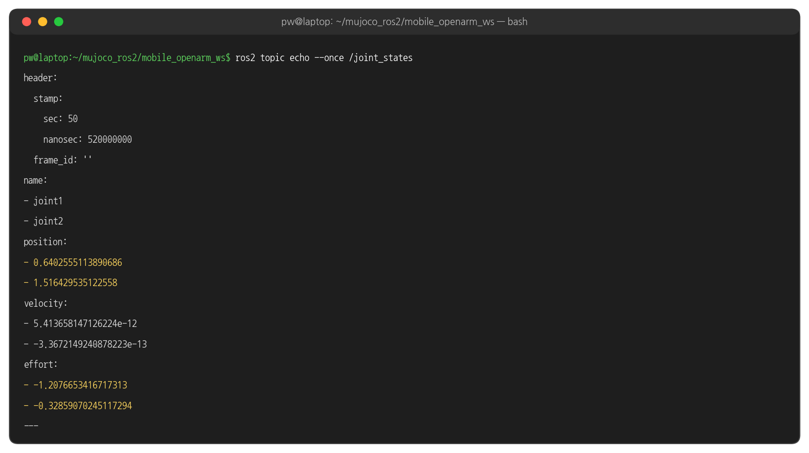{width=1000}

- 목표 0.6 인데 0.640: 위치 제어기(kp 30)가 중력을 받치느라 생긴 처짐
- effort -1.21 N·m = 그때 joint1 액추에이터가 내는 토크

### 터미널 3: 시뮬레이터가 계산한 끝점 자세

```bash
ros2 topic echo --once /tip_pose
```

### 실행 결과: /tip_pose (MuJoCo 의 xpos · xquat 에서)

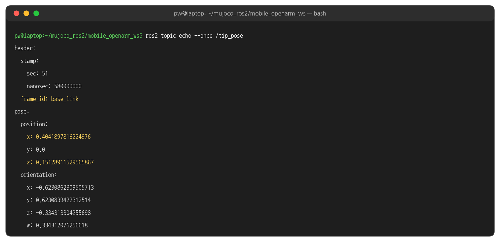{width=1000}

### 터미널 3: ROS 2 가 URDF 로 계산한 끝점 자세

```bash
ros2 run tf2_ros tf2_echo base_link camera_optical_frame
```

### 실행 결과: tf2_echo (URDF + /joint_states 에서)

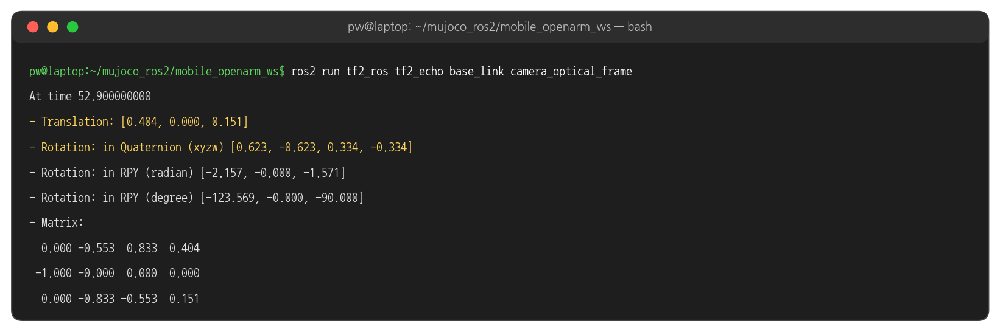{width=1000}

- 위치 0.404 · 0.000 · 0.151 m → `/tip_pose` 와 일치
- 쿼터니언은 네 값의 부호가 모두 반대 = 같은 회전 (q 와 -q)
- 두 길의 결과가 같음 → 변환 · 브리지 · URDF 가 서로 맞음

### 터미널 3: 개수가 틀린 명령

```bash
ros2 topic pub -1 /cmd std_msgs/msg/Float64MultiArray "{data: [0.6, 1.5, 0.1]}"
```

### 실행 결과: 브리지의 경고

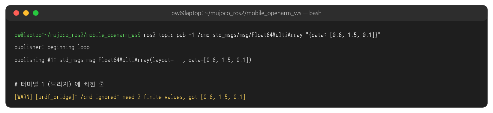{width=1000}

## 5. 내 로봇에 적용할 때

### 순서

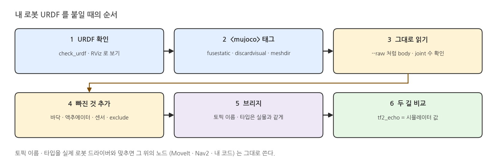{width=1000}

### 자주 틀리는 곳

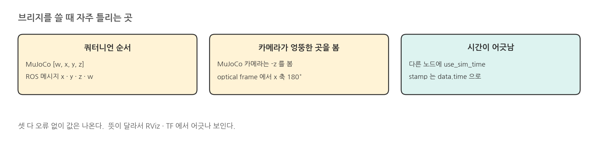{width=1000}

### 해 볼 것

- `urdf_to_mjcf.py` 의 `add_exclude` 줄을 지우고 [0.6, 1.5] 명령 → joint1 이 어디서 멈추는지 `/joint_states` 로 확인
- `spin()` 끝의 `sleep` 두 줄을 지우고 `ros2 topic hz /joint_states` → 50 Hz 에서 얼마나 달라지는지 확인
- URDF 에 `link3` · `joint3` 추가, `KP` 에 한 줄 추가 → 브리지 수정 없이 `/joint_states` 에 관절 3개
