## 1. 패키지: OpenARM 것과 우리가 만든 것

### 두 종류의 패키지

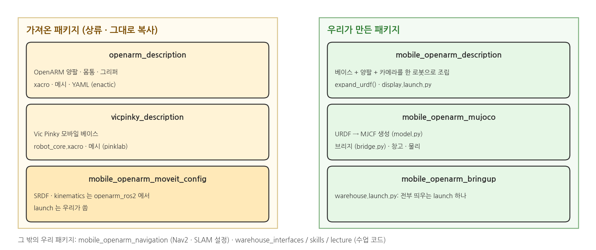{width=1000}

### OpenARM: 오픈소스 양팔 매니퓰레이터

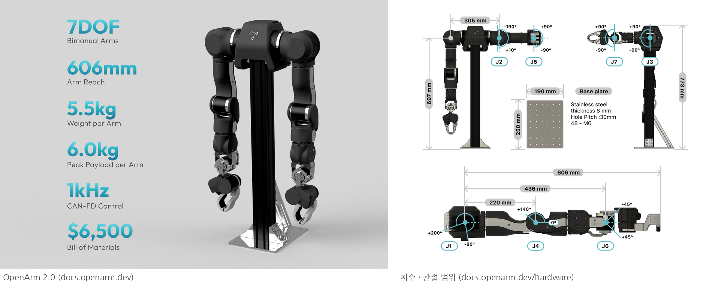{width=1000}

[핑크랩이 손대면 Open Source도 강력해집니다.](https://pinklab.art/mobile-dual-arm/)

### OpenARM 특징

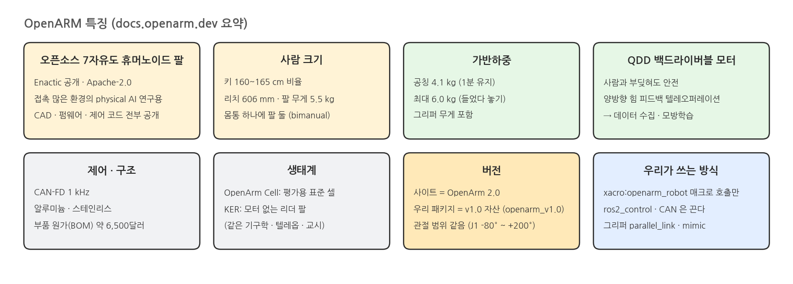{width=1000}

### Vic Pinky: PinkLAB 차동 구동 모바일 베이스

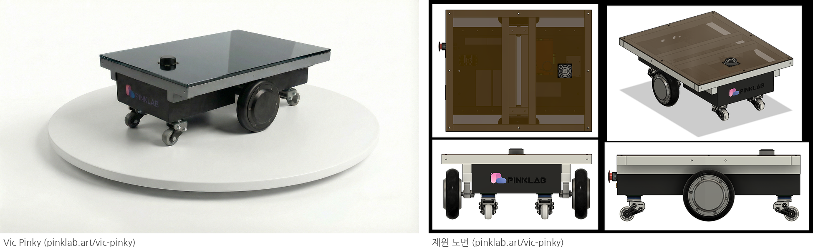{width=1000}

### Vic Pinky 특징

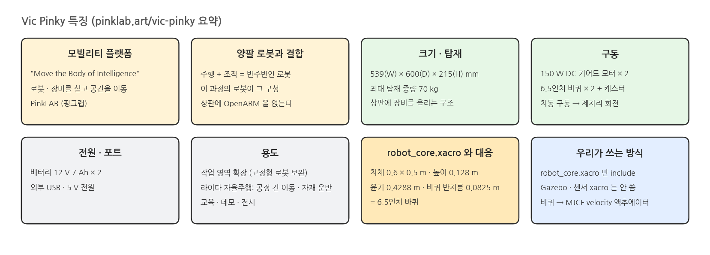{width=1000}

### Vic Pinky 의 description 만 보기

```bash
source /opt/ros/jazzy/setup.bash
source scripts/env.sh
ros2 launch vicpinky_description display.launch.py
```

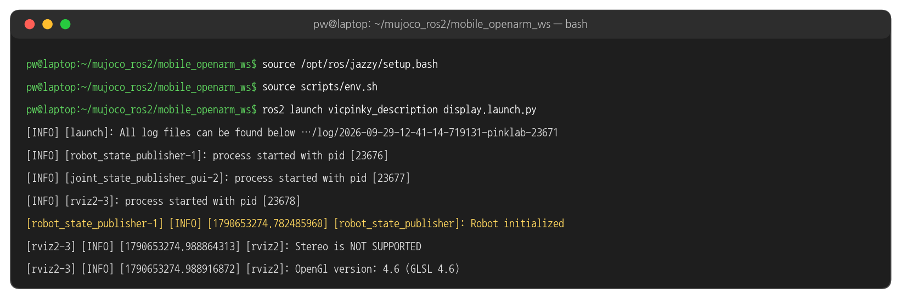{width=1000}

### Vic Pinky 의 실행 결과

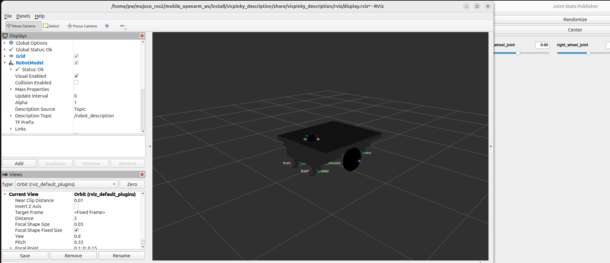{width=1000}

### OpenARM 의 description 만 보기

```bash
source /opt/ros/jazzy/setup.bash
source scripts/env.sh
ros2 launch openarm_description display.launch.py
```

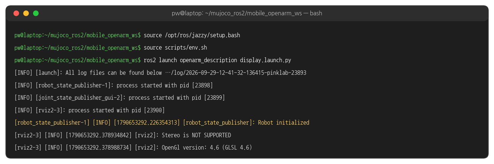{width=1000}

### OpenARM 의 실행 결과

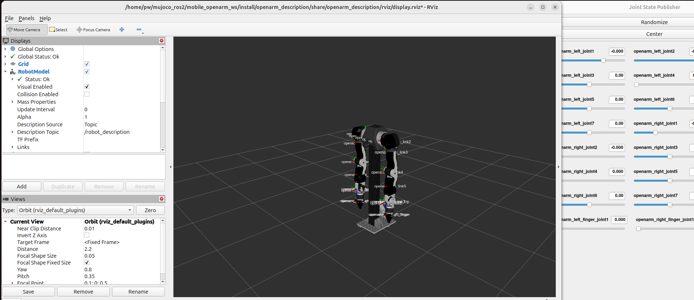{width=1000}

### 로봇 한 대의 조립

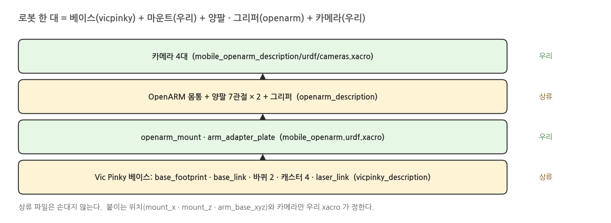{width=1000}

## 2. 관계 편: URDF 하나가 세 곳으로

### 앞 글의 2링크 팔과 무엇이 같고 다른가

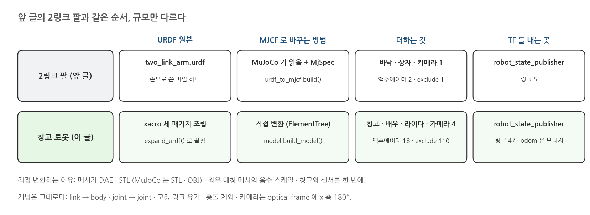{width=1000}

### 흐름 한눈에

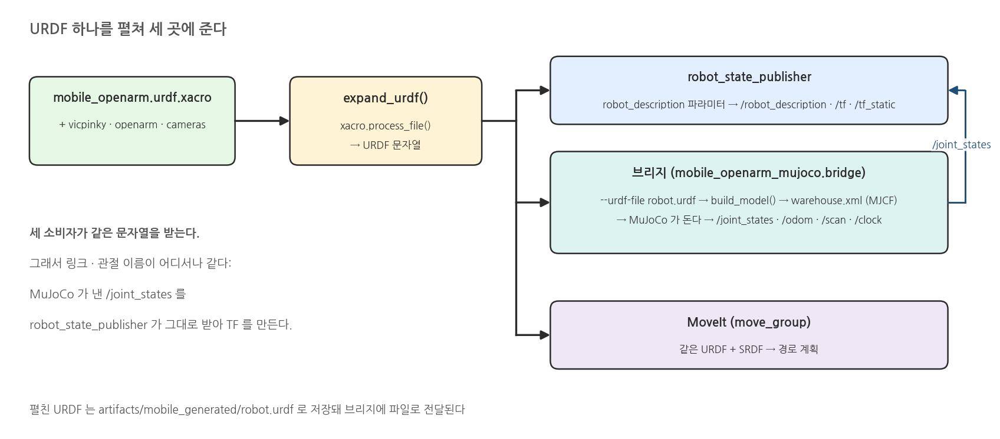{width=1000}

### Xacro 조립 순서

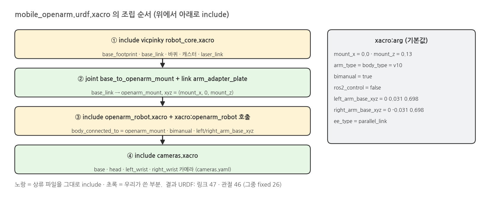{width=1000}

### URDF → MJCF: 그대로 가는 것 · 더해지는 것

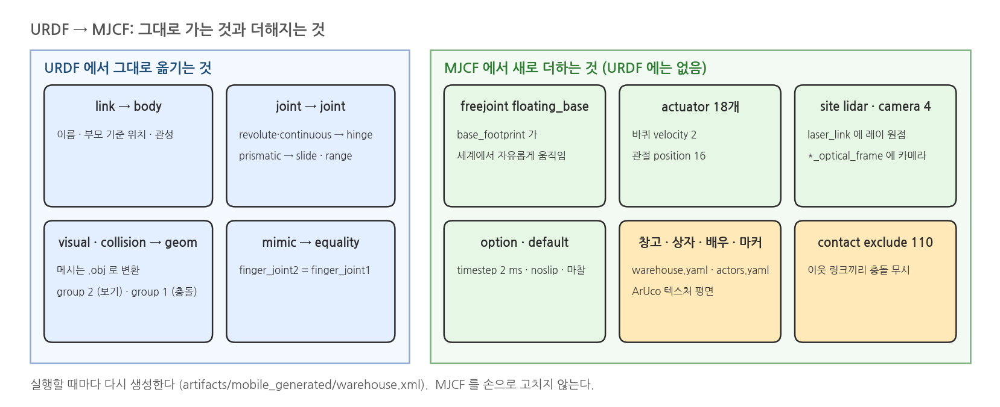{width=1000}

### 이름이 그대로라서 맞물린다

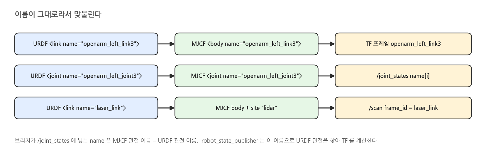{width=1000}

### TF는 누가 내나

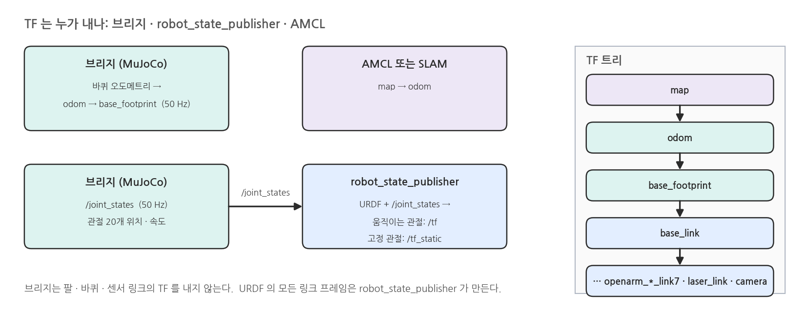{width=1000}

## 3. 코드 편

### 파생물의 흐름: model.py → robot.urdf → 누가 쓰나

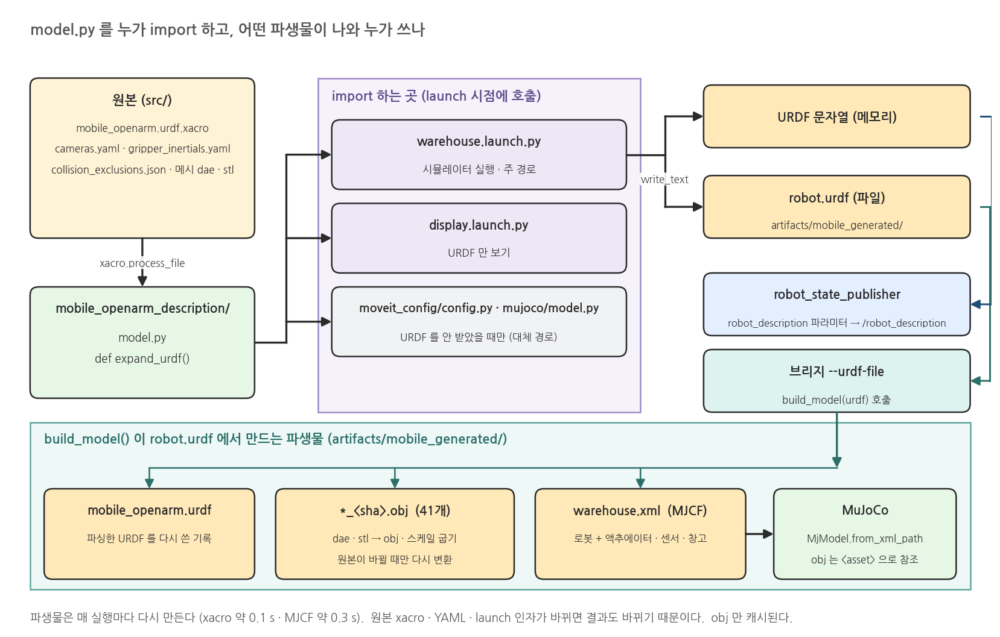{width=1000}

### expand_urdf: Xacro 파일 → URDF 문자열

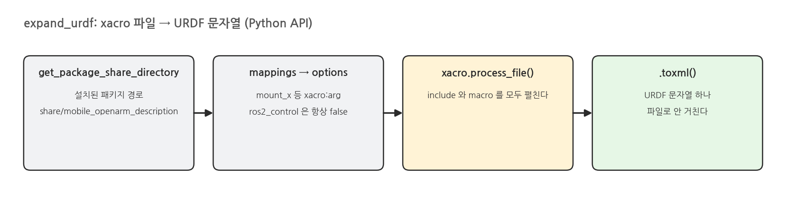{width=1000}

### Xacro 펼치기 (코드) - expand_urdf 함수

```py
# src/mobile_openarm_description/mobile_openarm_description/model.py
def expand_urdf(mappings=None):
    path = Path(get_package_share_directory("mobile_openarm_description")) / "urdf/mobile_openarm.urdf.xacro"
    options = {str(k): str(v) for k, v in (mappings or {}).items()}
    options["ros2_control"] = "false"
    return xacro.process_file(str(path), mappings=options).toxml()
```

- `xacro.process_file` = 터미널의 `xacro` 명령과 같은 일 · include 와 macro 를 모두 펼침
- 결과는 파일이 아니라 URDF 문자열 → launch · 브리지 · MoveIt 이 같은 값을 받음
- `ros2_control` 은 항상 false → 관절 제어는 MuJoCo 브리지가 맡음

### warehouse.launch.py setup(): 한 번 펼쳐 세 곳에

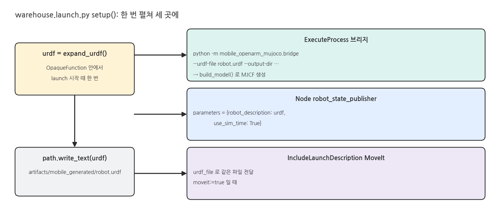{width=1000}

### URDF 펼쳐 저장 · 브리지 명령 (코드) - warehouse.launch.py 의 setup 함수

```py
# src/mobile_openarm_bringup/launch/warehouse.launch.py
urdf = expand_urdf()
path = root / "robot.urdf"
path.write_text(urdf)
command = [python, "-m", "mobile_openarm_mujoco.bridge", "--urdf-file", str(path), "--output-dir", str(root)]
...
```

- launch 가 시작될 때 한 번만 펼침 → `artifacts/mobile_generated/robot.urdf` 로 저장
- 브리지는 별도 프로세스라 문자열 대신 파일 경로(`--urdf-file`)로 받음

### 브리지 프로세스와 robot_state_publisher 등록 (코드) - warehouse.launch.py 의 setup 함수

```py
# src/mobile_openarm_bringup/launch/warehouse.launch.py setup (이어서)
physics = ExecuteProcess(cmd=command, output="screen", name="mobile_openarm_mujoco")
actions = [
    physics,
    RegisterEventHandler(OnProcessExit(target_action=physics, on_exit=exited)),
    Node(package="robot_state_publisher", executable="robot_state_publisher",
         parameters=[{"robot_description": urdf, "use_sim_time": True}], output="screen"),
]
```

- 브리지 = `ExecuteProcess` (venv 의 python 으로 실행) · robot_state_publisher = 일반 `Node`
- 두 곳이 같은 `urdf` 를 받음 → 관절 · 링크 이름이 어긋날 수 없음
- `OnProcessExit`: MuJoCo 쪽이 끝나면 launch 전체가 함께 끝남

### build_model: URDF 트리를 읽고 MJCF 뼈대를 세운다

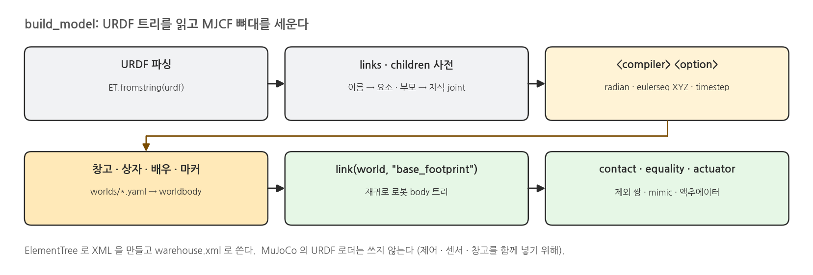{width=1000}

### URDF 읽고 부모-자식 표 만들기 (코드) - build_model 함수 앞부분

```py
# src/mobile_openarm_mujoco/mobile_openarm_mujoco/model.py
def build_model(output_dir, urdf=None, config_file=None, world_file=None, actors_file=None):
    robot = ET.fromstring(urdf or expand_urdf())
    links = {x.get("name"): x for x in robot.findall("link")}
    joints = robot.findall("joint")
    children = {}
    for j in joints:
        children.setdefault(j.find("parent").get("link"), []).append(j)
```

- URDF 는 link · joint 가 나란히 나열됨 → 트리로 돌려면 표가 필요
- `links`: 이름 → link 요소 · `children`: 부모 링크 이름 → 그 아래 joint 목록

### MJCF 뼈대: compiler · option → link → 파일 저장 (코드) - build_model 함수 앞부분

```py
# src/mobile_openarm_mujoco/mobile_openarm_mujoco/model.py
    # build_model (이어서)
    root = ET.Element("mujoco", model="mobile_openarm_warehouse")
    ET.SubElement(root, "compiler", angle="radian", eulerseq="XYZ", autolimits="true",
                  inertiafromgeom="false", fusestatic="false")
    ET.SubElement(root, "option", timestep=str(p["timestep"]), gravity=vector(p["gravity"]),
                  integrator=p["integrator"], iterations=str(p["iterations"]), ...)
    ...
    link(world, "base_footprint")
    ...
    ET.ElementTree(root).write(out / "warehouse.xml", encoding="unicode")
```

- `eulerseq="XYZ"`: URDF 의 rpy 를 그대로 `euler` 속성에 쓰기 위한 설정
- `fusestatic="false"`: 고정 링크(센서 프레임 등)를 body 로 남김 · 앞 글과 같은 이유
- `<option>` 값은 URDF 에 없음 → `mujoco.yaml` 에서 읽음

### link(): URDF 링크 하나 → MJCF body 하나, 자식으로 재귀

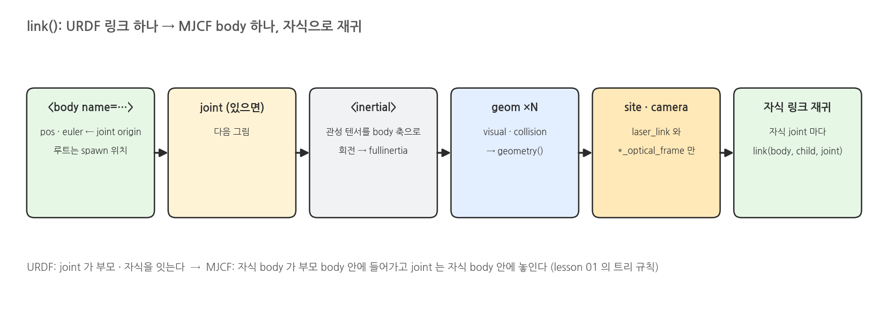{width=1000}

### 링크 → body (코드) - link 함수

```py
# src/mobile_openarm_mujoco/mobile_openarm_mujoco/model.py
def link(parent, name, joint=None):
    attrs = {"name": name}
    attrs.update(origin(joint) if joint is not None else {"pos": vector(settings["spawn"]["position"])})
    body = ET.SubElement(parent, "body", **attrs)
    ...  # joint · inertial · geom · site · camera
    for child in children.get(name, []):
        link(body, child.find("child").get("link"), child)

link(world, "base_footprint")
```

- body 의 위치 · 자세 = 그 링크로 들어오는 joint 의 `origin`
- 맨 위(`base_footprint`)만 joint 가 없음 → 창고 안의 시작 위치(`spawn`)에 둠
- 자식 joint 마다 자기 자신을 다시 부름 → URDF 의 나열이 MJCF 의 중첩으로

### 관절 변환 규칙

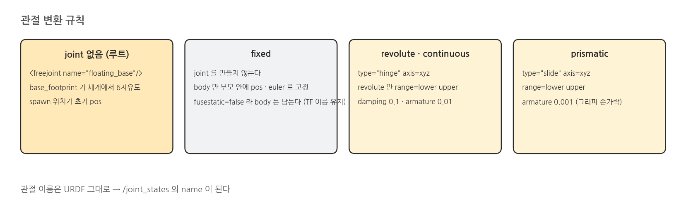{width=1000}

### 관절 → joint: 종류 · 축 · 감쇠 (코드) - link 함수 (관절 부분)

```py
# src/mobile_openarm_mujoco/mobile_openarm_mujoco/model.py
if joint is None:
    ET.SubElement(body, "freejoint", name="floating_base")
elif joint.get("type") != "fixed":
    typ = joint.get("type")
    a = {"name": joint.get("name"),
         "type": "slide" if typ == "prismatic" else "hinge",
         "axis": joint.find("axis").get("xyz"),
         "damping": "0.1",
         "armature": "0.01" if typ != "prismatic" else "0.001"}
```

- 루트 링크 → `freejoint`: 로봇이 바닥 위에서 자유롭게 움직임 (2링크 팔은 세계에 고정이었음)
- fixed → joint 를 만들지 않음 · body 만 남음
- `damping` · `armature` 는 URDF 값이 아니라 시뮬레이션 안정용 상수

### 관절 → joint: 범위와 joint 요소 (코드) - link 함수 (관절 부분)

```py
# src/mobile_openarm_mujoco/mobile_openarm_mujoco/model.py
    # link 함수 관절 부분 (이어서)
    if typ in ["revolute", "prismatic"]:
        lim = joint.find("limit")
        a["range"] = lim.get("lower") + " " + lim.get("upper")
    ET.SubElement(body, "joint", **a)
```

- continuous(바퀴)는 `range` 를 주지 않음 → 끝없이 회전
- `autolimits="true"` 라서 `range` 가 있으면 한계가 자동으로 켜짐

### 관성: URDF 값을 회전시켜 옮긴다

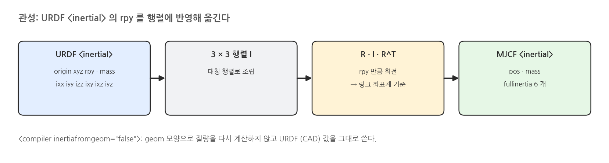{width=1000}

### 관성 → inertial (코드) - link 함수 (관성 부분)

```py
# src/mobile_openarm_mujoco/mobile_openarm_mujoco/model.py
    # link 함수 (이어서)
    inertial = links[name].find("inertial")
    if inertial is not None:
        I = inertial.find("inertia")
        xx, yy, zz, xy, xz, yz = [float(I.get(k)) for k in ["ixx", "iyy", "izz", "ixy", "ixz", "iyz"]]
        matrix = np.array([[xx, xy, xz], [xy, yy, yz], [xz, yz, zz]])
        R = rotation(numbers(origin(inertial)["euler"]))
        matrix = R @ matrix @ R.T
        ET.SubElement(body, "inertial", pos=origin(inertial)["pos"], mass=inertial.find("mass").get("value"),
                      fullinertia=vector([matrix[0, 0], matrix[1, 1], matrix[2, 2], matrix[0, 1], matrix[0, 2], matrix[1, 2]]))
```

- URDF 관성은 `<inertial><origin rpy>` 만큼 돌아간 좌표계 기준 → `R · I · R^T` 로 링크 좌표계 기준으로 바꿈
- `fullinertia` 순서 = xx yy zz xy xz yz (URDF 속성 순서와 다름)
- `<inertial>` 이 없는 링크(프레임만 있는 링크)는 건너뜀

### geometry(): visual · collision → geom

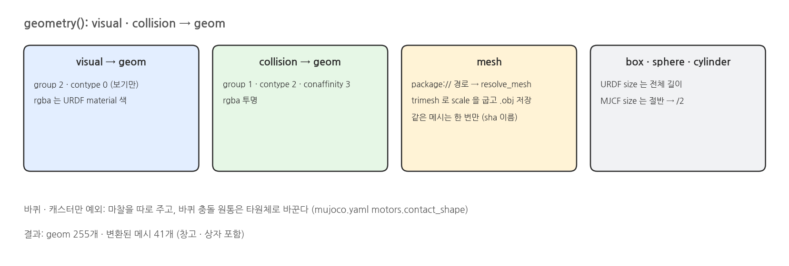{width=1000}

### 형상 → geom: 이름 · 그룹 · 충돌 속성 (코드) - geometry 함수

```py
# src/mobile_openarm_mujoco/mobile_openarm_mujoco/model.py
def geometry(body, element, is_visual, name, index):
    geom = element.find("geometry")[0]
    attrs = origin(element)
    attrs.update(name=f"{name}_{'visual' if is_visual else 'collision'}_{index}",
                 group="2" if is_visual else "1",
                 contype="0" if is_visual else "2",
                 conaffinity="0" if is_visual else "3")
```

- visual → group 2 · `contype 0` (보이기만 함) · collision → group 1 (충돌 계산)
- geom 이름 = `<링크>_visual_0` · `<링크>_collision_0` → 나중에 이름으로 찾음 (바퀴 반지름 등)
- 앞 글의 `discardvisual="false"` 가 해 주던 일을 직접 하는 부분

### 형상 → geom: mesh · box 형상 변환 (코드) - geometry 함수

```py
# src/mobile_openarm_mujoco/mobile_openarm_mujoco/model.py
    # geometry 함수 (이어서)
    if geom.tag == "mesh":
        path = resolve_mesh(geom.get("filename"))            # package:// → 실제 경로
        mesh = trimesh.load(str(path), force="scene").to_geometry()
        mesh.apply_scale(scale)
        mesh.export(str(converted))                            # <stem>_<sha>.obj
        attrs.update(type="mesh", mesh=meshes[key])
    elif geom.tag == "box":
        attrs.update(type="box", size=vector(numbers(geom.get("size")) / 2))
    ...
    ET.SubElement(body, "geom", **attrs)
```

- `package://` 경로를 실제 경로로 풀고, DAE · STL 을 OBJ 로 바꿔 저장 (한 번 만든 것은 다시 씀)
- 스케일을 꼭짓점에 미리 곱함 → 좌우 대칭용 음수 스케일에서도 면 방향이 맞음
- box 는 전체 길이 → 반 길이 (cylinder 도 같음)

### 센서 자리: URDF 링크 이름을 보고 site 와 camera 를 붙인다

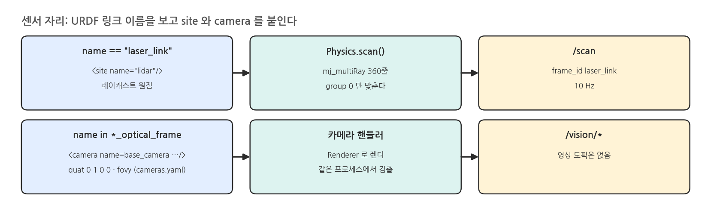{width=1000}

### 센서 자리 (코드) - lidar site 와 camera

```py
# src/mobile_openarm_mujoco/mobile_openarm_mujoco/model.py
if name == "laser_link":
    ET.SubElement(body, "site", name="lidar", size=".005", rgba="1 0 0 1")
if name in camera_frames:                       # {"base_camera_optical_frame": "base_camera", ...}
    camera_name = camera_frames[name]
    # Optical +Z forward/+Y down -> MuJoCo -Z forward/+Y up.
    ET.SubElement(body, "camera", name=camera_name, mode="fixed", quat="0 1 0 0",
                  fovy=str(cameras["cameras"][camera_name]["fovy"]))
```

- 센서는 URDF 에 없음 → 정해 둔 링크 이름을 만나면 그 body 에 붙임
- `site` = 라이다 광선이 출발하는 점 (다음 글에서 사용)
- 카메라는 `*_optical_frame` 에 `quat 0 1 0 0` → 앞 글의 2링크 팔과 같은 규칙

### 액추에이터: URDF 에 없는 것을 mujoco.yaml 값으로 만든다

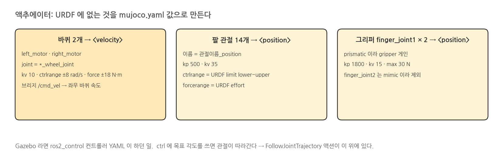{width=1000}

### 액추에이터: 바퀴 velocity (코드) - actuator 생성 발췌

```py
# src/mobile_openarm_mujoco/mobile_openarm_mujoco/model.py
actuators = ET.SubElement(root, "actuator")
for side in ["left", "right"]:
    ET.SubElement(actuators, "velocity", name=side + "_motor", joint=side + "_wheel_joint",
                  kv=str(motors["velocity_gain"]),
                  ctrlrange=vector([-motors["max_speed"], motors["max_speed"]]),
                  forcerange=vector([-motors["max_torque"], motors["max_torque"]]))
```

- 바퀴 = 속도 액추에이터 · `data.ctrl` 에 목표 각속도 [rad/s]
- `ctrlrange` · `forcerange` = 모터의 최고 속도 · 최대 토크 (`mujoco.yaml`)

### 액추에이터: 팔 · 그리퍼 관절 position (코드) - actuator 생성 발췌

```py
# src/mobile_openarm_mujoco/mobile_openarm_mujoco/model.py
# actuator 생성 (이어서)
for j in joints:
    if j.get("type") not in ["revolute", "prismatic"] or j.find("mimic") is not None:
        continue
    lim = j.find("limit")
    cfg = settings["gripper" if j.get("type") == "prismatic" else "arm"]
    ET.SubElement(actuators, "position", name=j.get("name") + "_position", joint=j.get("name"),
                  kp=str(cfg["kp"]), kv=str(cfg["kv"]),
                  ctrlrange=lim.get("lower") + " " + lim.get("upper"), forcerange=vector([-force, force]))
```

- 팔 14 + 그리퍼 2 = 위치 액추에이터 16 개 · mimic 관절(따라가는 손가락)은 건너뜀
- 목표 범위는 URDF `<limit>` · 이득 `kp` `kv` 는 `mujoco.yaml`
- `force` = URDF `effort` 와 yaml `max_force` 중 작은 값

### mimic → equality: 그리퍼 손가락 둘을 한 값으로

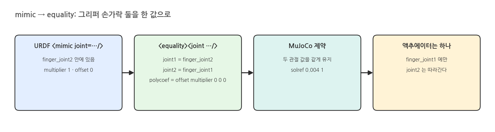{width=1000}

### mimic → equality (코드)

```py
# src/mobile_openarm_mujoco/mobile_openarm_mujoco/model.py
class Physics:
    def __init__(self, model_path, config_file=None):
        self.model = mujoco.MjModel.from_xml_path(str(model_path))
        self.data = mujoco.MjData(self.model)
        self.radius = float(self.model.geom("left_wheel_collision_0").size[0])
        self.track = float(abs(self.model.body("left_wheel").pos[1] - self.model.body("right_wheel").pos[1]))
        self.joint_names = [self.model.joint(i).name for i in range(self.model.njnt)
                            if self.model.jnt_type[i] in (2, 3)]          # slide · hinge
        self.q_indices = [self.model.joint(n).qposadr[0] for n in self.joint_names]
        self.v_indices = [self.model.joint(n).dofadr[0] for n in self.joint_names]
        self.targets = initial_positions()
```

- URDF `<mimic>` 를 가진 관절마다 구속 하나 · `joint1` = 따라가는 관절
- `polycoef` 앞 두 값 = offset · multiplier
- `solref`: 구속을 얼마나 빨리 · 단단히 맞출지 (시간 상수 0.004 s · 감쇠비 1)

### 충돌 제외: 계산하지 않을 body 쌍

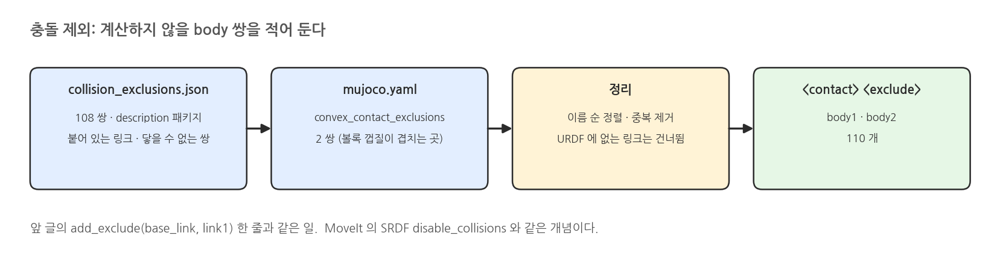{width=1000}

### 충돌 제외 → exclude (코드) - build_model 함수 뒷부분

```py
# src/mobile_openarm_mujoco/mobile_openarm_mujoco/model.py
contacts = ET.SubElement(root, "contact")
exclusions = set()
pairs = json.loads((share("mobile_openarm_description") / "config/collision_exclusions.json").read_text())
for pair in pairs + settings.get("convex_contact_exclusions", []):
    names = tuple(sorted(pair))
    if names not in exclusions and all(n in links for n in names):
        ET.SubElement(contacts, "exclude", body1=names[0], body2=names[1])
        exclusions.add(names)
```

- 붙어 있거나 서로 닿을 수 없는 링크 쌍 108 개 + yaml 의 2 개 = `<exclude>` 110 개
- 이름을 정렬해 (a, b) 와 (b, a) 를 같은 쌍으로 처리
- 빼지 않으면 겹쳐 있는 링크끼리 밀어냄 (앞 글에서 팔이 0.24 rad 에 멈춘 것과 같은 현상)

### Physics.__init__: MJCF 를 읽고 이름으로 번호를 찾아 둔다

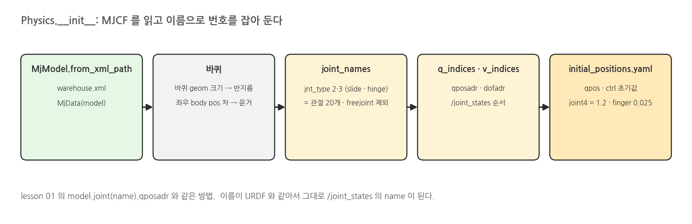{width=1000}

### 모델 읽기 (코드) - Physics 클래스의 __init__

```py
# src/mobile_openarm_mujoco/mobile_openarm_mujoco/model.py
class Physics:
    def __init__(self, model_path, config_file=None):
        self.model = mujoco.MjModel.from_xml_path(str(model_path))
        self.data = mujoco.MjData(self.model)
        self.radius = float(self.model.geom("left_wheel_collision_0").size[0])
        self.track = float(abs(self.model.body("left_wheel").pos[1] - self.model.body("right_wheel").pos[1]))
        self.joint_names = [self.model.joint(i).name for i in range(self.model.njnt)
                            if self.model.jnt_type[i] in (2, 3)]          # slide · hinge
        self.q_indices = [self.model.joint(n).qposadr[0] for n in self.joint_names]
        self.v_indices = [self.model.joint(n).dofadr[0] for n in self.joint_names]
        self.targets = initial_positions()
```

- 바퀴 반지름 · 바퀴 간격을 모델에서 읽음 → URDF 를 고치면 오도메트리도 따라 바뀜
- `joint_names`: hinge · slide 만 (자유 관절 제외) → 20 개 = `/joint_states` 의 이름
- `q_indices` · `v_indices`: 앞 글의 `qposadr` · `dofadr` 와 같은 것

### bridge.publish_state (50 Hz): MuJoCo 상태 → /odom · TF · /joint_states

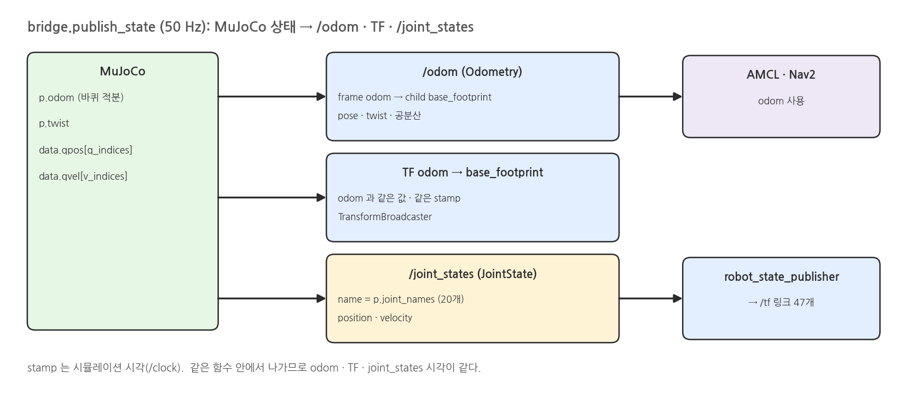{width=1000}

### /odom 발행 (코드) - publish_state 함수

```py
# src/mobile_openarm_mujoco/mobile_openarm_mujoco/bridge.py
def publish_state(self, now):
    p = self.physics
    odom = Odometry()
    odom.header.stamp, odom.header.frame_id, odom.child_frame_id = now, "odom", "base_footprint"
    planar(odom.pose.pose, p.odom)
    self.odom_pub.publish(odom)
```

- `p.odom` = 바퀴 회전으로 계산한 위치 (참값이 아님 · 다음 글에서 계산 과정)
- `frame_id` `odom` → `child_frame_id` `base_footprint`

### odom → base_footprint TF 발행 (코드) - publish_state 함수

```py
# src/mobile_openarm_mujoco/mobile_openarm_mujoco/bridge.py
    # publish_state (이어서)
    tf = TransformStamped()
    tf.header, tf.child_frame_id = odom.header, odom.child_frame_id
    tf.transform.translation.x = odom.pose.pose.position.x
    tf.transform.translation.y = odom.pose.pose.position.y
    tf.transform.rotation = odom.pose.pose.orientation
    self.tf.sendTransform(tf)
```

- 브리지가 직접 내는 TF 는 이것 하나 · URDF 만으로는 알 수 없는 "로봇이 어디 있나"
- 나머지 링크 TF 는 robot_state_publisher 가 계산

### /joint_states 발행 (코드) - publish_state 함수

```py
# src/mobile_openarm_mujoco/mobile_openarm_mujoco/bridge.py
    # publish_state (이어서)
    joints = JointState()
    joints.header.stamp = now
    joints.name = p.joint_names
    joints.position = p.data.qpos[p.q_indices].tolist()
    joints.velocity = p.data.qvel[p.v_indices].tolist()
    self.joint_pub.publish(joints)
```

- 앞 글 2링크 팔 브리지의 `publish_joints` 와 같은 구조 · 관절이 2 개에서 20 개로
- 이름이 URDF 와 같아서 robot_state_publisher 가 그대로 받아 씀

### display.launch.py: 노드 셋, 인자 둘

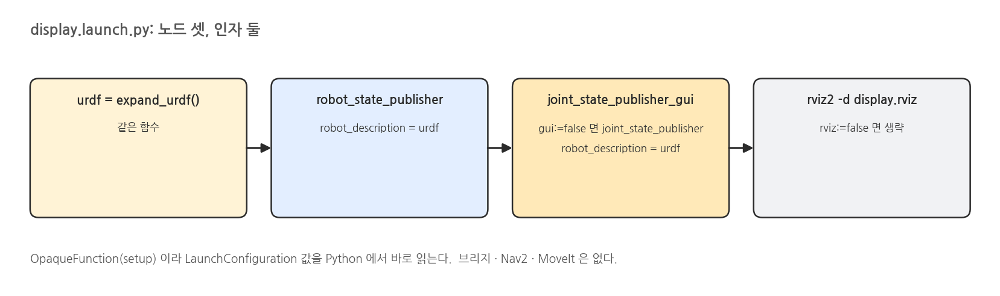{width=1000}

### display.launch.py: robot_state_publisher · joint_state_publisher 노드 (코드) - setup 함수

```py
# src/mobile_openarm_description/launch/display.launch.py
def setup(context):
    urdf = expand_urdf()
    gui = LaunchConfiguration("gui").perform(context) == "true"
    actions = [
        Node(package="robot_state_publisher", executable="robot_state_publisher",
             parameters=[{"robot_description": urdf}], output="screen"),
        Node(package="joint_state_publisher_gui" if gui else "joint_state_publisher",
             executable="joint_state_publisher_gui" if gui else "joint_state_publisher",
             parameters=[{"robot_description": urdf}], output="screen"),
    ]
```

- 시뮬레이터 없이 URDF 만 볼 때 → `/joint_states` 를 슬라이더가 대신 냄
- `gui:=false` → 슬라이더 없이 모든 관절 0 을 발행

### display.launch.py: RViz 노드 추가 (코드) - setup 함수

```py
    # src/mobile_openarm_description/launch/display.launch.py setup (이어서)
    if LaunchConfiguration("rviz").perform(context) == "true":
        actions.append(Node(package="rviz2", executable="rviz2",
                            arguments=["-d", str(share / "config/display.rviz")], output="screen"))
    return actions
```

- `rviz:=false` → RViz 없이 노드만 (다른 PC 에서 볼 때)

## 4. 실행해보기

### 시뮬레이터 없이 보기: display.launch.py

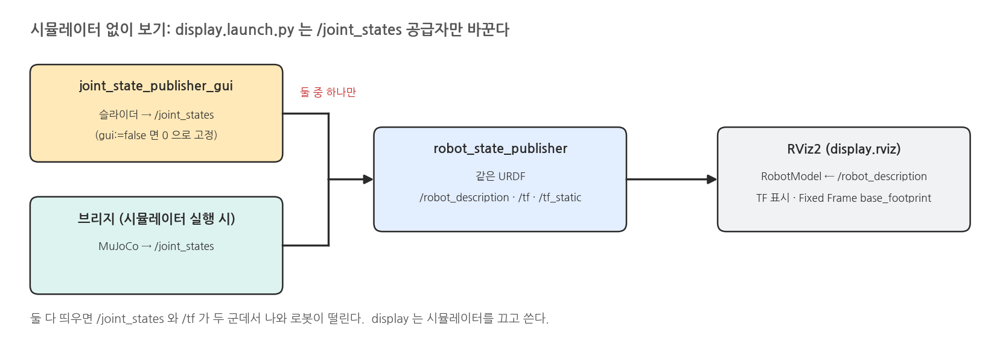{width=1000}

### 실행: 터미널 1 (display)

```bash
source /opt/ros/jazzy/setup.bash
source scripts/env.sh
./scripts/mobile_openarm display          # = ros2 launch mobile_openarm_description display.launch.py
```

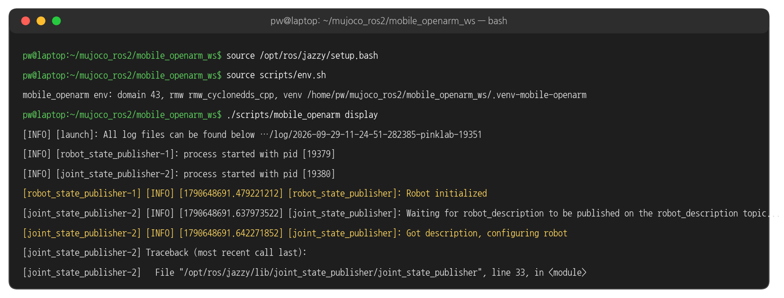{width=1000}

### display 의 실행 결과

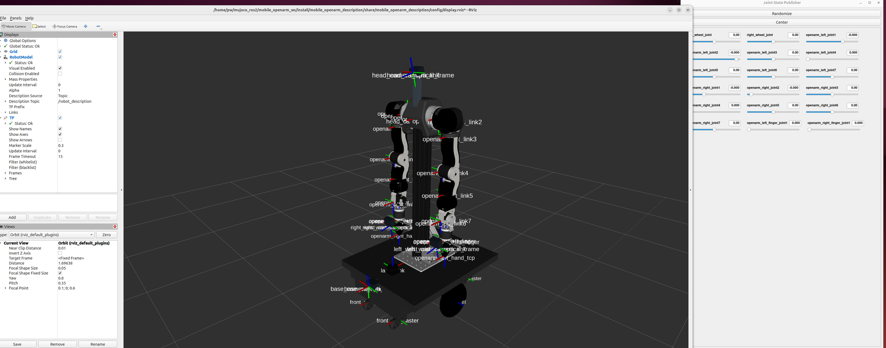{width=1000}

### 슬라이더로 관절 움직이기

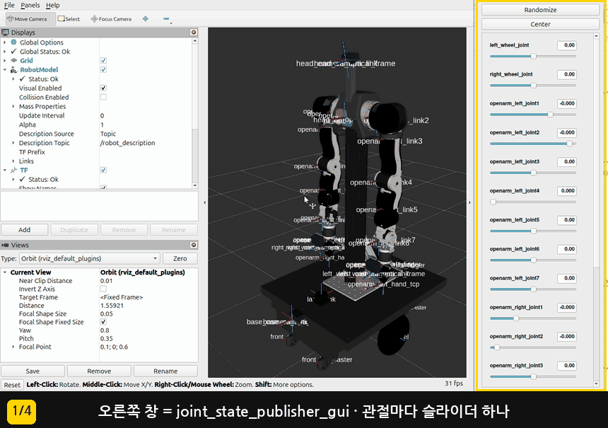{width=860}

### 터미널 2: ros2 node list

```bash
source /opt/ros/jazzy/setup.bash
source scripts/env.sh
ros2 node list
```

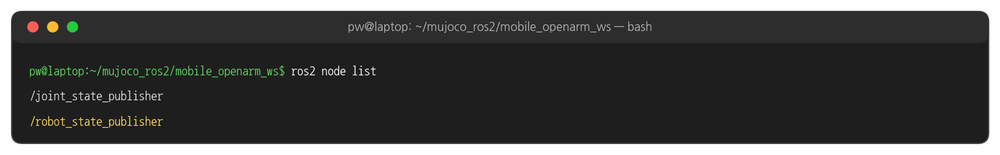{width=1000}

### 터미널 2: ros2 topic list · topic info /robot_description

```bash
ros2 topic list
ros2 topic info /robot_description
```

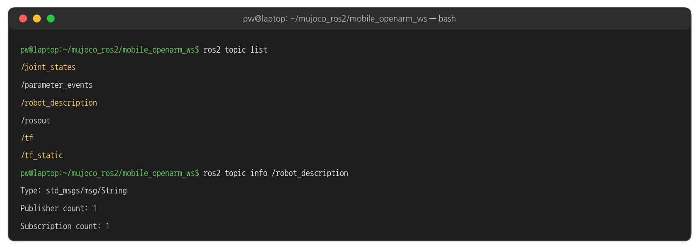{width=1000}

### 터미널 2: ros2 topic echo /joint_states

```bash
ros2 topic echo --once /joint_states
```

### 터미널 2: /joint_states 출력

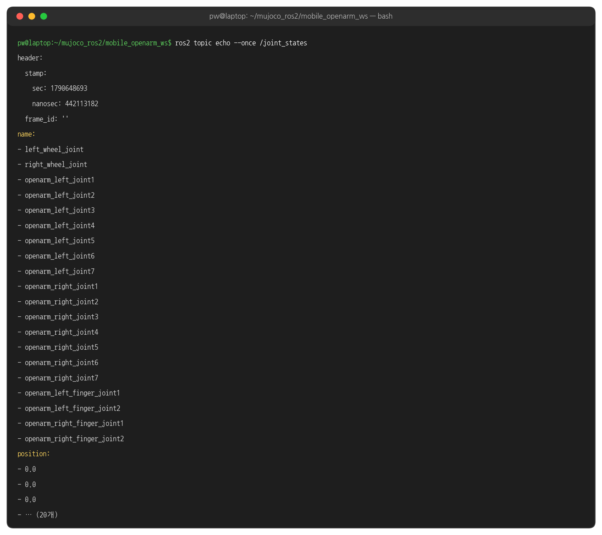{width=1000}

### 터미널 2: tf2_echo base_footprint openarm_left_hand_tcp

```bash
ros2 run tf2_ros tf2_echo base_footprint openarm_left_hand_tcp
```

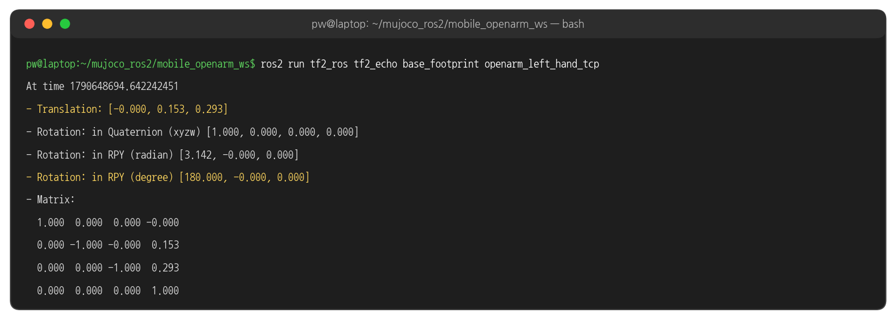{width=1000}

### 터미널 2: tf2_echo base_link laser_link

```bash
ros2 run tf2_ros tf2_echo base_link laser_link
```

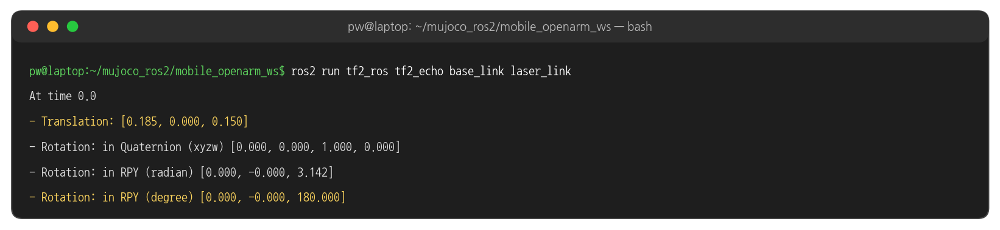{width=1000}

### 생성된 파일 보기

```bash
ls artifacts/mobile_generated/
head -3 artifacts/mobile_generated/warehouse.xml
```

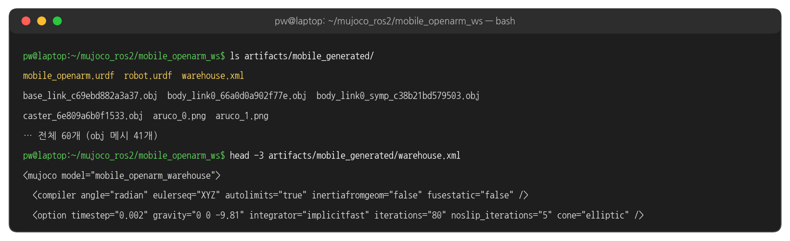{width=1000}

### URDF 와 MJCF 의 크기 비교

```bash
python - <<'EOF'
import collections, mujoco, xml.etree.ElementTree as ET
urdf = ET.parse("artifacts/mobile_generated/robot.urdf").getroot()
print("URDF link", len(urdf.findall("link")), dict(collections.Counter(j.get("type") for j in urdf.findall("joint"))))
m = mujoco.MjModel.from_xml_path("artifacts/mobile_generated/warehouse.xml")
print("MJCF body", m.nbody, "joint", m.njnt, "geom", m.ngeom, "camera", m.ncam, "actuator", m.nu, "exclude", m.nexclude, "equality", m.neq)
EOF
```

### URDF 와 MJCF 의 크기 비교: 결과

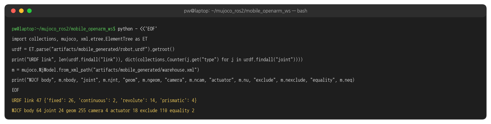{width=1000}

- URDF 관절 46 개 = fixed 26 + 움직이는 관절 20 (바퀴 2 · 팔 14 · 손가락 4)
- MJCF joint 24 개 = 그 20 개 + 자유 관절 4 (로봇 1 · 상자 3) · fixed 26 개는 body 만 남음
- body 64 개 = 링크 47 + world 1 + 창고에 놓인 것 16 (상자 · 배우 등)

### 해 볼 것

- `./scripts/mobile_openarm display` 실행 후 슬라이더로 `openarm_left_joint4` 조작 → `tf2_echo base_footprint openarm_left_hand_tcp` 값 변화 확인
- `ros2 launch mobile_openarm_description display.launch.py gui:=false`로 실행 시 관절이 0에 고정 → 초기 자세와 다른 이유를 `initial_positions.yaml`에서 확인
- `mujoco.yaml`의 `arm.kp`를 절반으로 줄이고 `./scripts/mobile_openarm start` 실행 → 팔이 초기 자세를 잡는 시간 변화 확인
