## 1. 도킹 · 인식 · 팔을 하나의 스킬로

### ⑧ 에서 ⑨ 로

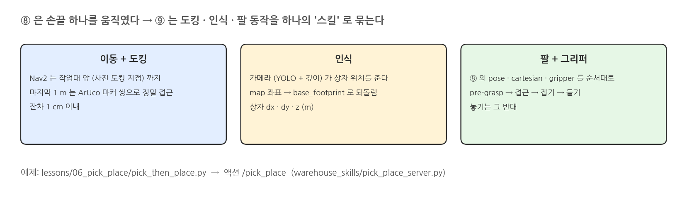{width=1000}

### PickPlace 액션

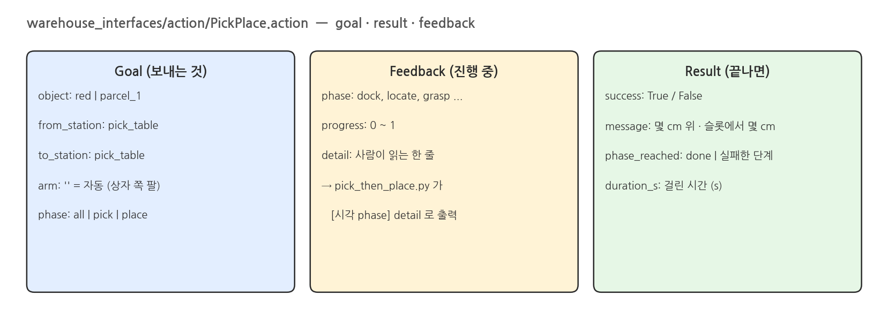{width=1000}

### 단계: pick 절반과 place 절반

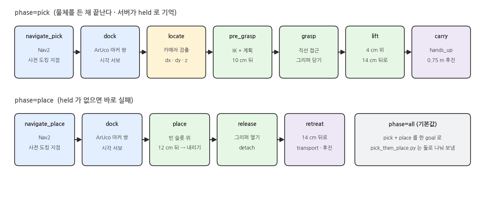{width=1000}

### 작업대 · 마커 · 상자 · 슬롯

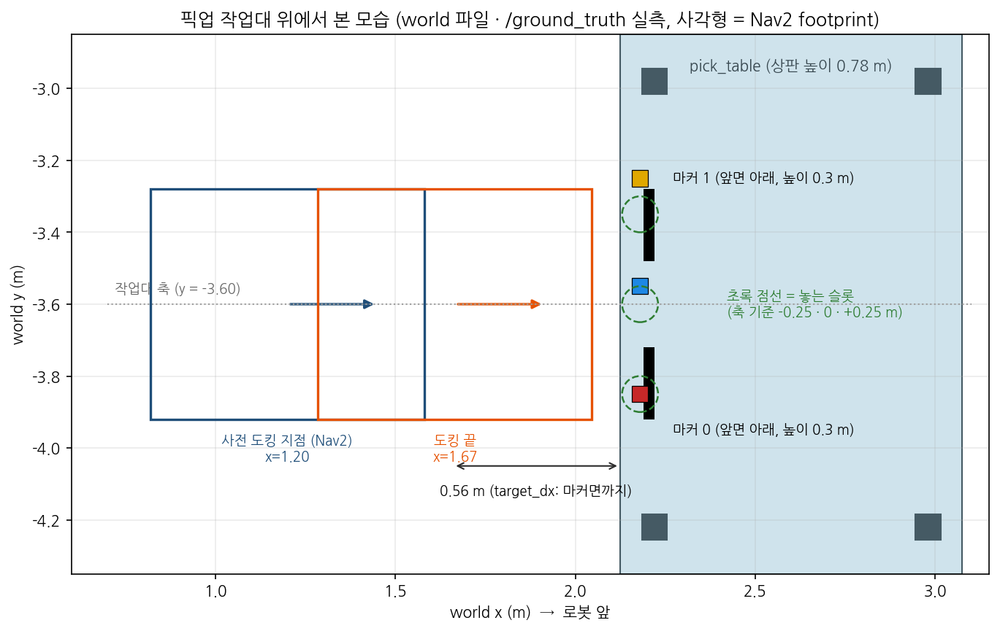{width=1000}

### 도킹: 마커 두 개로 마지막 50 cm

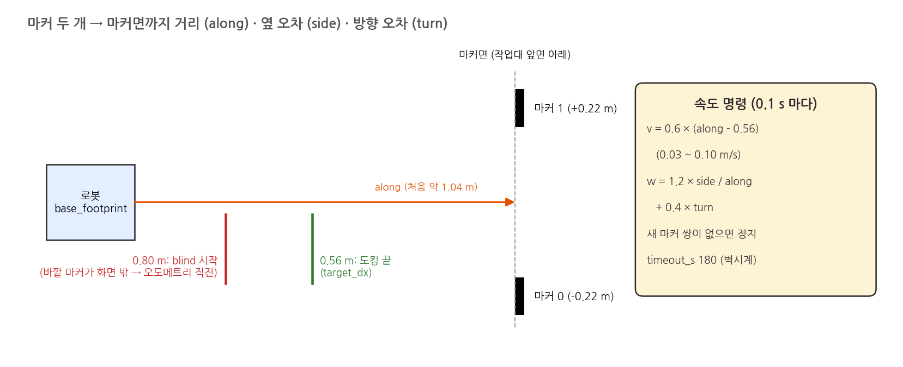{width=1000}

### 위치 확인: 카메라 → base_footprint

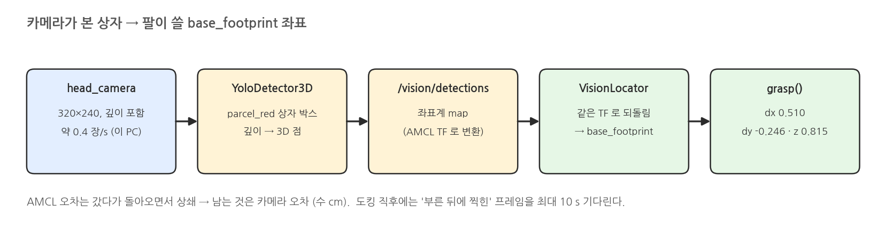{width=1000}

### 잡기: pre-grasp → 직선 접근 → 들기

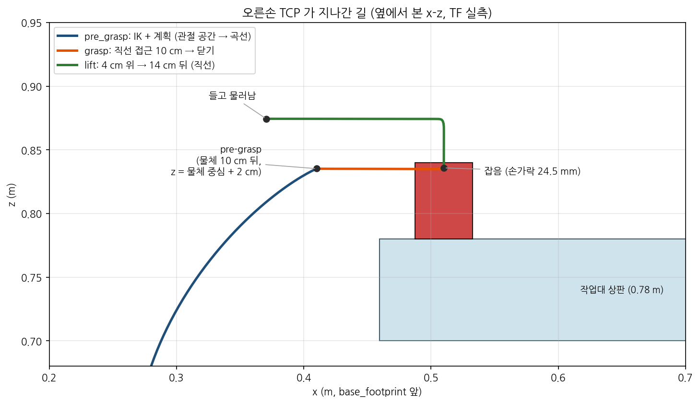{width=1000}

## 2. 실행: pick_then_place.py

### 실행: 터미널 1 (start)

```bash
source /opt/ros/jazzy/setup.bash
source scripts/env.sh
H=warehouse_lecture.vision
LECTURE_HANDLERS="$H.aruco:ArucoDetector,$H.yolo_detector:YoloDetector3D" \
  ./scripts/mobile_openarm start spawn:=pick_table camera_depth:=true locate:=vision viewer:=true rviz:=false
```

### 실행 결과: 터미널 1

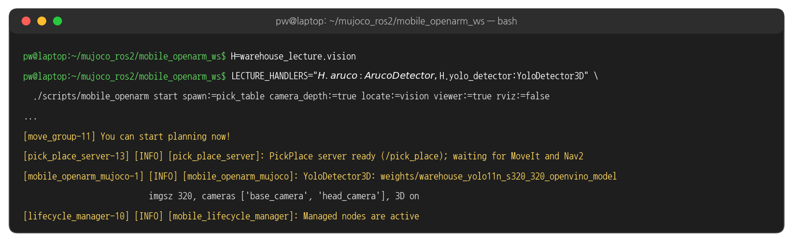{width=1000}

### 실행 결과: 시작 화면

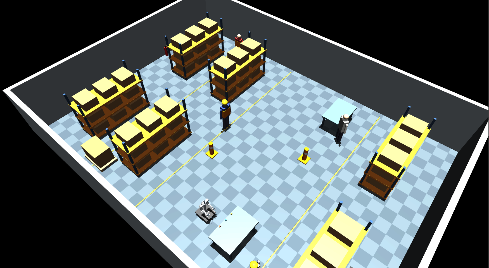{width=1000}

### 터미널 2: pick_then_place.py

```bash
source /opt/ros/jazzy/setup.bash
source scripts/env.sh
time ./scripts/mobile_openarm exec python lessons/06_pick_place/pick_then_place.py red   # 집고, 같은 작업대에 다시 놓기
```

### 실행 결과: pick 절반

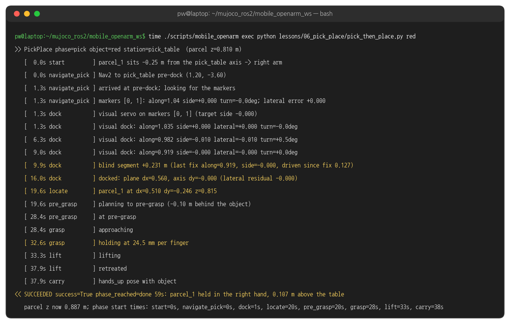{width=1000}

### 실행 결과: place 절반

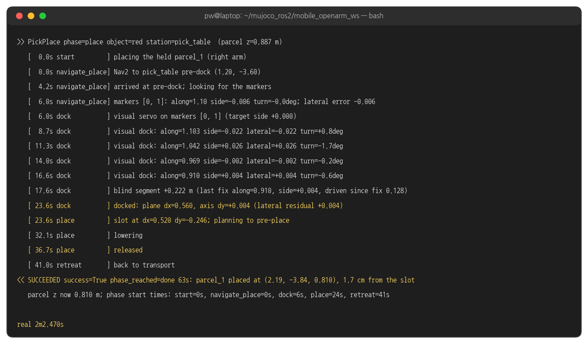{width=1000}

### 움직이는 그림: 집고 놓기 전체

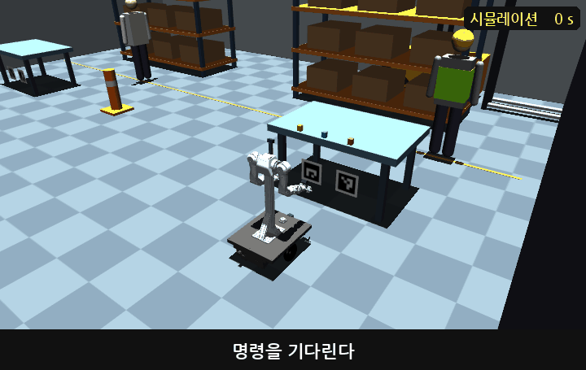{width=720}

### 실행 결과: 도킹

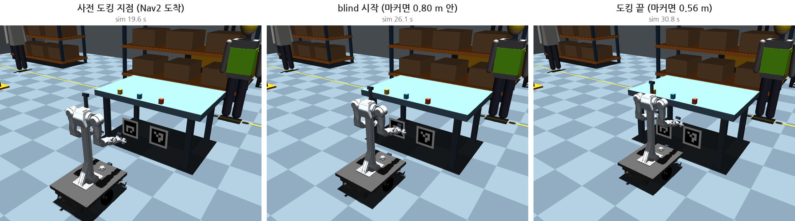{width=1000}

### 도킹 그래프

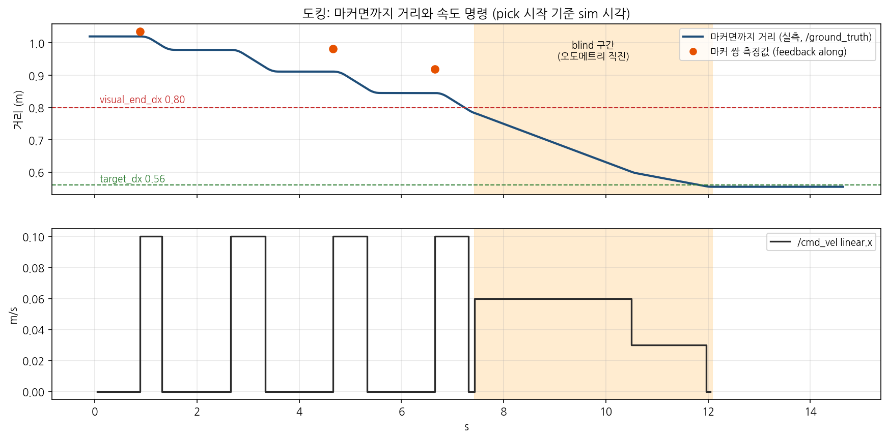{width=1000}

### 카메라가 본 것

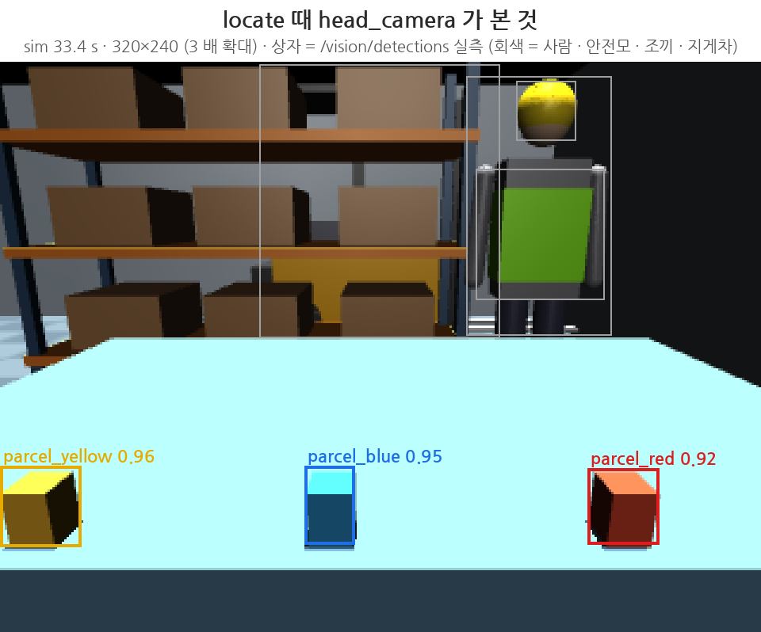{width=1000}

### 실행 결과: 잡기

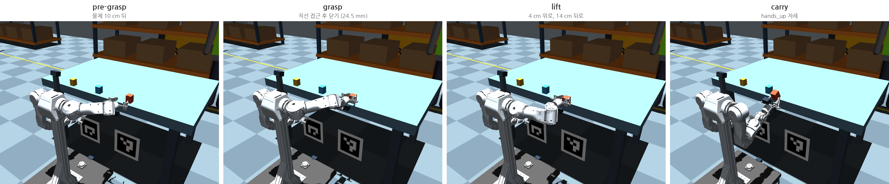{width=1000}

### 손가락 · 손끝 · 상자 높이

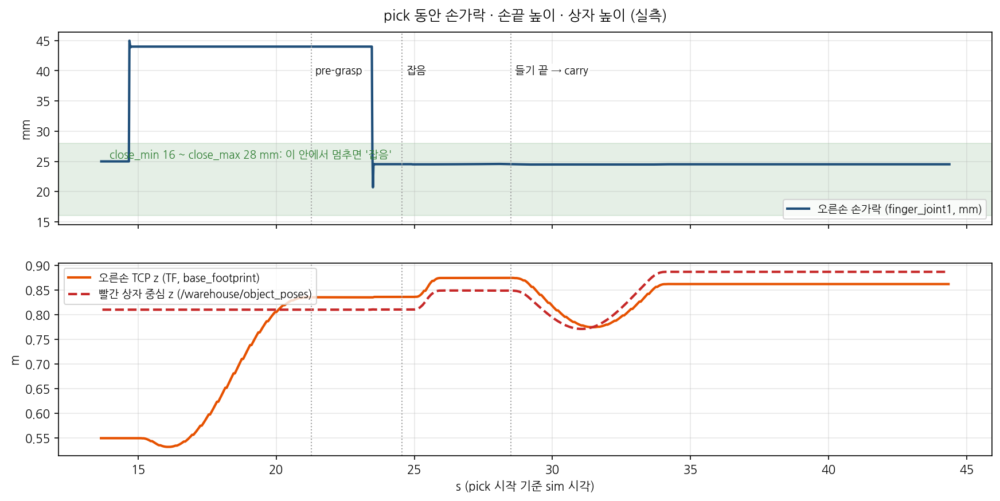{width=1000}

### 실행 결과: 놓기

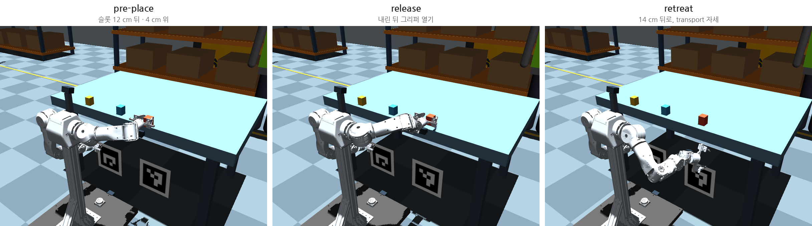{width=1000}

### 단계별 시간

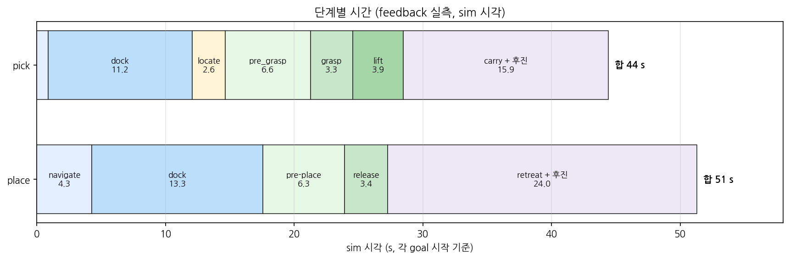{width=1000}

### 터미널 2: 실패하는 명령

```bash
./scripts/mobile_openarm exec python lessons/06_pick_place/pick_then_place.py red --only place   # 든 것이 없는데 놓기
```

### 실행 결과: 실패

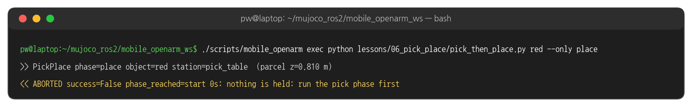{width=1000}

### 같은 일을 CLI 로

```bash
./scripts/mobile_openarm pick red --phase pick                            # 집은 채 멈춘다 (뷰어로 살펴보기)
./scripts/mobile_openarm pick red pick_table pick_table --phase place     # 인자: 색 · 출발 작업대 · 놓을 작업대 (기본 place_table)
```

### 실행 결과: CLI

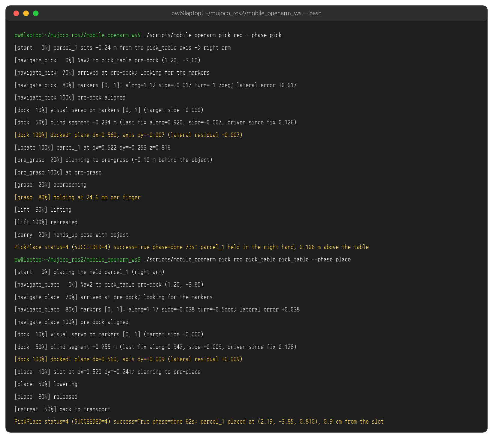{width=1000}

## 3. 코드와 설정

### 함수 구조

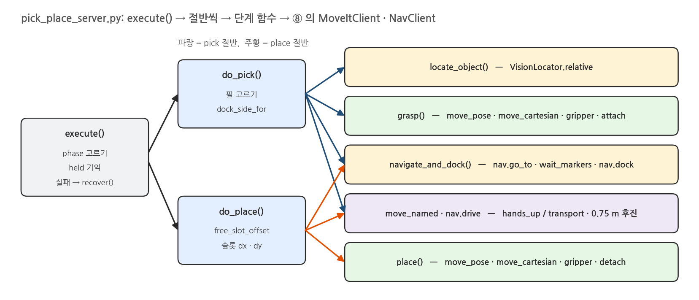{width=1000}

### goal 과 feedback 콜백 - pick_then_place.py run 함수 발췌

```python
# lessons/06_pick_place/pick_then_place.py
goal = PickPlace.Goal(object=colour, phase=phase)            # red, pick | place
if phase == "pick":
    goal.from_station = station
else:
    goal.to_station = station


def on_fb(m):                                                 # feedback 마다 한 줄
    f = m.feedback
    print(f"   [{time.monotonic() - t0:5.1f}s {f.phase:14s}] {f.detail}", flush=True)
```

- `phase` 로 절반만 실행 · pick 은 `from_station`, place 는 `to_station`
- feedback 의 `phase` · `detail` = 서버가 지금 하는 단계 → 경과 시간과 함께 출력

### 보내고 결과 기다리기 - pick_then_place.py run 함수 발췌

```python
# lessons/06_pick_place/pick_then_place.py run (이어서)
future = self.client.send_goal_async(goal, feedback_callback=on_fb)   # 액션 /pick_place
rclpy.spin_until_future_complete(self, future, timeout_sec=10)
gh = future.result()
rf = gh.get_result_async()
while not rf.done() and time.monotonic() < end:
    rclpy.spin_once(self, timeout_sec=0.1)
r = rf.result().result                                        # success · message · phase_reached · duration_s
```

- 앞 글의 Nav2 goal 과 같은 액션 순서: goal 수락 → feedback → result
- `spin_once` 를 돌려야 feedback 콜백이 불림 · `end` 는 전체 제한 시간 (기본 600 s)

### 어느 절반을 할지 고르기 - pick_place_server.py execute 함수 발췌

```python
# src/warehouse_skills/warehouse_skills/pick_place_server.py
which = (goal.phase or "all").lower()
if which == "place":
    if self.held is None:
        raise SkillError("nothing is held: run the pick phase first")
    name, arm = self.held["name"], self.held["arm"]           # pick 절반이 기억해 둔 것
else:
    name, arm, src = self.do_pick(goal, feedback)
```

- `phase` 가 비어 있으면 `all` = pick 과 place 를 goal 하나로
- `self.held`: pick goal 이 끝나며 남긴 물체 · 팔 → 다음 place goal 이 이어받음

### 절반의 성공 판정 - pick_place_server.py execute 함수 발췌

```python
# src/warehouse_skills/warehouse_skills/pick_place_server.py execute (이어서)
if which == "pick":
    lifted = float(fz - top_z)                                # 상자가 상판보다 얼마나 위에 있나 (정답 위치)
    result.success = bool(lifted > 0.02)
    if result.success:
        self.held = {"name": name, "arm": arm}
else:
    st, offset = self.do_place(goal, name, arm, feedback)
    placed = float(math.hypot(fx - target[0], fy - target[1]))   # 슬롯 중심에서 몇 cm
    result.success = bool(placed < 0.08 and fz > st["top_z"])
```

- 성공은 명령이 아니라 결과로 판정: 시뮬레이터 정답 위치 `fx` · `fy` · `fz` 사용
- pick: 상판보다 2 cm 넘게 들림 · place: 슬롯 중심 8 cm 안 + 상판 위

### 물체 · 팔 고르고 도킹 - pick_place_server.py do_pick 함수 발췌

```python
# src/warehouse_skills/warehouse_skills/pick_place_server.py
def do_pick(self, goal, feedback):
    name = self.resolve_object(goal.object)                   # red → parcel_1
    src = self.resolve_station(goal.from_station or "pick_table")
    offset = self.object_offset(name, src)                    # 작업대 축에서 -0.25 m
    arm = goal.arm or self.arm_for_offset(offset)             # 음수 → 오른팔
    self.moveit.move_named(arm, self.cfg["transport_pose"], self.states)
    dock_side = self.dock_side_for(offset)                    # 0.25 m 이내면 축 위에 도킹
    self.navigate_and_dock(src, arm, lambda origin, u: -dock_side, "navigate_pick", feedback)
```

- `offset` 부호로 가까운 어깨 쪽 팔 선택 · `goal.arm` 을 주면 그 팔 사용
- 주행 전 팔을 `transport` 자세로 접음 (앞 글의 named target)
- `dock_side`: 상자가 축에서 0.25 m 넘게 떨어지면 그만큼 옆으로 도킹 (최대 0.2 m)

### 위치 확인 · 잡기 · 후진 - pick_place_server.py do_pick 함수 발췌

```python
    # src/warehouse_skills/warehouse_skills/pick_place_server.py do_pick (이어서)
    rel = self.locate_object(name)                            # 카메라: (dx, dy, z) in base_footprint
    if not goal.arm and self.arm_for_offset(rel[1]) != arm:
        arm = self.arm_for_offset(rel[1])                     # 도킹 잔차 때문에 반대쪽이면 팔 바꾸기
    self.grasp(arm, name, feedback, rel)
    self.moveit.move_named(arm, self.cfg["carry_pose"], self.states)   # hands_up
    self.nav.drive(-float(self.cfg["dock"]["undock_distance"]))       # 0.75 m 후진
    return name, arm, src
```

- 팔은 도킹 뒤 실제로 본 `rel[1]` (좌우 [m]) 로 다시 결정
- `hands_up` 으로 든 뒤 후진 → 상자가 작업대 · 베이스 상판에 닿지 않음

### 마커 쌍 기다리기 - nav_client.py dock 함수 발췌

```python
# src/warehouse_skills/warehouse_skills/nav_client.py
end = time.monotonic() + float(d["timeout_s"])                # 180 s (벽시계)
while time.monotonic() < end:
    f = self.fixes(ids, max_age=0.8)                          # 0.8 s 안에 찍힌 마커만
    if len(f) < 2:                                            # 쌍이 아니면 멈추고 기다림
        if last is not None and last[0] <= visual_end + 0.15:
            break
        self._publish(0.0, 0.0)
        time.sleep(0.1)
        continue
```

- 마커 하나로는 방향 추정이 흔들림 → 두 개가 함께 보일 때만 사용
- 쌍이 사라져도 마지막 측정이 0.95 m 안이면 `break` → 오도메트리 구간으로

### 마커를 보며 다가가기 - nav_client.py dock 함수 발췌

```python
    # src/warehouse_skills/warehouse_skills/nav_client.py dock while 루프 (이어서)
    along, side, turn, _, _ = self.geometry(f, offsets)
    last = (along, side, turn)
    last_odom = self.markers_odom
    if along <= visual_end:                                   # 0.80 m 안: 바깥 마커가 곧 화면 밖
        break
    lateral = side - float(target_side)
    v = min(float(d["max_speed"]), max(0.03, float(d["gain"]) * (along - float(target_dx))))
    w = float(d["lateral_gain"]) * lateral / max(along, 0.3) + float(d["heading_gain"]) * turn
    self._publish(v, max(-0.3, min(0.3, w)))
    time.sleep(0.1)
```

- `v`: 남은 거리에 비례 · 0.03 ~ `max_speed` [m/s] 로 제한
- `w`: 옆 오차(`lateral`) 와 방향 오차(`turn`) 를 함께 줄임 · ±0.3 [rad/s] 제한
- 앞 글의 `/cmd_vel` 을 0.1 s 마다 발행하는 P 제어

### 마지막 구간은 오도메트리로 - nav_client.py dock 함수 발췌

```python
# src/warehouse_skills/warehouse_skills/nav_client.py dock (이어서)
# blind: 마지막 측정 뒤 이미 간 거리를 빼고 오도메트리로 직진
remaining = along - travelled - float(target_dx)
self.drive(remaining, speed=float(d["blind_speed"]))
```

- `travelled`: 마지막 마커 영상이 찍힌 뒤 이미 간 거리 → 두 번 가지 않게 뺌
- `target_dx` 0.56 m = 도킹이 끝났을 때 마커 면까지의 거리

### 부른 시각 기록 - locate.py VisionLocator.relative 함수 발췌

```python
# src/warehouse_skills/warehouse_skills/locate.py
def relative(self, label, wait=10.0):
    since = self.node.get_clock().now().nanoseconds * 1e-9    # 부른 시각 (sim)
    end = time.monotonic() + wait
```

- `since` 는 sim 시간 (검출 stamp 와 비교) · `end` 는 벽시계 (기다리는 한도 10 s)

### 그 뒤에 찍힌 검출 기다리기 - locate.py VisionLocator.relative 함수 발췌

```python
    # src/warehouse_skills/warehouse_skills/locate.py VisionLocator.relative (이어서)
    while True:
        m = self.latest                                       # 마지막 /vision/detections
        fresh = m is not None and m.header.stamp.sec + m.header.stamp.nanosec * 1e-9 >= since
        hits = [d for d in m.detections if d.label == label and d.has_position] if fresh else []
        if hits:
            break
        if time.monotonic() > end:
            raise SkillError(f"{label} not visible")
        time.sleep(0.05)
```

- 도킹 직후의 마지막 프레임은 움직이는 중에 찍힌 것일 수 있음 → `since` 뒤 것만 사용
- `has_position`: 깊이로 3D 위치까지 얻은 검출만 · 끝내 없으면 `SkillError`

### base_footprint 좌표로 바꾸기 - locate.py VisionLocator.relative 함수 발췌

```python
    # src/warehouse_skills/warehouse_skills/locate.py VisionLocator.relative (이어서)
    best = max(hits, key=lambda d: d.score)
    out = self.buffer.transform(best.position, "base_footprint", timeout=rclpy.duration.Duration(seconds=0.5))
    return float(out.point.x), float(out.point.y), float(out.point.z)   # map → base_footprint (같은 TF)
```

- 같은 라벨이 여럿이면 `score` 가 가장 높은 검출 선택
- 검출 좌표를 만든 것과 같은 TF 로 되돌림 → AMCL 위치 오차가 상쇄됨

### 열고 다가가기 - pick_place_server.py grasp 함수 발췌

```python
# src/warehouse_skills/warehouse_skills/pick_place_server.py
dx, dy, dz = rel
z = dz + float(g["z_offset"])                                 # 물체 중심 + 2 cm
self.moveit.gripper(arm, g["open"], g["effort"])              # 44 mm
for pre in offsets:                                           # -0.10, -0.06, -0.03 m
    try:
        self.moveit.move_pose(arm, make_pose([dx + pre, dy, z]))   # ⑧ 의 pose goal
        break
    except SkillError as error:
        last_error = error
self.moveit.move_cartesian(arm, [make_pose([dx, dy, z])])     # ⑧ 의 Cartesian: 직선 접근
```

- `rel` = 카메라가 준 상자 위치 (base_footprint 기준 [m])
- pre-grasp 는 상자 뒤 10 cm 부터 시도 · IK 실패 시 6 cm → 3 cm 로 줄임
- 마지막 접근만 Cartesian 직선 → 상자를 옆에서 치지 않음

### 닫고 확인 · 들어 올려 빼기 - pick_place_server.py grasp 함수 발췌

```python
# src/warehouse_skills/warehouse_skills/pick_place_server.py grasp (이어서)
result = self.moveit.gripper(arm, g["close"], g["effort"])    # 12 mm 명령 → 상자에 막혀 멈춤
if not (float(g["close_min"]) <= result.position <= float(g["close_max"])):
    raise SkillError(f"grasp missed: finger stopped at {result.position * 1000:.1f} mm")
self.moveit.attach(arm, name, [size[2], size[1], size[0]], below_tcp=float(g["z_offset"]))   # planning scene
up = make_pose([dx, dy, z + float(g["lift_z"])])              # 4 cm 위
back = make_pose([dx + float(g["retreat_x"]), dy, z + float(g["lift_z"])])   # 14 cm 뒤
self.moveit.move_cartesian(arm, [up, back])
```

- 손가락이 멈춘 위치가 `close_min` ~ `close_max` 밖이면 헛잡음으로 판정
- `attach`: 상자를 팔의 일부로 등록 → 이후 계획이 상자 충돌까지 계산
- 위로 든 뒤 뒤로 빼는 두 점을 Cartesian 한 번으로 이동

### 놓기 - pick_place_server.py place 함수 발췌

```python
# src/warehouse_skills/warehouse_skills/pick_place_server.py
z = top_z + float(p["drop_z"]) + size[2] / 2 + float(g["z_offset"])   # 상판 + 4 mm + 상자 반 + 2 cm
self.moveit.move_pose(arm, make_pose([slot_dx + float(p["pre_offset_x"]), slot_dy, z + float(g["lift_z"])]))
self.moveit.move_cartesian(arm, [make_pose([slot_dx, slot_dy, z + float(g["lift_z"])]),
                                 make_pose([slot_dx, slot_dy, z])])   # 앞으로 12 cm → 아래로 4 cm
self.moveit.gripper(arm, g["open"], g["effort"])
self.moveit.detach(arm, name)
self.moveit.move_cartesian(arm, [make_pose([slot_dx + float(g["retreat_x"]), slot_dy, z + float(g["lift_z"])])])
```

- 잡기의 역순: 슬롯 뒤 · 위로 이동 → 앞으로 → 아래로 → 열기 → 뒤로
- `drop_z`: 상자 바닥과 상판 사이 4 mm 를 남기고 놓음
- `detach` 로 planning scene 의 상자를 손에서 떼어 냄

### skills.yaml 의 값

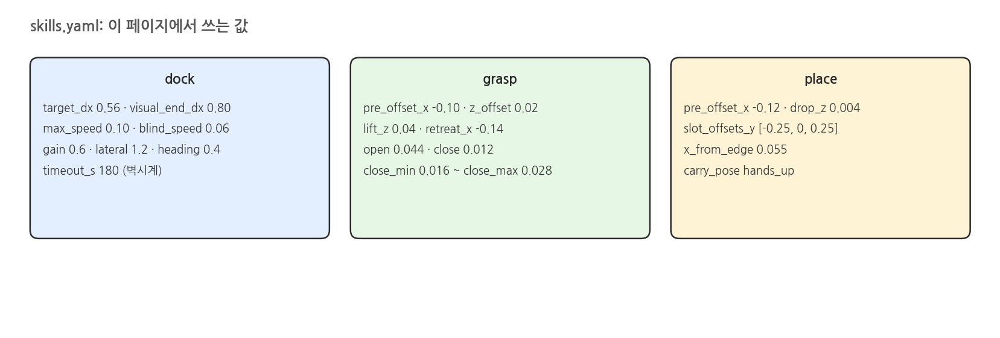{width=1000}

### 도킹 값 - skills.yaml 발췌

```yaml
# src/warehouse_skills/config/skills.yaml (발췌)
dock:
  target_dx: 0.56
  visual_end_dx: 0.80
  max_speed: 0.10
  blind_speed: 0.06
  gain: 0.6
  lateral_gain: 1.2
  heading_gain: 0.4
  timeout_s: 180.0
  undock_distance: 0.75
```

- `visual_end_dx` 0.80 m 까지 마커 서보 · 그 뒤 `target_dx` 0.56 m 까지 오도메트리
- `gain` · `lateral_gain` · `heading_gain` = 앞 코드의 `v` · `w` 계수
- `undock_distance`: 작업 뒤 후진 거리 → Nav2 팽창 영역 밖으로

### 잡기 값 - skills.yaml 발췌

```yaml
# src/warehouse_skills/config/skills.yaml (이어서)
grasp:
  pre_offset_x: -0.10
  lift_z: 0.04
  retreat_x: -0.14
  z_offset: 0.02
  open: 0.044
  close: 0.012
  close_min: 0.016
  close_max: 0.028
  effort: 25.0
```

- 거리 [m] · `open` · `close` 는 손가락 하나의 위치 · `effort` 는 쥐는 힘
- 45 mm 상자면 손가락이 22.5 mm 에서 멈춤 → 16 ~ 28 mm 면 잡은 것으로 판정

### 놓기 값 · 운반 자세 - skills.yaml 발췌

```yaml
# src/warehouse_skills/config/skills.yaml (이어서)
place:
  pre_offset_x: -0.12
  drop_z: 0.004
  slot_offsets_y: [-0.25, 0.0, 0.25]
  x_from_edge: 0.055
carry_pose: hands_up
```

- `slot_offsets_y`: 작업대 축 기준 놓는 자리 세 곳 (좌우 25 cm 간격)
- `x_from_edge`: 작업대 앞 가장자리에서 5.5 cm 안쪽
- `carry_pose`: 상자를 든 채 후진 · 이동할 때의 팔 자세

### 해 볼 것

- `pick_then_place.py blue` · `yellow` 로 바꿔 팔 선택 (feedback 의 `-> left arm` / `right arm`) 과 놓는 슬롯 비교
- `skills.yaml` 의 `grasp.close_max` 를 0.020 으로 좁혀 `grasp missed` 를 만들고, 실패 뒤 팔이 어떻게 풀려나는지 (`recover()`) 보기 (끝나면 0.028 로 되돌리기)
- `--to place_table` 로 반대편 작업대에 놓아 ⑩ (주행 + Pick & Place) 로 넘어가기
