## 1. 주행 + 집기 + 놓기를 하나의 goal 로

### ⑨ 에서 ⑩ 으로

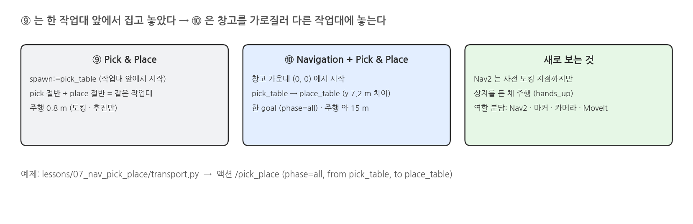{width=1000}

### 상태 기계

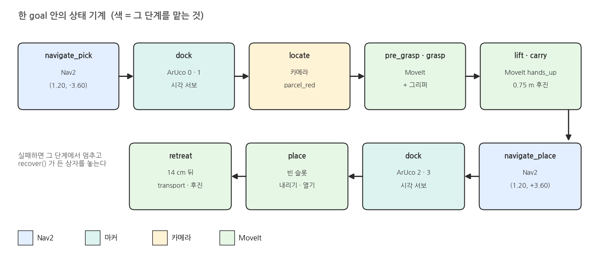{width=1000}

### 정밀도는 누가 책임지나

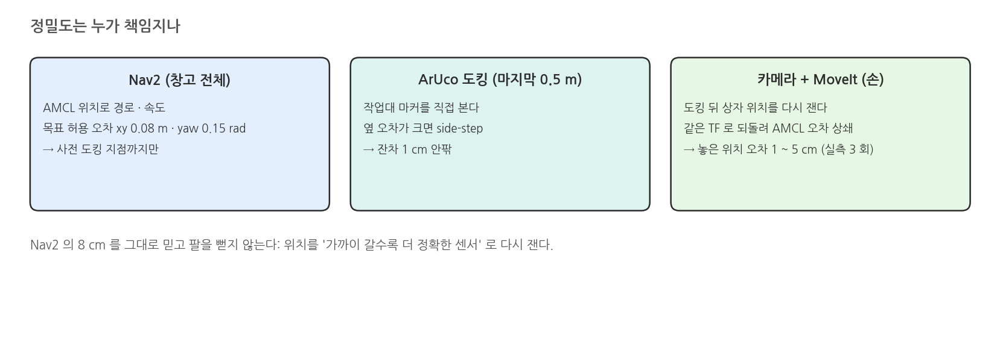{width=1000}

### 카메라가 늦을 때: 찍힌 시각과 받은 시각

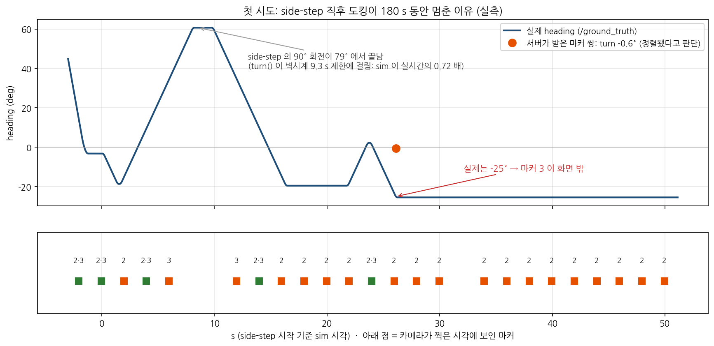{width=1000}

### 고친 것

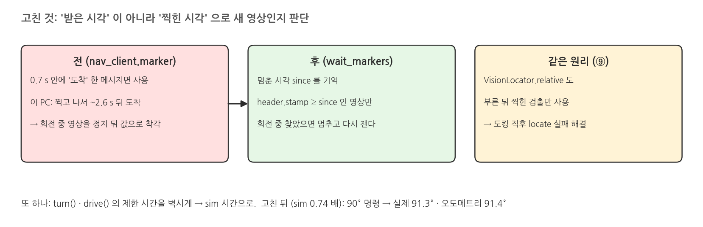{width=1000}

## 2. 실행: transport.py

### 실행: 터미널 1 (start)

```bash
source /opt/ros/jazzy/setup.bash
source scripts/env.sh
H=warehouse_lecture.vision
LECTURE_HANDLERS="$H.aruco:ArucoDetector,$H.yolo_detector:YoloDetector3D" \
  ./scripts/mobile_openarm start camera_depth:=true locate:=vision viewer:=true rviz:=false   # spawn 없음 = 창고 가운데
```

### 실행 결과: 터미널 1

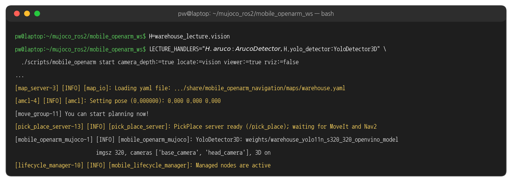{width=1000}

### 실행 결과: 시작 화면

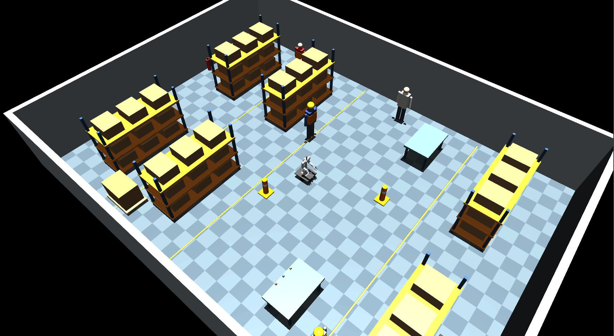{width=1000}

### 터미널 2: transport.py

```bash
source /opt/ros/jazzy/setup.bash
source scripts/env.sh
time ./scripts/mobile_openarm exec python lessons/07_nav_pick_place/transport.py red   # pick_table → place_table
```

### 실행 결과: pick 절반

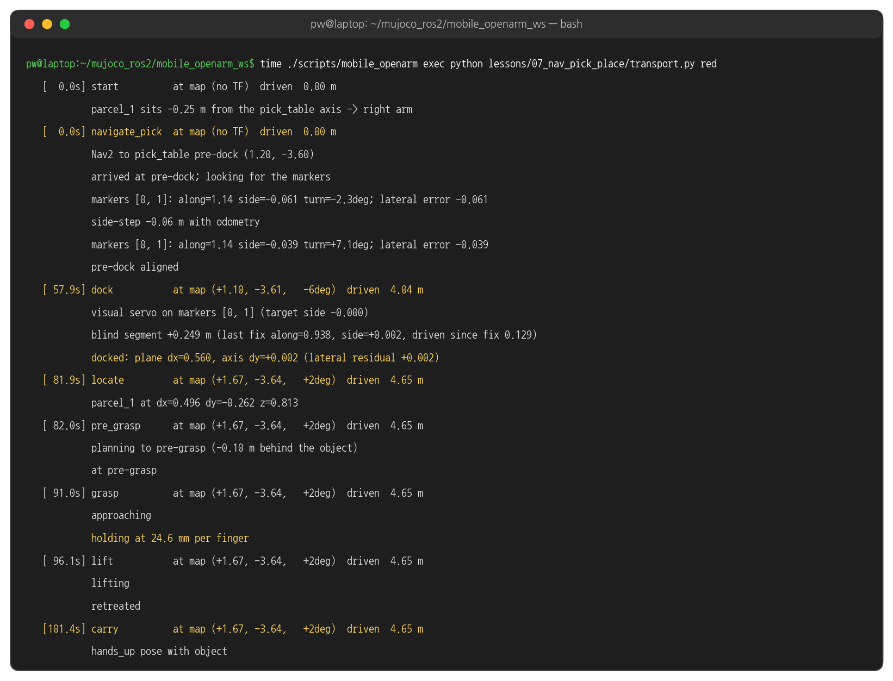{width=1000}

### 실행 결과: place 절반

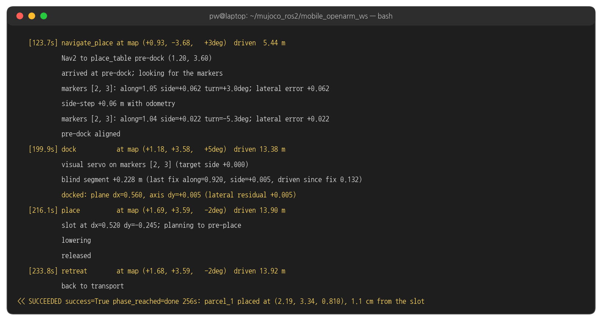{width=1000}

### 실행 결과: 단계별 요약

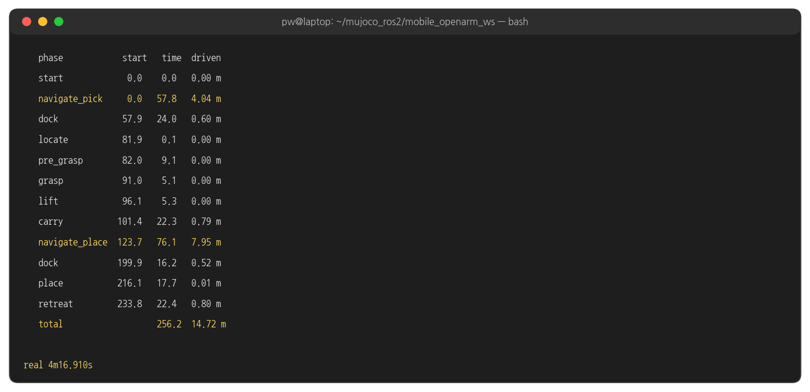{width=1000}

### 지도 위의 경로

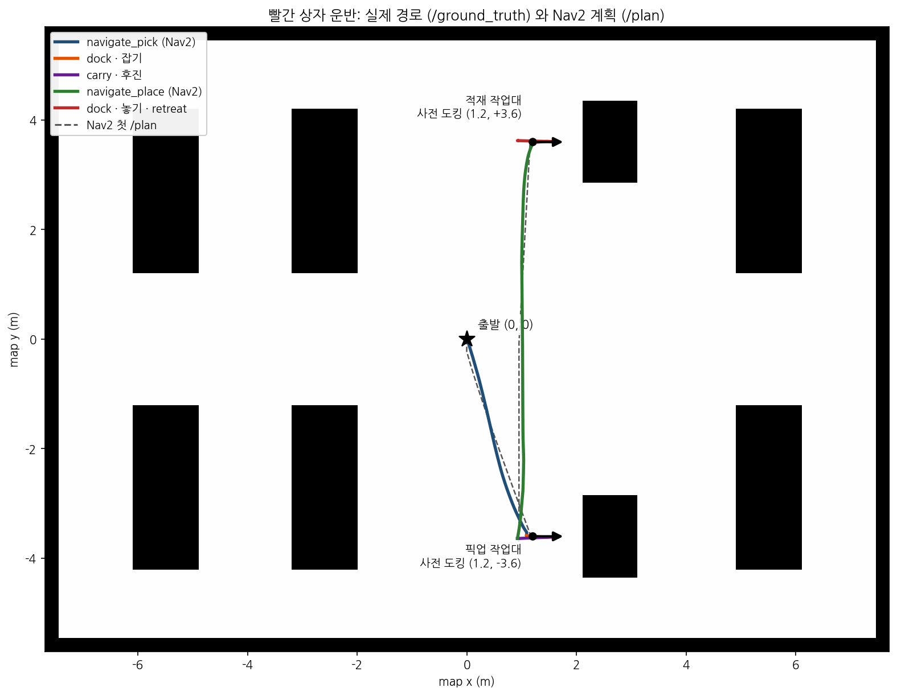{width=1000}

### 작업대 앞: Nav2 도착 → 도킹 끝

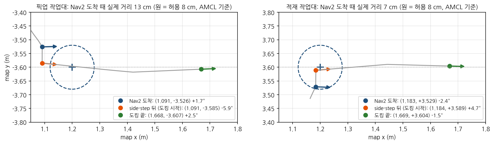{width=1000}

### 실행 결과: 장면

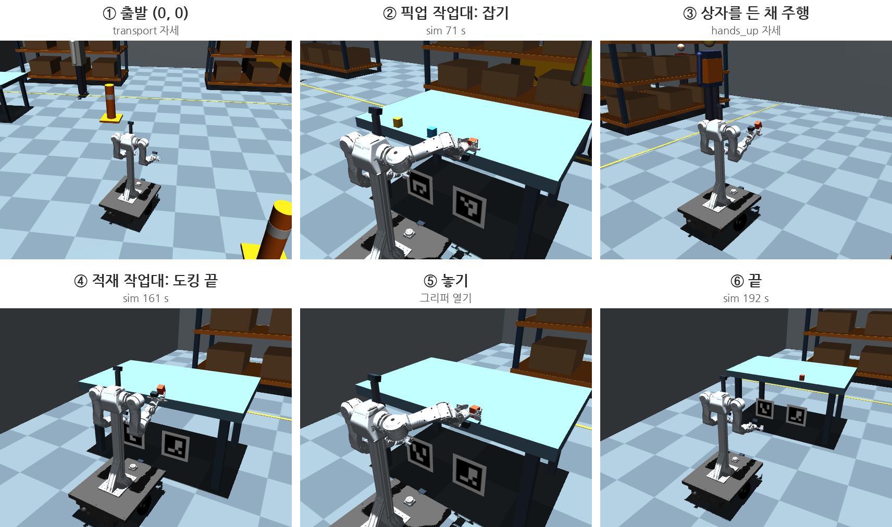{width=1000}

### 주행 속도

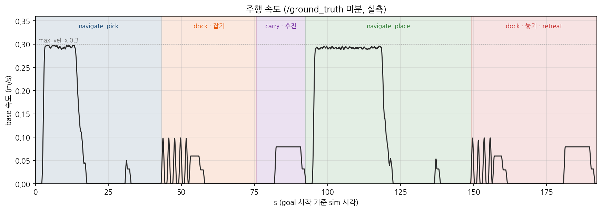{width=1000}

### 터미널 2: 다른 색

```bash
time ./scripts/mobile_openarm exec python lessons/07_nav_pick_place/transport.py blue
time ./scripts/mobile_openarm exec python lessons/07_nav_pick_place/transport.py yellow   # 축에서 +0.35 m: 왼팔, 옆으로 도킹
```

### 실행 결과: 노랑

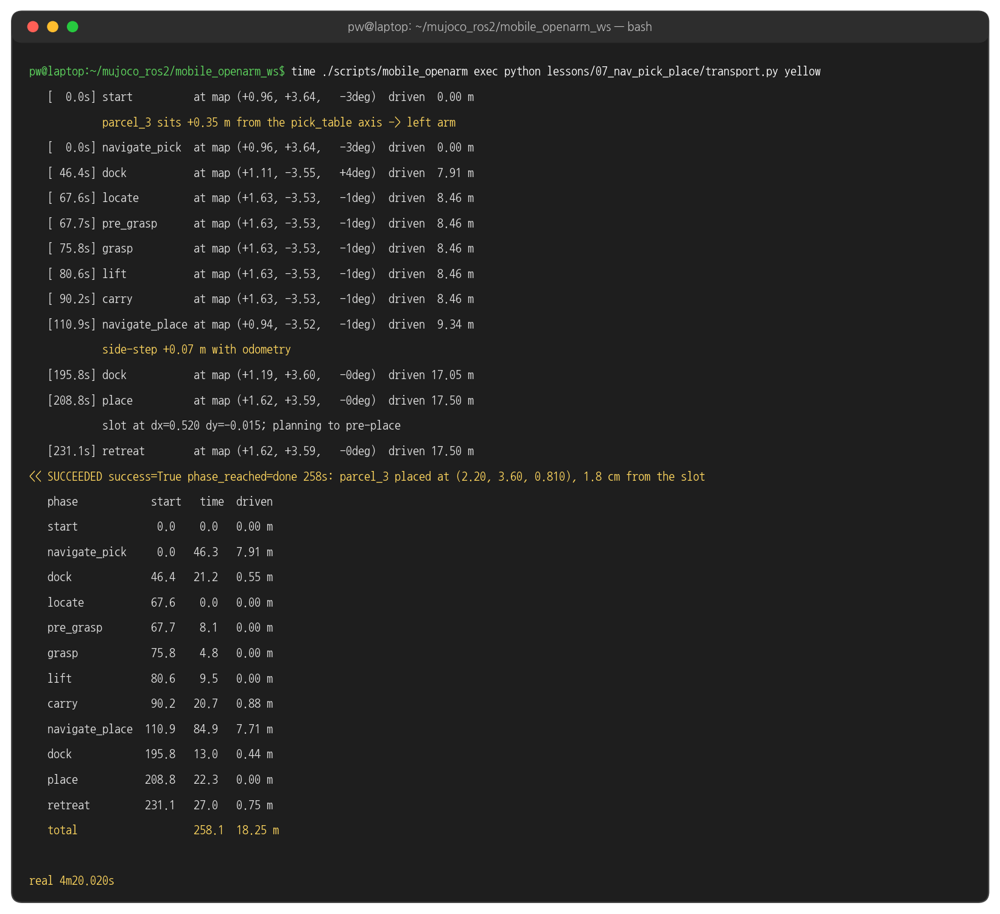{width=1000}

### 세 색 비교

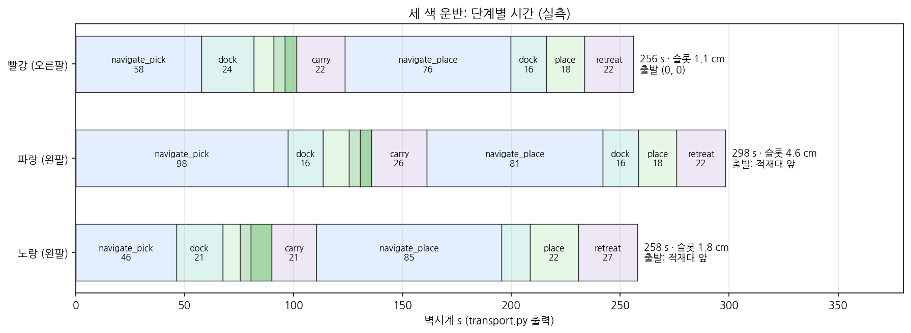{width=1000}

## 3. 코드와 설정

### map 위치 읽기 - transport.py where 함수 발췌

```python
# lessons/07_nav_pick_place/transport.py
def where(self):
    tf = self.tf.lookup_transform("map", "base_footprint", rclpy.time.Time()).transform   # AMCL + 오도메트리
    q = tf.rotation
    yaw = math.atan2(2 * (q.w * q.z + q.x * q.y), 1 - 2 * (q.y * q.y + q.z * q.z))
    return tf.translation.x, tf.translation.y, yaw
```

### 단계가 바뀔 때 위치 출력 - transport.py on_fb 함수 발췌

```python
# transport.py (이어서)
goal = PickPlace.Goal(object=colour, from_station=src, to_station=dst, phase="all")   # goal 하나


def on_fb(m):
    f = m.feedback
    if not rows or rows[-1][0] != f.phase:                    # 단계가 바뀔 때만
        rows.append((f.phase, time.monotonic() - t0, self.path))
        p = self.where()
        print(f"   [{time.monotonic() - t0:5.1f}s] {f.phase:14s} at map ({p[0]:+.2f}, {p[1]:+.2f}, ...)  driven {self.path:5.2f} m")
```

### 두 절반 - pick_place_server.py execute 함수 발췌

```python
# warehouse_skills/pick_place_server.py
which = (goal.phase or "all").lower()                         # transport.py 는 "all"
name, arm, src = self.do_pick(goal, feedback)                 # navigate_pick → dock → locate → grasp → carry
st, offset = self.do_place(goal, name, arm, feedback)         # navigate_place → dock → place → retreat
```

### place 절반 - pick_place_server.py do_place 함수

```python
# warehouse_skills/pick_place_server.py
def do_place(self, goal, name, arm, feedback):
    dst = self.resolve_station(goal.to_station or "place_table")
    offset = self.free_slot_offset(dst, name, arm)            # 든 팔이 닿는 빈 슬롯 (축 기준)
    st, mdx, mdy = self.navigate_and_dock(dst, arm, lambda origin, u: 0.0, "navigate_place", feedback)
    slot_dx = mdx - (st["marker_x"] - st["object_x"])         # 마커면 기준 → base_footprint
    slot_dy = mdy + offset
    self.place(arm, name, slot_dx, slot_dy, st["top_z"], feedback)
    self.moveit.move_named(arm, self.cfg["transport_pose"], self.states)
    self.nav.drive(-float(self.cfg["dock"]["undock_distance"]))
    return st, offset
```

### Nav2 로 사전 도킹 지점까지 - pick_place_server.py navigate_and_dock 함수 발췌

```python
# warehouse_skills/pick_place_server.py
goal = list(self.locations.goal(key))                         # locations.yaml base_goal
self.nav.go_to(*goal)                                         # Nav2 navigate_to_pose
self.nav.settle()                                             # 멈추고 1 s
```

### 마커로 옆 오차 맞추고 도킹 - pick_place_server.py navigate_and_dock 함수 발췌

```python
# pick_place_server.py navigate_and_dock (이어서)
for attempt in range(3):
    fixes = self.nav.wait_markers(st["markers"])              # 멈춘 뒤 찍힌 마커 쌍
    along, side, turn, origin, u = self.nav.geometry(fixes, st["offsets"])
    lateral = side - target_side_fn(origin, u)
    if abs(lateral) <= float(d["max_lateral_error"]) or attempt == 2:   # 0.05 m
        break
    if abs(turn) > 0.03:
        self.nav.turn(turn)
    self.nav.sidestep(lateral)                                # 90° 돌기 → 직진 → 되돌기 (오도메트리)
    self.nav.settle()
dx, residual = self.nav.dock(st["offsets"], self.cfg["dock"]["target_dx"], target_side, ...)
```

### map 목표 보내기 - nav_client.py _go_to_once 함수 발췌

```python
# warehouse_skills/nav_client.py
goal = NavigateToPose.Goal()
goal.pose.header.frame_id = "map"
goal.pose.pose.position.x, goal.pose.pose.position.y = float(x), float(y)
goal.pose.pose.orientation.z, goal.pose.pose.orientation.w = math.sin(yaw / 2), math.cos(yaw / 2)
handle = wait(self.nav.send_goal_async(goal), 10.0, "navigate_to_pose goal")
if not handle.accepted:
    raise SkillError("Nav2 rejected the goal")
```

### 결과 기다리기 · 제한 시간 - nav_client.py _go_to_once 함수 발췌

```python
# nav_client.py _go_to_once (이어서)
future = handle.get_result_async()
while not future.done():
    if self.cancel_requested or time.monotonic() > end:       # 180 s
        handle.cancel_goal_async()
        raise SkillError("navigation timed out")
    time.sleep(0.1)
```

### 받은 시각 · 찍힌 시각 거르기 - nav_client.py marker 함수 발췌

```python
# warehouse_skills/nav_client.py
def marker(self, marker_id, max_age=1.5, since=None):
    if self.markers is None or time.monotonic() - self.markers_wall > max_age:   # 받은 지 max_age 안
        return None
    if since is not None:
        stamp = self.markers.header.stamp
        if stamp.sec + stamp.nanosec * 1e-9 < since:          # 찍힌 시각이 since 전이면 버린다
            return None
    ...
```

### 멈춘 뒤 찍힌 마커 쌍 기다리기 - nav_client.py wait_markers 함수 발췌

```python
# nav_client.py (이어서)
def wait_markers(self, ids, timeout=10.0, search=True, need=2, max_age=0.7):
    since = self.now()                                        # 지금 (sim) = 로봇이 멈춘 뒤
    end = time.monotonic() + timeout
    while time.monotonic() < end:
        f = self.fixes(ids, max_age=max_age, since=since)
        if len(f) >= need:
            return f
        time.sleep(0.1)
    # 안 보이면 제자리에서 좌우로 돌며 찾는다. 찾으면 멈추고 다시 wait_markers (search=False)
```

### sim 시간으로 제한 시간 정하기 - nav_client.py turn 함수 발췌

```python
# warehouse_skills/nav_client.py
deadline = self.now() + abs(angle) / speed + 3.0                # sim 시간 (전: 벽시계 → 느린 PC 에서 90° 가 80° 로 끊김)
guard = time.monotonic() + 4 * (abs(angle) / speed + 3.0)       # 시뮬레이터가 멈췄을 때만
```

### 목표 각도까지 돌기 - nav_client.py turn 함수 발췌

```python
# nav_client.py turn (이어서)
while self.now() < deadline and time.monotonic() < guard:
    q = self.odom.pose.pose.orientation
    yaw = 2 * math.atan2(q.z, q.w)
    done = math.atan2(math.sin(yaw - yaw0), math.cos(yaw - yaw0))
    if sign * done >= abs(angle) - 0.01:
        break
    self._publish(0.0, sign * speed)
    time.sleep(0.05)
else:
    self.node.get_logger().warning(f"turn stopped by the deadline at ...")
```

### 설정 값

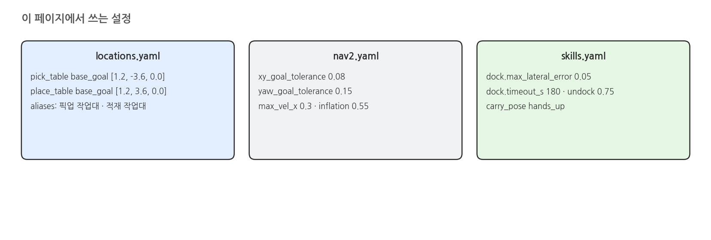{width=1000}

### locations.yaml 발췌

```yaml
# src/warehouse_lecture/worlds/locations.yaml (발췌)
locations:
  pick_table:
    aliases: [픽업 작업대, 픽업대, 집기 작업대, pick station]
    center: [2.6, -3.6]
    base_goal: [1.2, -3.6, 0.0]     # Nav2 목표 = 사전 도킹 지점 (map x, y, yaw)
    station: pick
  place_table:
    aliases: [적재 작업대, 적재대, 놓기 작업대, place station]
    center: [2.6, 3.6]
    base_goal: [1.2, 3.6, 0.0]
    station: place
```

### 해 볼 것

- `transport.py red --to pick_table` 로 같은 작업대에 되돌려 놓고 ⑨ 와 시간 비교
- `locations.yaml` 의 `place_table` `base_goal` x 를 1.0 으로 바꿔 도킹 시간 비교 (끝나면 1.2 로 되돌리기)
- 운반 중 다른 터미널에서 `./scripts/mobile_openarm exec ros2 topic echo /pick_place/_action/feedback` 으로 feedback 직접 보기
