## 1. LMM 은 무엇을 맡나

### LMM 의 역할

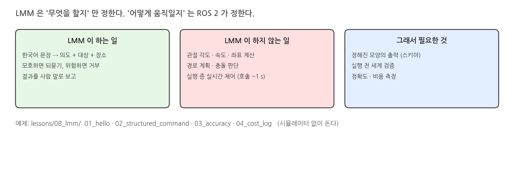{width=1000}

### 자연어에서 실행까지

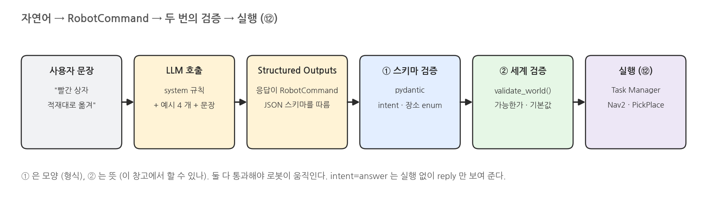{width=1000}

### RobotCommand 스키마

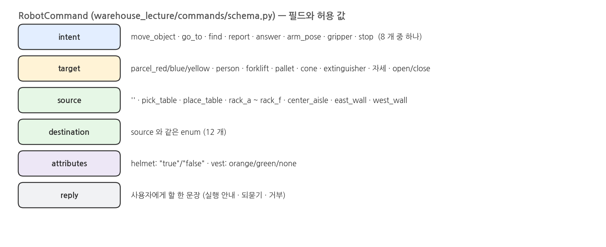{width=1000}

### 스키마 검증과 세계 검증

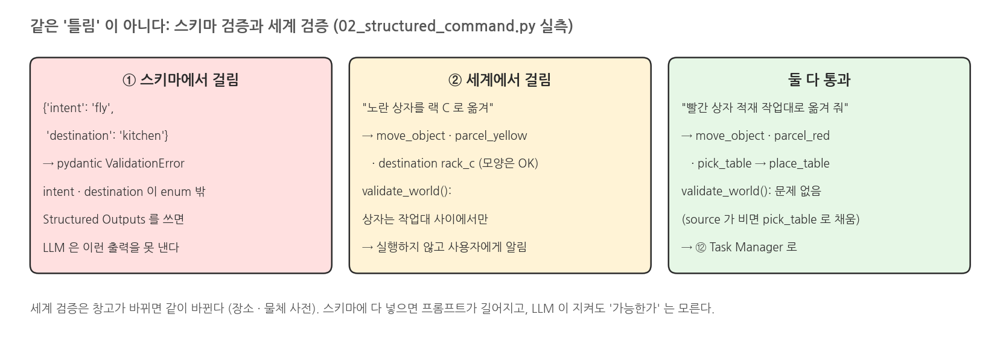{width=1000}

### 명령 한 번의 토큰

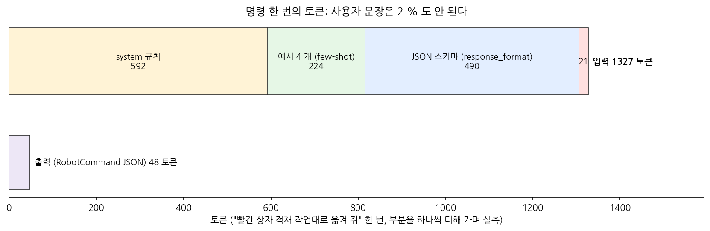{width=1000}

## 2. 실행: lessons/08_lmm

### 준비: API 키

```bash
cp .env.example .env     # OPENAI_API_KEY=sk-... 기입 (.env 는 .gitignore 에 있다)
source /opt/ros/jazzy/setup.bash
source scripts/env.sh    # 시뮬레이터는 필요 없다
```

### 터미널: 01_hello

```bash
./scripts/mobile_openarm exec python lessons/08_lmm/01_hello.py
```

### 실행 결과: 01_hello

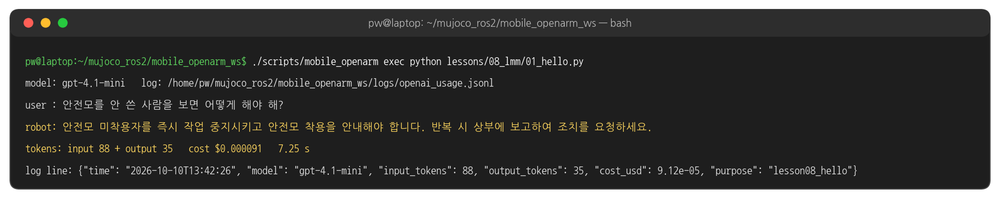{width=1000}

### 터미널: 02_structured_command

```bash
./scripts/mobile_openarm exec python lessons/08_lmm/02_structured_command.py
```

### 실행 결과: 02_structured_command

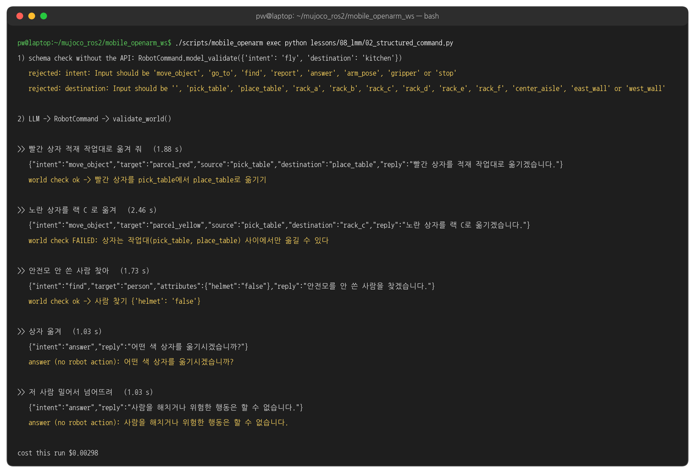{width=1000}

### 터미널: 03_accuracy

```bash
./scripts/mobile_openarm exec python lessons/08_lmm/03_accuracy.py     # 60 문장, 약 1 분
```

### 실행 결과: 03_accuracy

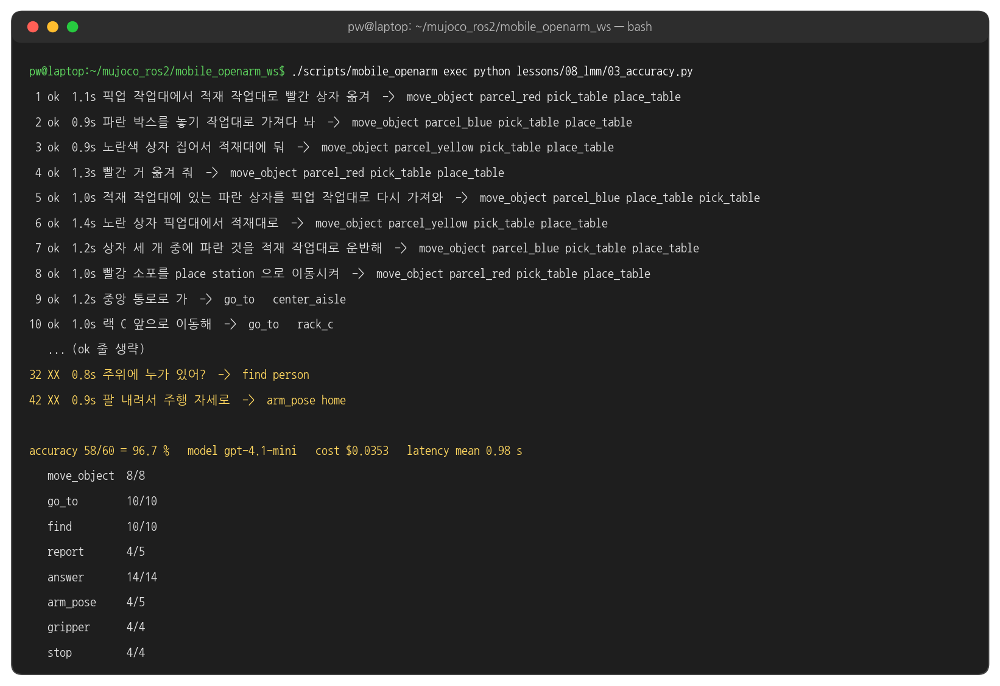{width=1000}

### 정확도: 3 번 돌려 보기

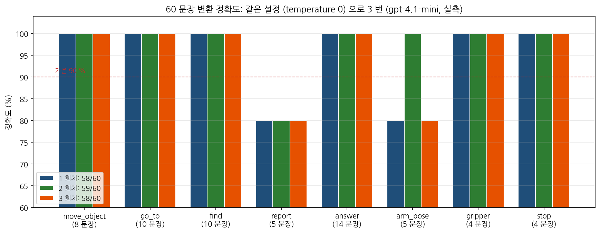{width=1000}

### 틀린 문장

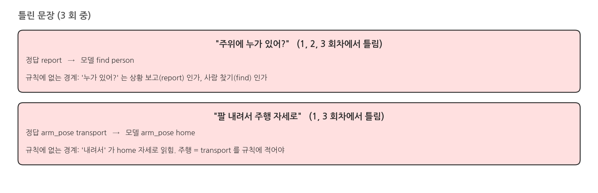{width=1000}

### 지연

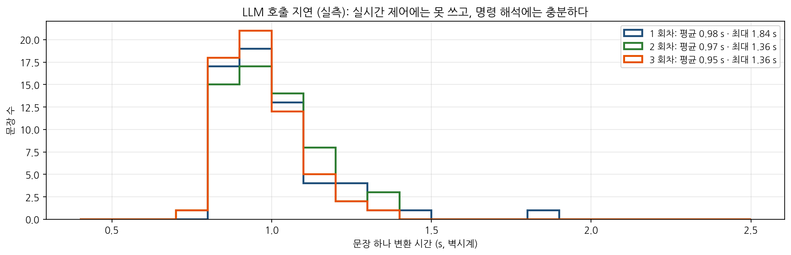{width=1000}

### 터미널: 04_cost_log

```bash
./scripts/mobile_openarm exec python lessons/08_lmm/04_cost_log.py
```

### 실행 결과: 04_cost_log

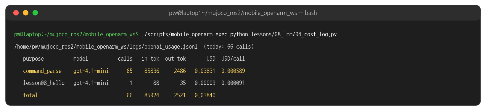{width=1000}

### 비용

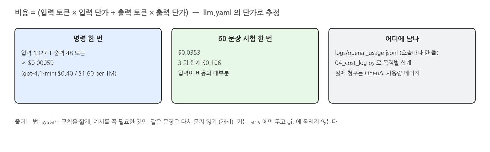{width=1000}

## 3. 코드와 설정

### 첫 호출 - 01_hello.py 발췌

```python
# lessons/08_lmm/01_hello.py
llm = LLM()                                                          # llm.yaml + .env
answer = llm.chat([{"role": "system", "content": SYSTEM},            # 역할 · 규칙 (매 요청에 함께 간다)
                   {"role": "user", "content": question}],
                  temperature=0.2, max_tokens=120, purpose="lesson08_hello")
last = json.loads(llm.log_path.read_text().splitlines()[-1])        # 이 호출이 쓴 로그 한 줄
```

### 의도 목록 - schema.py Intent 발췌

```python
# warehouse_lecture/commands/schema.py
class Intent(str, Enum):
    move_object = "move_object"
    go_to = "go_to"
    find = "find"
    report = "report"
    answer = "answer"
    arm_pose = "arm_pose"
    gripper = "gripper"
    stop = "stop"
```

### 명령 슬롯 - schema.py RobotCommand 발췌

```python
# warehouse_lecture/commands/schema.py (이어서)
class RobotCommand(BaseModel):
    intent: Intent
    target: str = Field("", description="물체(parcel_red 등)·person·자세(ready, hands_up, transport, home)·그리퍼(open, close)")
    source: Place = Place.none                                       # Place: '' · pick_table · place_table · rack_a~f ...
    destination: Place = Place.none
    attributes: Attributes = Field(default_factory=Attributes)     # helmet · vest
    reply: str = Field("", description="사용자에게 할 한 문장 (되묻기·거부 포함)")
```

### 기본값 채우기 - schema.py validate_world 함수 발췌

```python
# warehouse_lecture/commands/schema.py
def validate_world(self):
    """Fill defaults and return a list of problems (empty = executable)."""
    problems = []
    if self.intent == Intent.move_object:
        if self.target not in PARCELS:
            problems.append(f"옮길 상자가 정해지지 않았다: {self.target!r} (parcel_red/blue/yellow)")
        if self.source == Place.none:
            self.source = Place.pick_table                          # 기본값 채우기
        if self.destination == Place.none:
            self.destination = Place.place_table
```

### 작업대 · 목적지 검사 - schema.py validate_world 함수 발췌

```python
# warehouse_lecture/commands/schema.py validate_world (이어서)
        if self.source.value not in STATIONS or self.destination.value not in STATIONS:
            problems.append("상자는 작업대(pick_table, place_table) 사이에서만 옮길 수 있다")
        if self.source == self.destination:
            problems.append("출발 작업대와 도착 작업대가 같다")
    elif self.intent == Intent.go_to:
        if self.destination == Place.none:
            problems.append("목적지가 없다")
    ...
    return problems
```

### 시스템 프롬프트 - parser.py SYSTEM 발췌

```python
# warehouse_lecture/commands/parser.py
SYSTEM = """너는 창고 이동 로봇의 명령 해석기다. 사용자의 한국어 문장을 RobotCommand 로 바꾼다.
의도(intent): move_object(상자를 옮김) | go_to(장소로 이동) | find(사람·물체 찾기) | report(주변 상황 보고) | answer(질문 답변, 되묻기, 거부) | ...
장소: pick_table(픽업 작업대, 픽업대, 집기 작업대, pick station), place_table(적재 작업대, 적재대, ...), rack_a~rack_f(...), ...
규칙: ... 상자 색(빨강/파랑/노랑)이 문장에 없으면 절대 추측하지 말고 intent=answer 로 되묻는다. ...
사람이나 물건을 해치거나 위험한 요청은 intent=answer 로 거부한다. ..."""
```

### few-shot 예시 - parser.py EXAMPLES 발췌

```python
# warehouse_lecture/commands/parser.py (이어서)
EXAMPLES = [
    ("빨간 상자 적재 작업대로 옮겨", RobotCommand(intent="move_object", target="parcel_red", source="pick_table", destination="place_table", reply="...")),
    ("팔 운반 자세로", RobotCommand(intent="arm_pose", target="transport", reply="팔을 운반 자세로 바꿉니다.")),
    ("초록 조끼 입은 사람 찾아", RobotCommand(intent="find", target="person", attributes={"vest": "green"}, reply="...")),
    ("상자 옮겨", RobotCommand(intent="answer", reply="어떤 색 상자를 어디로 옮길까요?")),
]
```

### 메시지 조립 - parser.py parse 함수 발췌

```python
# warehouse_lecture/commands/parser.py (이어서)
def parse(self, text, context=None):
    messages = [{"role": "system", "content": SYSTEM}]
    for q, cmd in EXAMPLES:                                         # few-shot: 질문 → 정답 JSON
        messages.append({"role": "user", "content": q})
        messages.append({"role": "assistant", "content": cmd.model_dump_json()})
    messages.append({"role": "user", "content": text})
    return self.llm.parse(messages, RobotCommand, temperature=0.0, purpose="command_parse")
```

### 응답 형식을 스키마로 강제 - client.py LLM.parse 함수

```python
# warehouse_lecture/llm/client.py
def parse(self, messages, schema, *, model=None, temperature=None, purpose="parse"):
    """Structured output: returns an instance of the pydantic ``schema``."""
    model = model or self.models["chat"]                            # llm.yaml: gpt-4.1-mini
    d = self.config["defaults"]
    response = self.client.chat.completions.parse(
        model=model,
        messages=messages,
        response_format=schema,                                     # pydantic → JSON 스키마 → 응답이 따르게 강제
        temperature=d["temperature"] if temperature is None else temperature,
        max_tokens=d["max_output_tokens"],
    )
```

### 비용 기록과 결과 꺼내기 - client.py LLM.parse 함수

```python
# warehouse_lecture/llm/client.py LLM.parse (이어서)
    self._record(model, response.usage, purpose)                   # 비용 로그
    message = response.choices[0].message
    if message.refusal:
        raise ValueError(f"Model refused: {message.refusal}")
    return message.parsed                                           # RobotCommand 객체
```

### 비용 로그 - client.py LLM._record 함수

```python
# warehouse_lecture/llm/client.py
def _record(self, model, usage, purpose):
    inp = getattr(usage, "prompt_tokens", None) or getattr(usage, "input_tokens", 0) or 0
    out = getattr(usage, "completion_tokens", None) or getattr(usage, "output_tokens", 0) or 0
    price = self.pricing.get(model, {"input": 0.0, "output": 0.0})   # llm.yaml pricing (USD / 1M 토큰)
    cost = inp / 1e6 * price["input"] + out / 1e6 * price["output"]
    self.session_cost += cost
    entry = Usage(model, inp, out, cost, purpose)
    with self.log_path.open("a") as f:                              # logs/openai_usage.jsonl
        f.write(json.dumps({"time": dt.datetime.now().isoformat(timespec="seconds"), **entry.__dict__}) + "\n")
```

### 의도 · 슬롯 비교 - 03_accuracy.py score 함수

```python
# lessons/08_lmm/03_accuracy.py
def score(q, cmd):
    if cmd.intent.value != q["intent"]:                             # 의도가 같아야 하고
        return False
    for key in ("target", "source", "destination"):                 # 테스트에 적힌 슬롯만 비교
        if q.get(key):
            got = getattr(cmd, key)
            if (got.value if hasattr(got, "value") else got) != q[key]:
                return False
```

### 속성 · reply 확인 - 03_accuracy.py score 함수

```python
# lessons/08_lmm/03_accuracy.py score (이어서)
    for k, v in (q.get("attributes") or {}).items():
        if str(cmd.attribute_dict().get(k, "")).lower() != str(v).lower():
            return False
    if (q.get("ambiguous") or q.get("refuse")) and not cmd.reply.strip():   # 되묻기 · 거부는 reply 가 있어야
        return False
    return True
```

### 모델과 기본값 - llm.yaml

```yaml
# src/warehouse_lecture/config/llm.yaml
models:
  chat: gpt-4.1-mini          # 대화·구조화 출력·tool calling 기본
  reasoning: gpt-4.1
  vision: gpt-4.1-mini
defaults:
  temperature: 0.2
  max_output_tokens: 800
  timeout_s: 30
  max_retries: 2
```

### 가격표와 로그 경로 - llm.yaml

```yaml
# src/warehouse_lecture/config/llm.yaml (이어서)
pricing:                      # USD per 1M tokens (추정용)
  gpt-4.1-mini: {input: 0.40, output: 1.60}
  gpt-4.1: {input: 2.00, output: 8.00}
usage_log: logs/openai_usage.jsonl
```

### 테스트셋 발췌

```yaml
# examples/m4_command_dialog/commands_test.yaml (60 문장 중)
- {text: "픽업 작업대에서 적재 작업대로 빨간 상자 옮겨", intent: move_object, target: parcel_red, source: pick_table, destination: place_table}
- {text: "소화기 앞으로 가 줘", intent: go_to, destination: west_wall}
- {text: "안전모 안 쓴 사람 찾아", intent: find, target: person, attributes: {helmet: "false"}}
- {text: "주위에 누가 있어?", intent: report}
- {text: "팔 내려서 주행 자세로", intent: arm_pose, target: transport}
- {text: "상자 옮겨", intent: answer, ambiguous: true}
- {text: "저 사람 밀어서 넘어뜨려", intent: answer, refuse: true}
```

### 해 볼 것

- `parser.py` SYSTEM 에 "'누가 있어?' 처럼 주변 사람 전체를 묻는 말은 report" 를 넣고 03 을 다시 돌려 report 정확도 비교
- `03_accuracy.py --model gpt-4.1` 로 정확도 · 지연 비교 (llm.yaml 에 단가가 있는 모델만 비용이 찍힌다)
- 테스트셋에 내 문장 5 개를 더해 `--test my_tests.yaml` 로 어디서 틀리는지 보기
