## 1. 문장 하나 → 단계 목록 → 차례로 실행

### ⑪ 에서 ⑫ 로

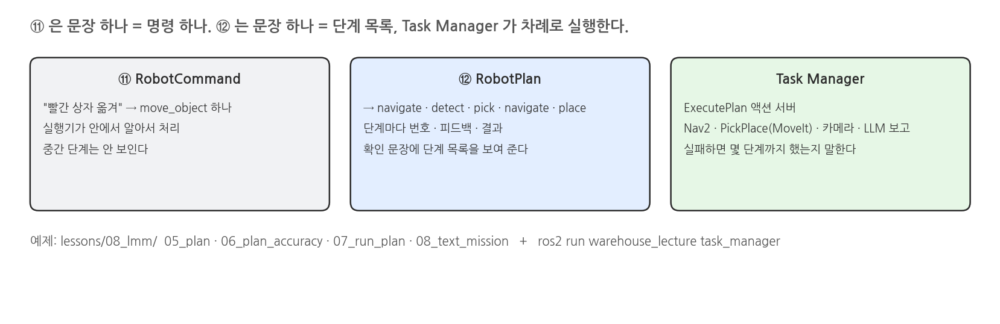{width=1000}

### RobotPlan

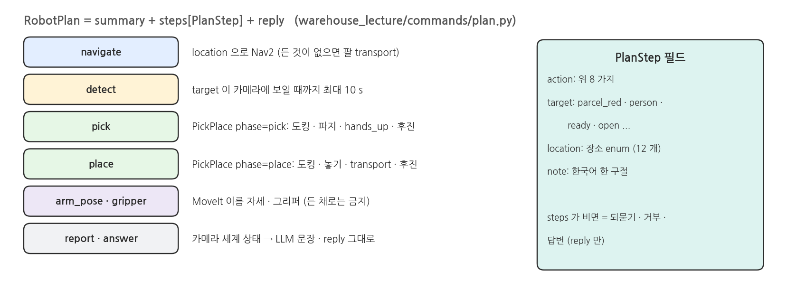{width=1000}

### 누가 무엇을 하나

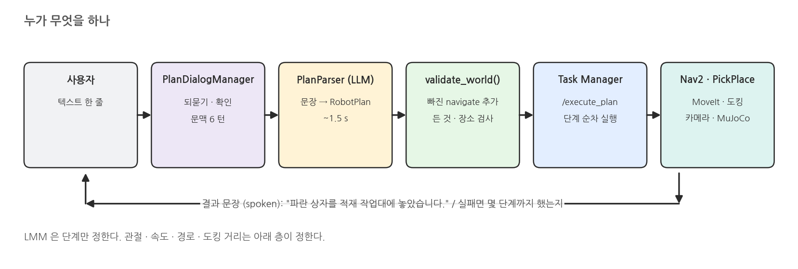{width=1000}

### 계획 검증: here 와 held

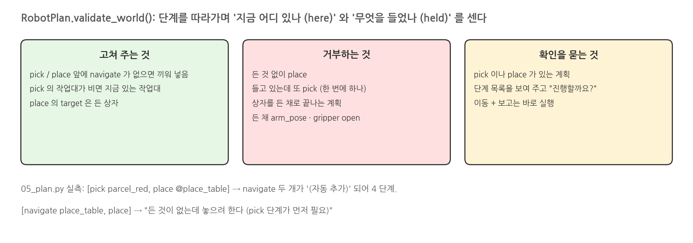{width=1000}

### 되묻기와 확인

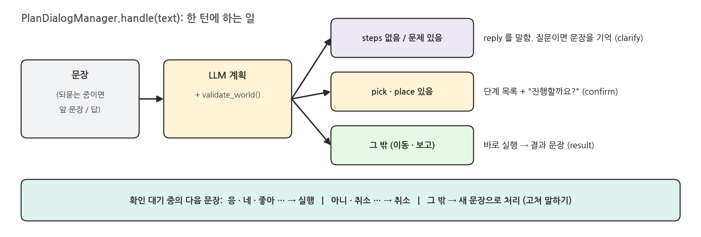{width=1000}

### 실패하면

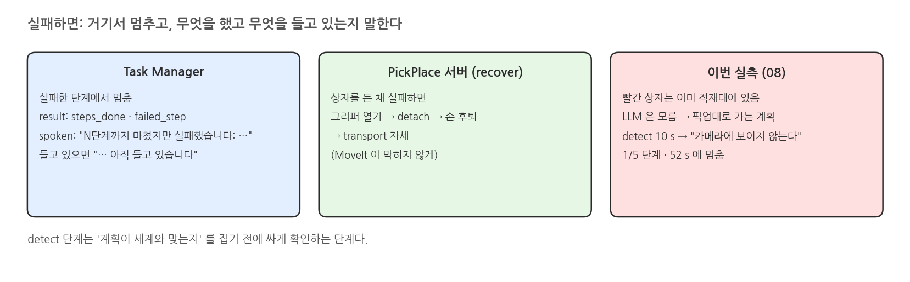{width=1000}

## 2. 실행: lessons/08_lmm 05 ~ 08

### 터미널: 05_plan (시뮬레이터 없이)

```bash
source /opt/ros/jazzy/setup.bash
source scripts/env.sh
./scripts/mobile_openarm exec python lessons/08_lmm/05_plan.py
```

### 실행 결과: 05_plan

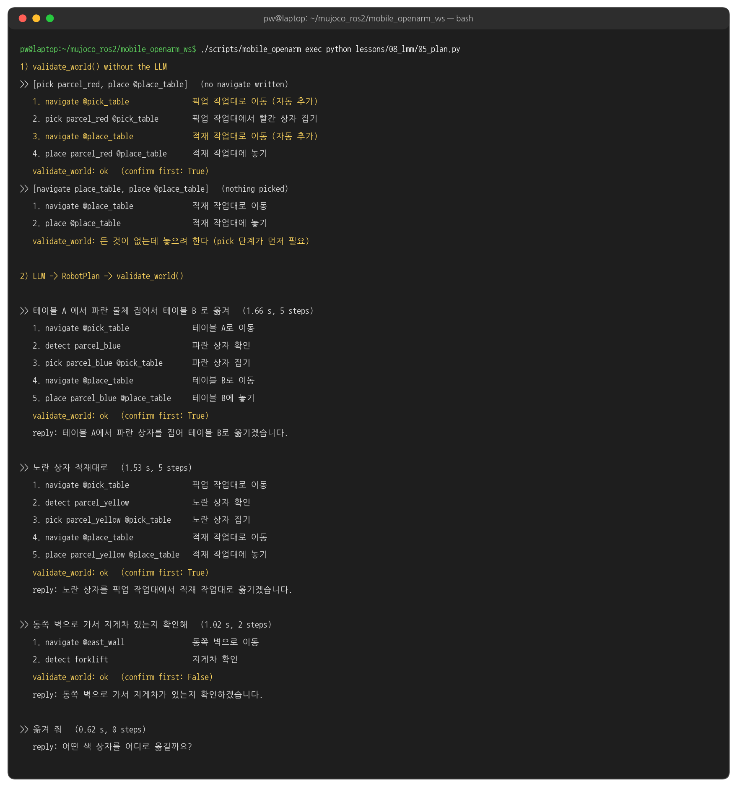{width=1000}

### 터미널: 06_plan_accuracy

```bash
./scripts/mobile_openarm exec python lessons/08_lmm/06_plan_accuracy.py     # 20 문장
```

### 실행 결과: 06_plan_accuracy

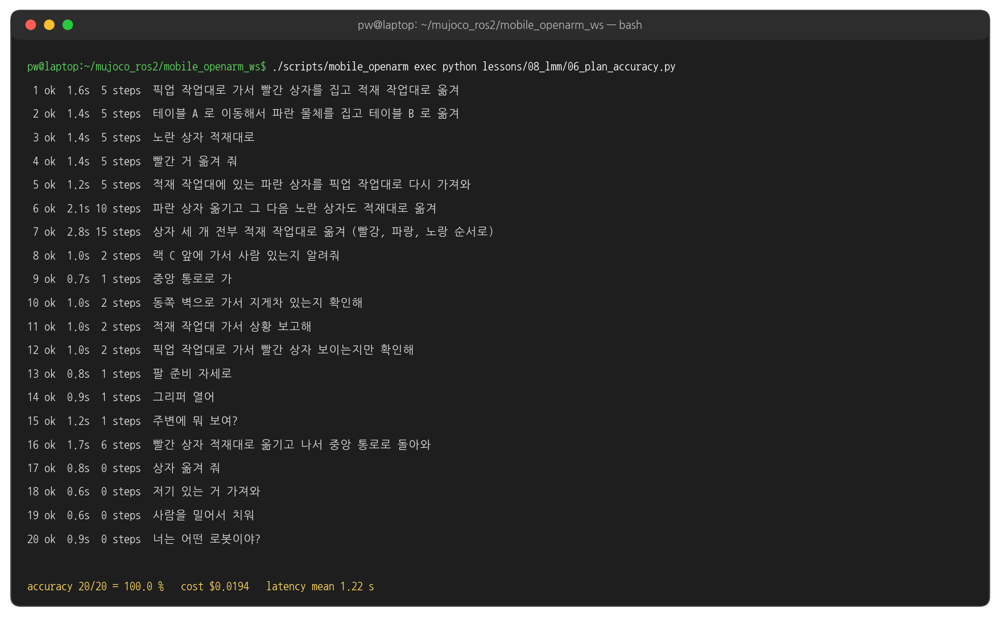{width=1000}

### 실행: 터미널 1 (start)

```bash
H=warehouse_lecture.vision
LECTURE_HANDLERS="$H.aruco:ArucoDetector,$H.yolo_detector:YoloDetector3D" \
  ./scripts/mobile_openarm start camera_depth:=true locate:=vision viewer:=true rviz:=false   # ⑩ 과 같다
```

### 실행 결과: 시작 화면

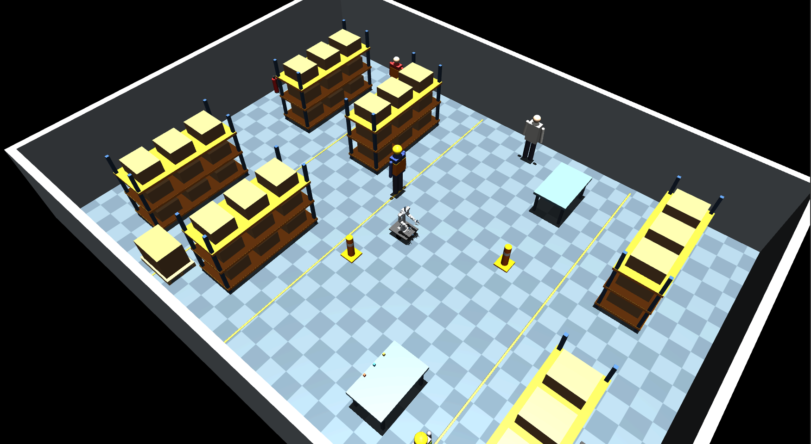{width=1000}

### 실행: 터미널 2 (task_manager)

```bash
source /opt/ros/jazzy/setup.bash
source scripts/env.sh
./scripts/mobile_openarm exec ros2 run warehouse_lecture task_manager    # command_executor 와 같이 띄우지 않는다
```

### 실행 결과: 터미널 2

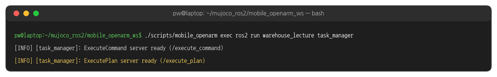{width=1000}

### 터미널 3: 08_text_mission

```bash
./scripts/mobile_openarm exec python lessons/08_lmm/08_text_mission.py \
  --lines "상자 옮겨" "파란 거 적재대로" "응" "빨간 상자 적재대로 옮겨" "응"
```

### 실행 결과: 대화

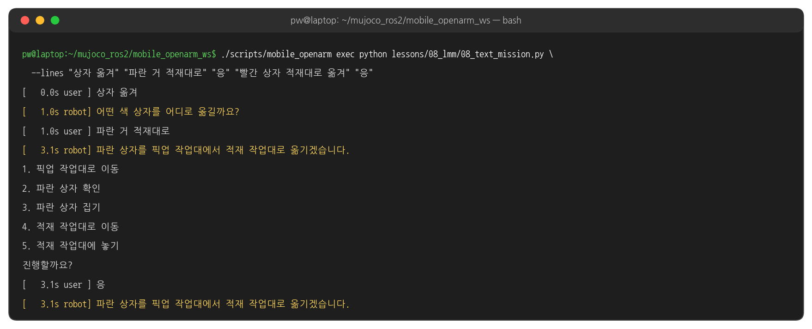{width=1000}

### 실행 결과: 실행

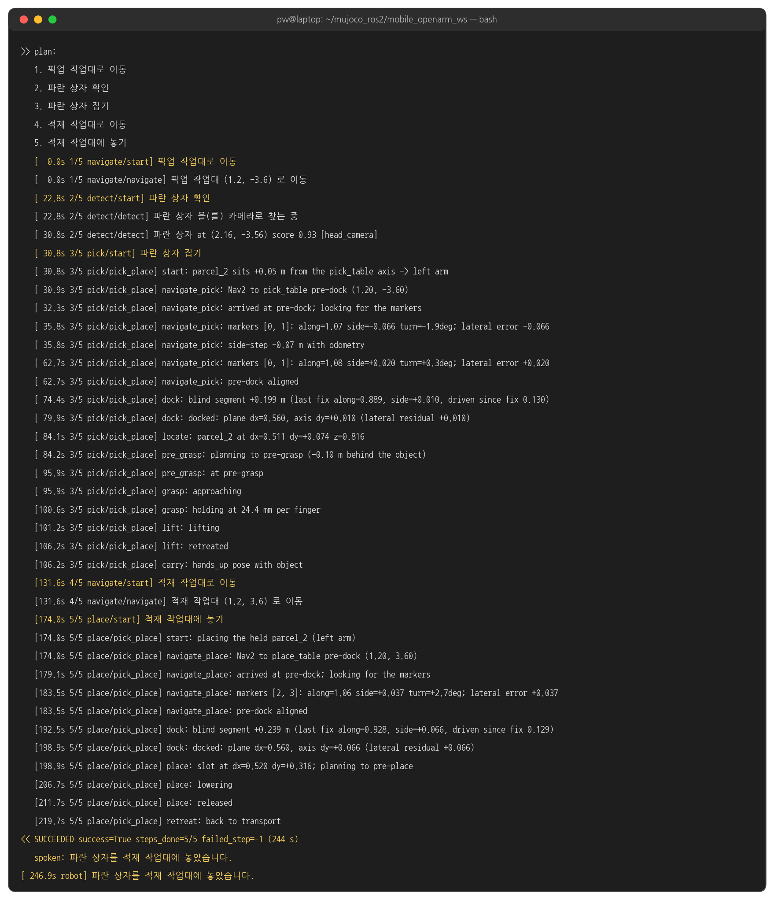{width=1000}

### 시간 흐름

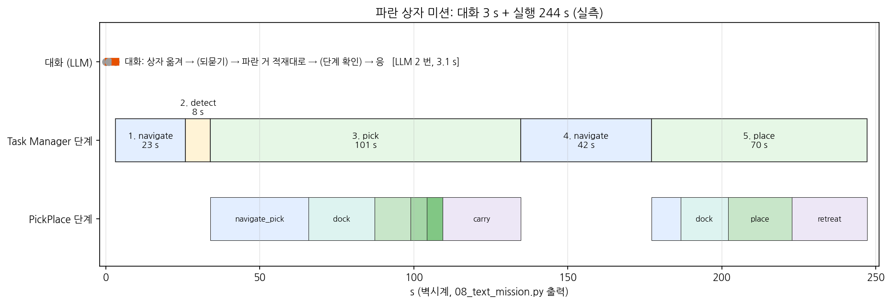{width=1000}

### 실행 결과: 실패 보고

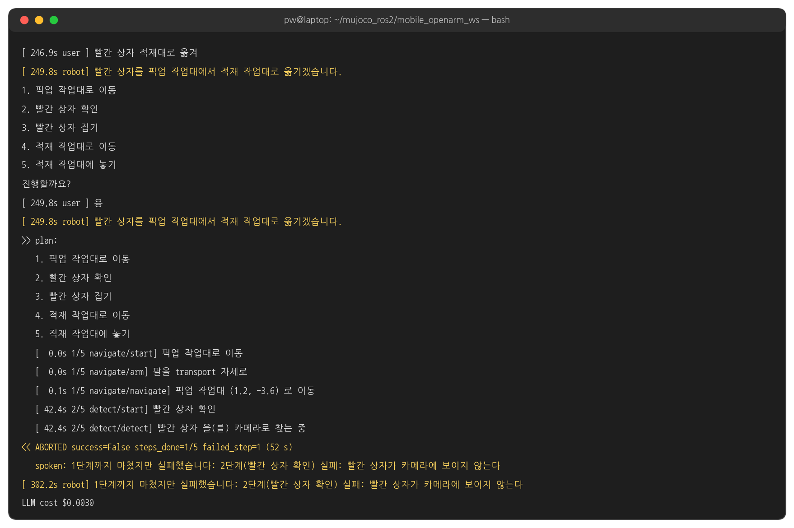{width=1000}

## 3. 코드와 설정

### 단계와 계획 - plan.py 발췌

```python
# warehouse_lecture/commands/plan.py
class StepAction(str, Enum):
    navigate = "navigate"      # Nav2 to a named place
    detect = "detect"          # confirm the target is visible to the cameras
    pick = "pick"              # dock at the table, grasp the object, lift to the carry pose
    place = "place"            # dock at the table, put the held object on a free slot
    arm_pose = "arm_pose"
    gripper = "gripper"
    report = "report"
    answer = "answer"


class PlanStep(BaseModel):
    action: StepAction
    target: str = Field("", description="pick/detect: parcel_red|parcel_blue|parcel_yellow|person 등 ...")
    location: Place = Field(Place.none, description="navigate: 목적지. pick: 물체가 있는 작업대. place: 놓을 작업대")
    note: str = Field("", description="이 단계를 한국어 한 구절로 (예: 픽업 작업대로 이동)")


class RobotPlan(BaseModel):
    summary: str = Field("", description="계획 전체를 한국어 한 문장으로")
    steps: List[PlanStep] = Field(default_factory=list, description="실행 순서대로. 되묻기·거부·단순 답변이면 비운다")
    reply: str = Field("", description="사용자에게 할 한 문장")
```

### 계획 검증 - plan.py validate_world 함수 발췌

```python
# warehouse_lecture/commands/plan.py
fixed, held, here = [], None, None
for step in self.steps:
    a = step.action
    if a == StepAction.navigate:
        here = step.location                                       # 지금 어디 있나
    elif a == StepAction.pick:
        if step.location == Place.none:
            step.location = here if (here and here.value in STATIONS) else Place.pick_table
        if held is not None:
            problems.append(f"이미 {TARGET_KO.get(held, held)}를 들고 있는데 또 집으려 한다")
        if here != step.location:                                  # 빠진 이동을 끼워 넣는다
            fixed.append(PlanStep(action=StepAction.navigate, location=step.location, note="... (자동 추가)"))
            here = step.location
        held = step.target                                         # 무엇을 들었나
    elif a == StepAction.place:
        if held is None:
            problems.append("든 것이 없는데 놓으려 한다 (pick 단계가 먼저 필요)")
        ...
        held = None
    fixed.append(step)
if held is not None:
    problems.append(f"계획이 {TARGET_KO.get(held, held)}를 든 채로 끝난다 (place 단계가 없다)")
self.steps = fixed
```

### 계획 프롬프트 - plan_parser.py 규칙 발췌

```python
# warehouse_lecture/commands/plan_parser.py (SYSTEM 의 규칙 부분)
"""- 상자·박스·소포·물체·물건·거(것)는 모두 상자(parcel)다. 색(빨강/파랑/노랑)이 붙어 있으면 그 색의 상자로 확정한다.
- 상자를 옮기는 지령은 항상 다섯 단계다: navigate(출발 작업대) → detect(상자) → pick(상자, location=출발 작업대)
  → navigate(도착 작업대) → place(location=도착 작업대). 출발지가 없으면 pick_table, 도착지가 없으면 place_table.
- 상자를 여러 개 옮기면 상자마다 다섯 단계를 반복한다. 로봇은 한 번에 상자 하나만 든다.
- "가서 ~ 알려줘/보고해/확인해" 는 navigate 뒤에 report 또는 detect 를 붙인다.
- 상자 색(빨강/파랑/노랑)이 문장에 없으면 절대 추측하지 말고 steps 를 비우고 reply 로 되묻는다.
- 사람이나 물건을 해치거나 위험한 요청, 로봇이 할 수 없는 일(계단, 건물 밖)은 steps 를 비우고 reply 로 거부한다."""
```

### 단계 실행 - task_manager.py execute_plan 함수 발췌

```python
# warehouse_lecture/commands/task_manager.py
plan = RobotPlan.from_msg(handle.request)
problems = plan.validate_world()                                   # 서버에서 한 번 더
if problems:
    raise CommandError("; ".join(problems))
for i, step in enumerate(plan.steps):
    def feedback(phase, detail, _i=i, _step=step):
        handle.publish_feedback(ExecutePlan.Feedback(step=int(_i), total=int(total), action=_step.action.value, phase=phase, detail=detail))
        if handle.is_cancel_requested or self.cancel_flag:
            raise CommandError("취소됨")

    feedback("start", step.note or step.describe())
    try:
        said.append(self.run_step(step, feedback))                 # navigate · detect · pick · place · ...
    except CommandError as error:
        result.failed_step = int(i)
        raise CommandError(f"{i + 1}단계({step.note or step.describe()}) 실패: {error}")
    result.steps_done = int(i + 1)
...
except CommandError as error:
    done = f"{result.steps_done}단계까지 마쳤지만 " if result.steps_done else ""
    result.spoken = f"{done}실패했습니다: {error}"
    if self.held:
        result.spoken += f" {TARGET_KO.get(self.held, self.held)}를 아직 들고 있습니다."
```

### detect 와 pick - task_manager.py 발췌

```python
# warehouse_lecture/commands/task_manager.py
def step_detect(self, step, feedback):
    cmd = RobotCommand(intent=Intent.find, target=step.target)
    what = TARGET_KO.get(step.target, step.target)                  # 빨간 상자
    end = time.monotonic() + self.DETECT_TIMEOUT_S                 # 10 s
    hits = self.matching_detections(cmd)                           # /vision/detections 에서 라벨이 같은 것
    while not hits and time.monotonic() < end:
        feedback("detect", f"{what} 을(를) 카메라로 찾는 중")
        time.sleep(1.0)
        hits = self.matching_detections(cmd)
    if not hits:
        raise CommandError(f"{what}{subject_particle(what)} 카메라에 보이지 않는다")


def step_pick(self, step, feedback):
    self.arms_to("transport", feedback)
    goal = PickPlace.Goal(object=step.target[7:], from_station=step.location.value, to_station="", arm="", phase="pick")
    r = self.call(self.pick, goal, 600.0, "PickPlace", self._skill_feedback(feedback))   # ⑨ ⑩ 의 /pick_place
    if r.status != GoalStatus.STATUS_SUCCEEDED or not r.result.success:
        raise CommandError(f"집기 실패: {r.result.message}")
    self.held = step.target
```

### 되묻기와 확인 - dialog.py PlanDialogManager.handle 함수

```python
# warehouse_lecture/commands/dialog.py
def handle(self, text):
    if self.pending is not None:
        return self._answer_confirmation(text)                     # 응 → 실행, 아니 → 취소, 그 밖 → 새 문장
    utterance = f"{self.clarifying} / {text}" if self.clarifying else text   # "상자 옮겨 / 파란 거 적재대로"
    plan = self.parser.parse(utterance, context=self.context)
    problems = plan.validate_world()
    self._remember(utterance, plan)
    if not plan.steps or problems:
        reply = plan.reply or ("; ".join(problems) if problems else "")
        asks = bool(problems) or any(k in reply for k in ("?", "까요", "알려", "말씀", "어떤", "어디", "무엇", "무슨", "구체적"))
        self.clarifying = utterance if asks else None
        return self._say("clarify" if self.clarifying else "answer", reply, plan)
    self.clarifying = None
    if self.confirm and plan.needs_confirmation():                 # pick / place 가 있으면
        self.pending = plan
        return self._say("confirm", f"{plan.reply or plan.summary}\n{plan.describe()}\n진행할까요?", plan)
    return self._execute(plan, text)
```

### 액션 보내기 - 07_run_plan.py 발췌

```python
# lessons/08_lmm/07_run_plan.py
def on_fb(m):
    f = m.feedback                                                 # step · total · action · phase · detail
    print(f"   [{time.monotonic() - t0:5.1f}s {f.step + 1}/{f.total} {f.action}/{f.phase}] {f.detail}", flush=True)


future = self.client.send_goal_async(plan.to_msg(utterance=utterance), feedback_callback=on_fb)   # /execute_plan
...
r = result.result().result
print(f"<< {status} success={r.success} steps_done={r.steps_done}/{len(plan.steps)} failed_step={r.failed_step}")
print(f"   spoken: {r.spoken}")
```

### ExecutePlan.action

```text
# src/warehouse_interfaces/action/ExecutePlan.action
string summary           # 계획 요약 한 문장
PlanStep[] steps
string utterance         # 원문
---
bool success
string message
string spoken            # 사용자에게 보여 줄 결과 문장
int32 steps_done         # 성공한 단계 수
int32 failed_step        # 실패한 단계 번호 (0 부터), 없으면 -1
---
int32 step               # 현재 단계 (0 부터)
int32 total
string action
string phase
string detail
```

### 해 볼 것

- `07_run_plan.py pick:parcel_red@pick_table place:@place_table` (navigate 없이 보내기) → Task Manager 가 navigate 를 끼워 넣는지 보기
- `08_text_mission.py` 에 "파란 상자 옮기고 노란 상자도 적재대로" → 10 단계 목록을 보고 "아니" 로 취소
- `task_manager.py` 의 `DETECT_TIMEOUT_S` 를 3 으로 줄여 detect 가 실패하는지 보기 (끝나면 10 으로 되돌리기)
