## 1. 브라우저에서 작업 지령

### ⑫ 에서 ⑬ 으로

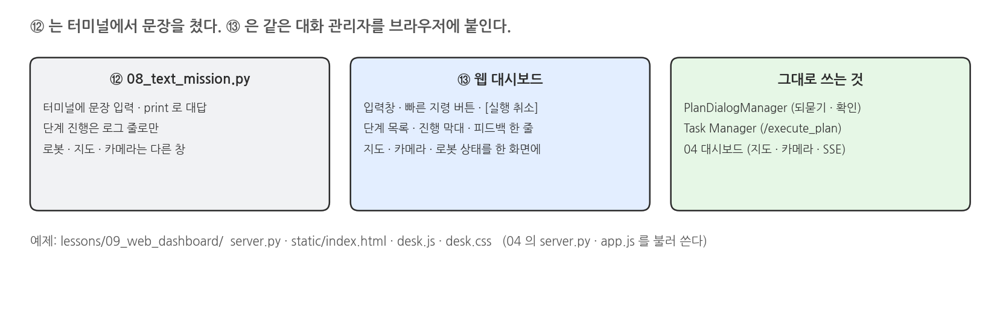{width=1000}

### 화면 구성

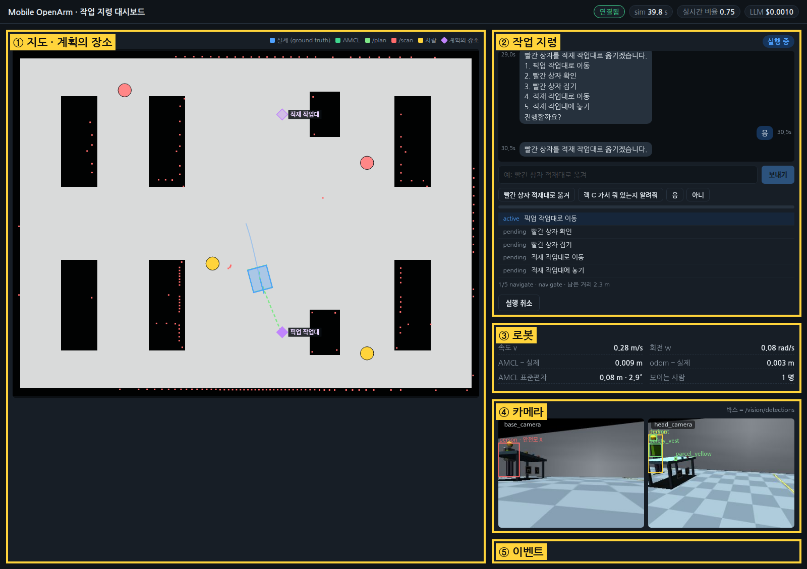{width=1000}

### 통신 구조

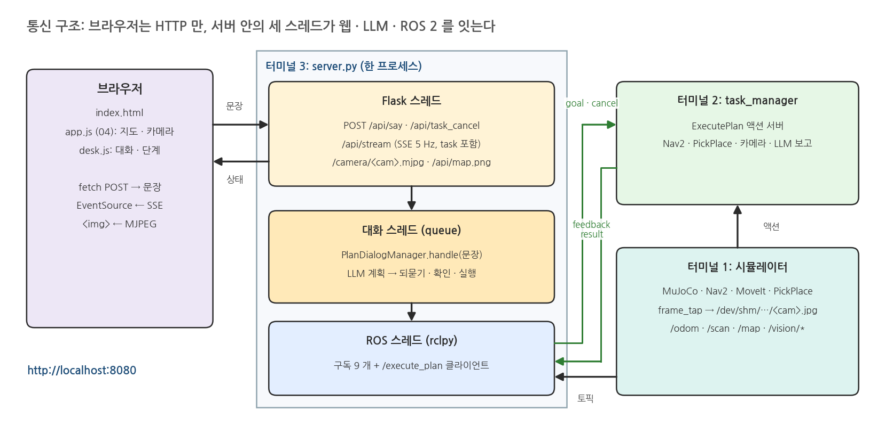{width=1000}

- 브라우저는 ROS 를 모른다: 문장은 HTTP POST, 상태는 SSE 한 줄기, 카메라는 MJPEG
- 지도 · 카메라 · SSE 는 04 대시보드 코드를 그대로 불러 쓰고, 작업 지령 부분만 더한다

### 지령 한 건의 흐름

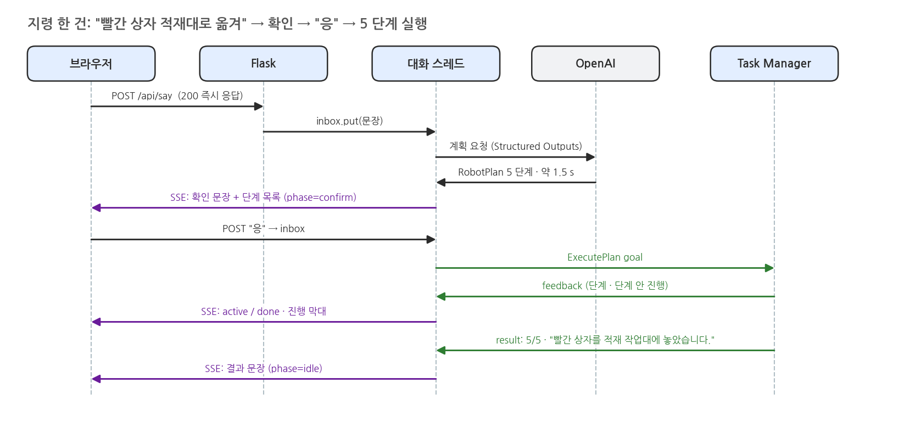{width=1000}

### 작업 지령 패널의 상태

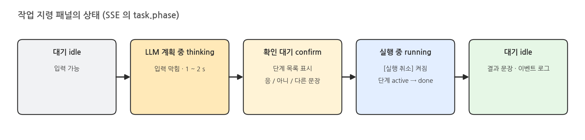{width=1000}

### 실행 취소

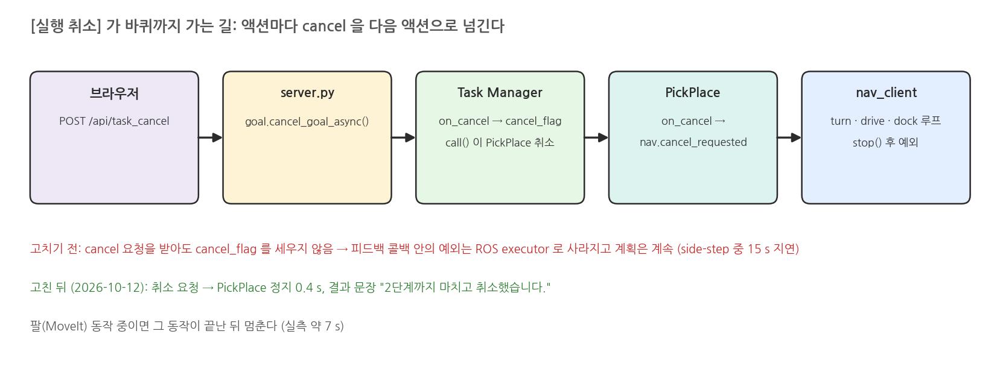{width=1000}

## 2. 실행

### 터미널 1: 시뮬레이터

```bash
H=warehouse_lecture.vision
LECTURE_HANDLERS="$H.aruco:ArucoDetector,$H.yolo_detector:YoloDetector3D" \
  ./scripts/mobile_openarm start camera_depth:=true locate:=vision rviz:=false \
  camera_handler:=lessons/04_navigation/dashboard/frame_tap.py:DashboardPipeline
```

### 실행 결과: 터미널 1

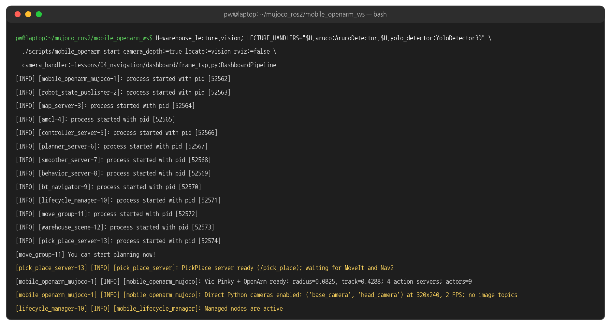{width=1000}

### 터미널 2: Task Manager

```bash
./scripts/mobile_openarm exec ros2 run warehouse_lecture task_manager
```

### 실행 결과: 터미널 2

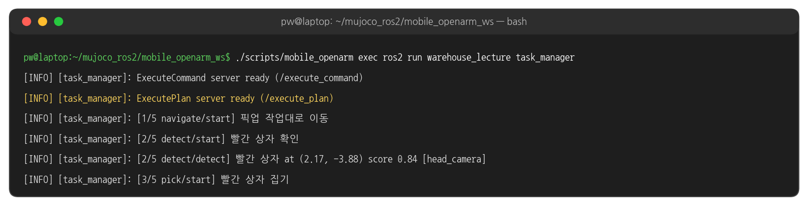{width=1000}

### 터미널 3: 대시보드 서버

```bash
./scripts/mobile_openarm exec python lessons/09_web_dashboard/server.py
# 브라우저에서 http://localhost:8080
```

### 실행 결과: 터미널 3

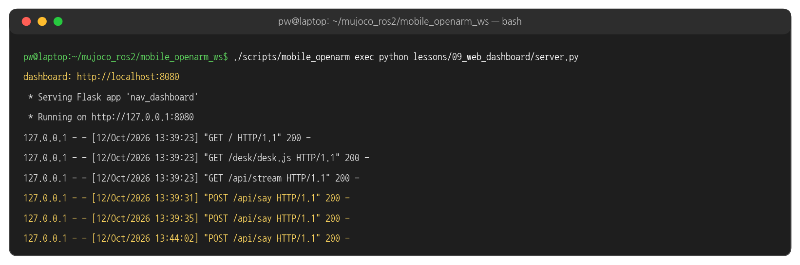{width=1000}

### 실행 결과: 지령 입력 → LLM 계획 중

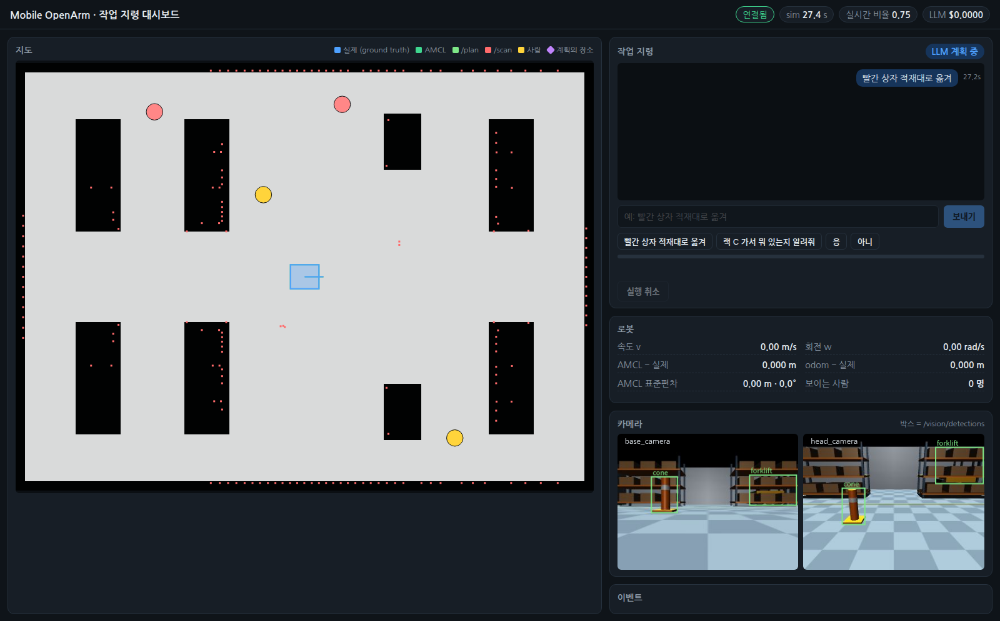{width=1000}

### 실행 결과: 확인 질문 → 응

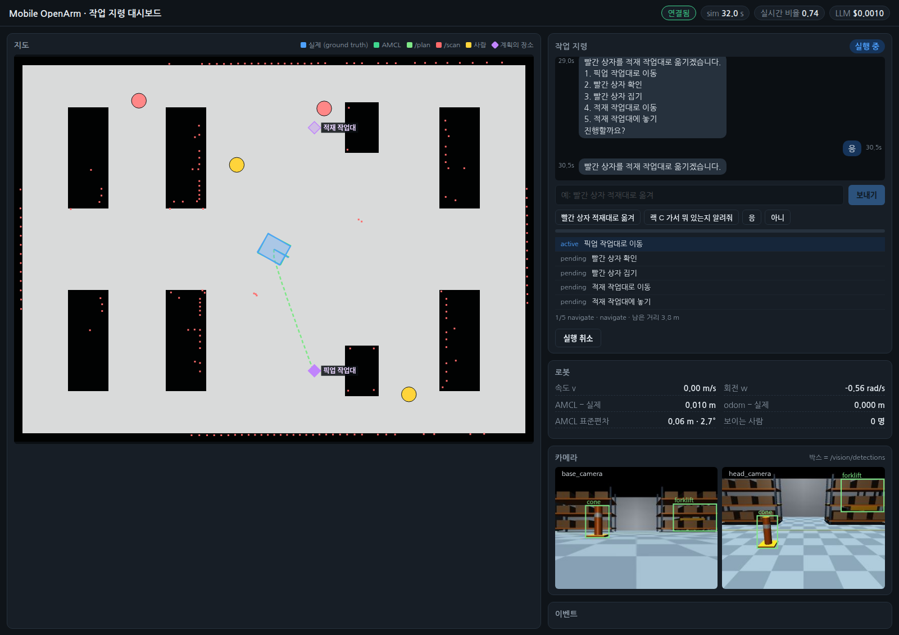{width=1000}

### 실행 결과: 이동

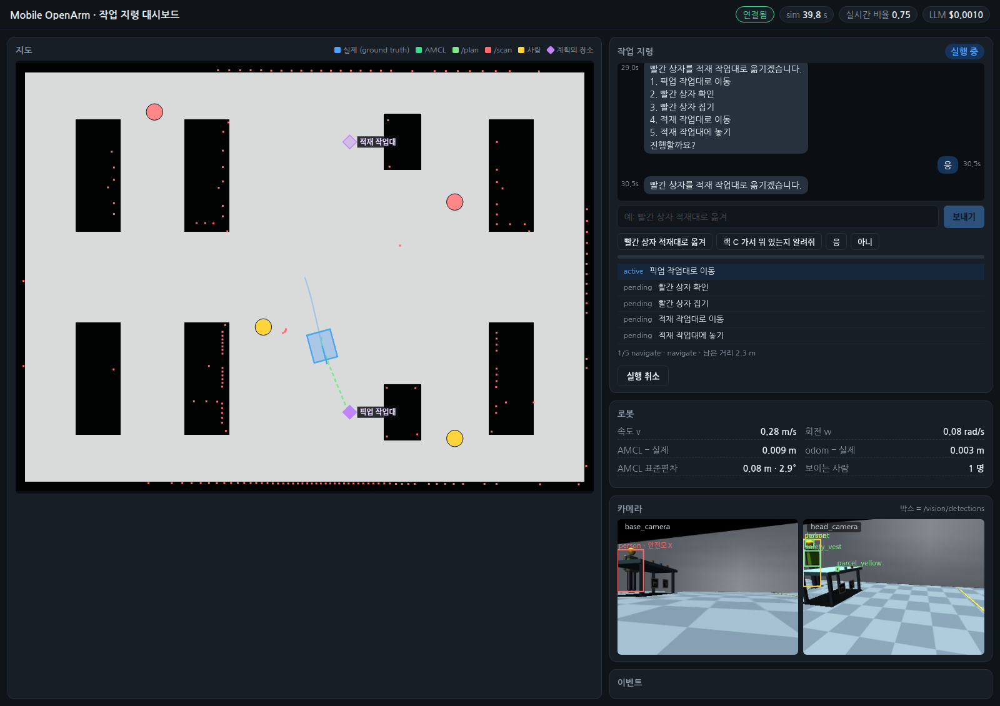{width=1000}

### 실행 결과: 도킹 · 집기

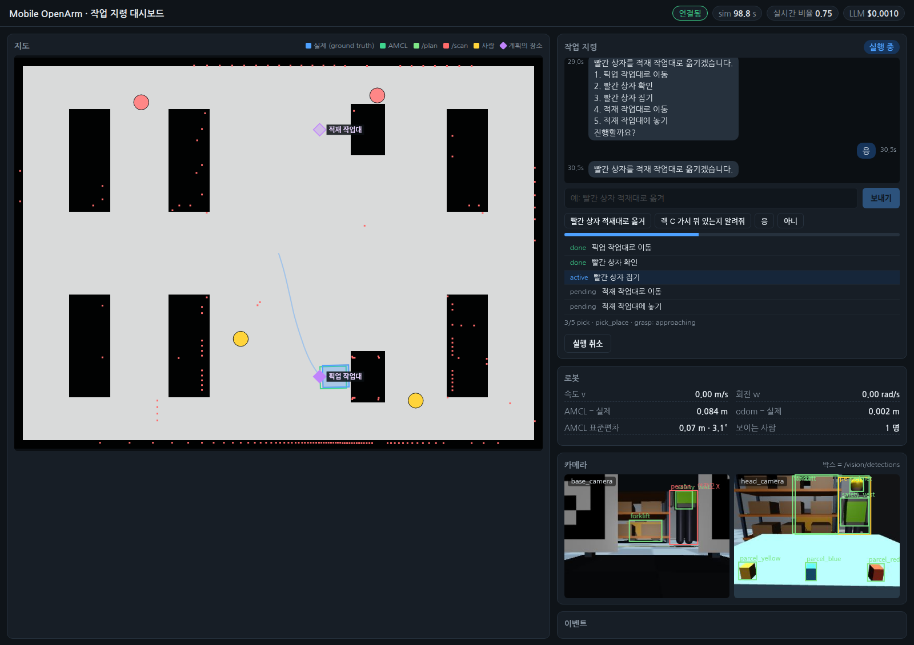{width=1000}

### 실행 결과: 운반

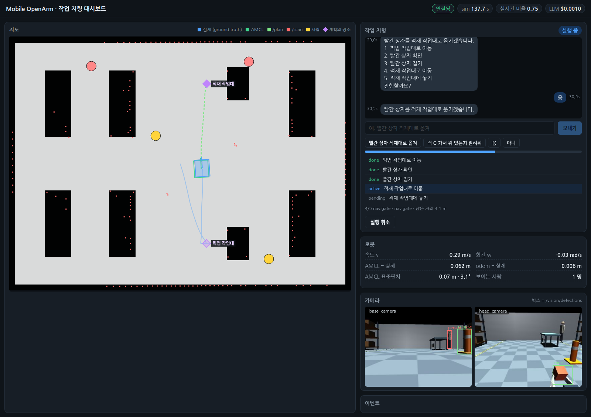{width=1000}

### 실행 결과: 완료

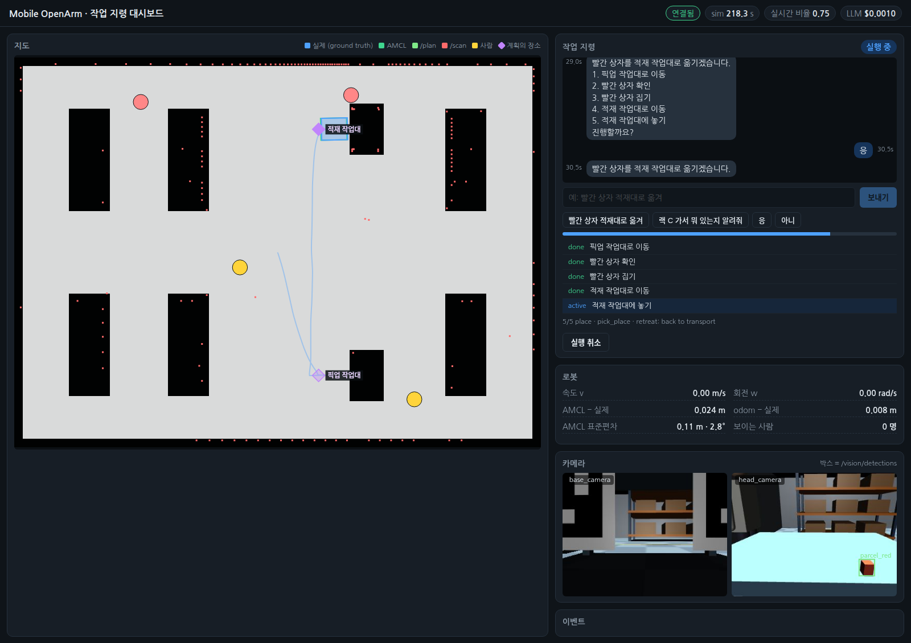{width=1000}

### 시간 흐름

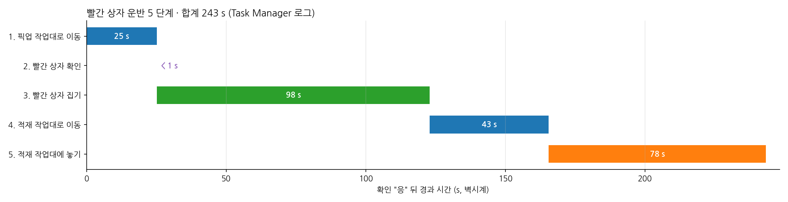{width=1000}

### 실행 결과: 확인 없이 바로 실행 (보고)

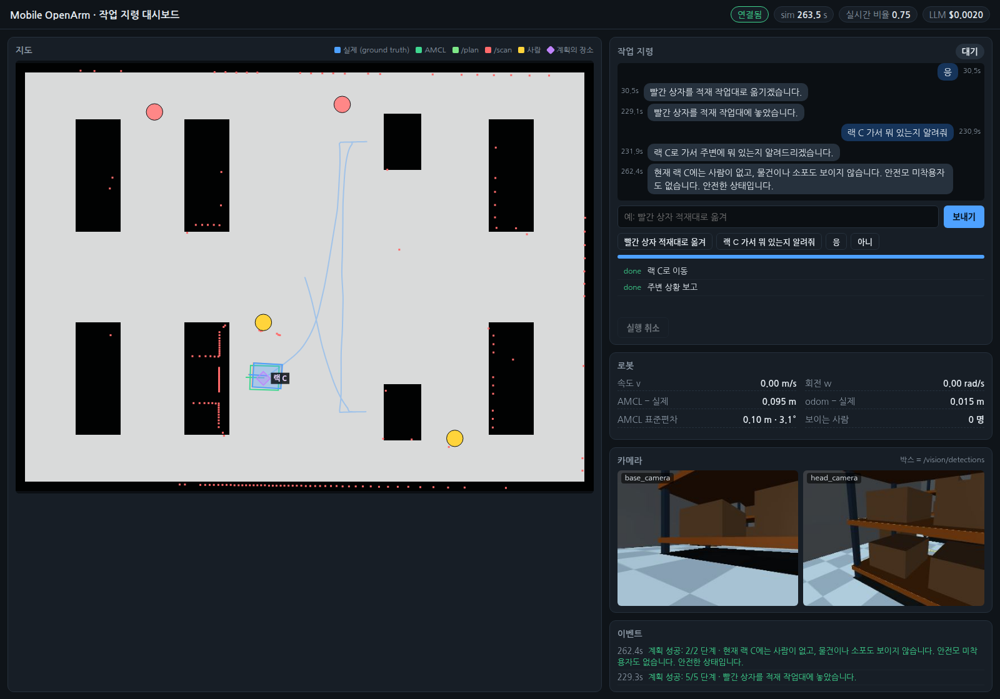{width=1000}

### 실행 결과: 되묻기

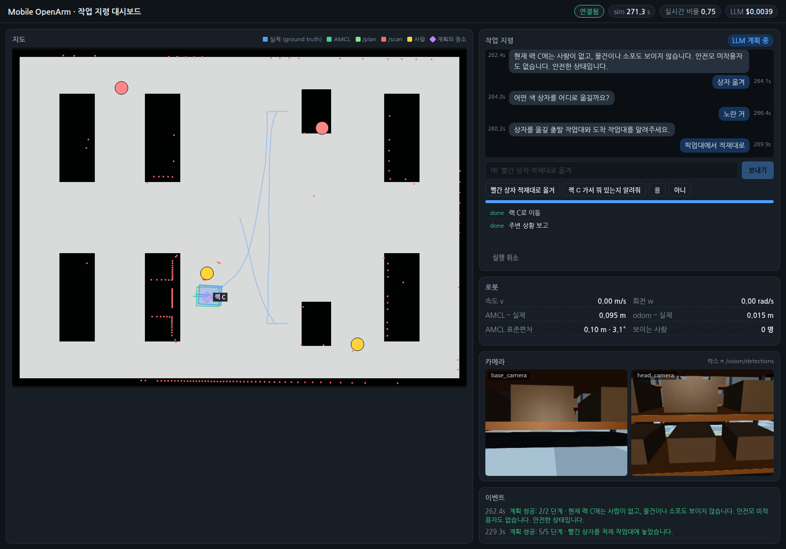{width=1000}

### 실행 결과: 실행 취소

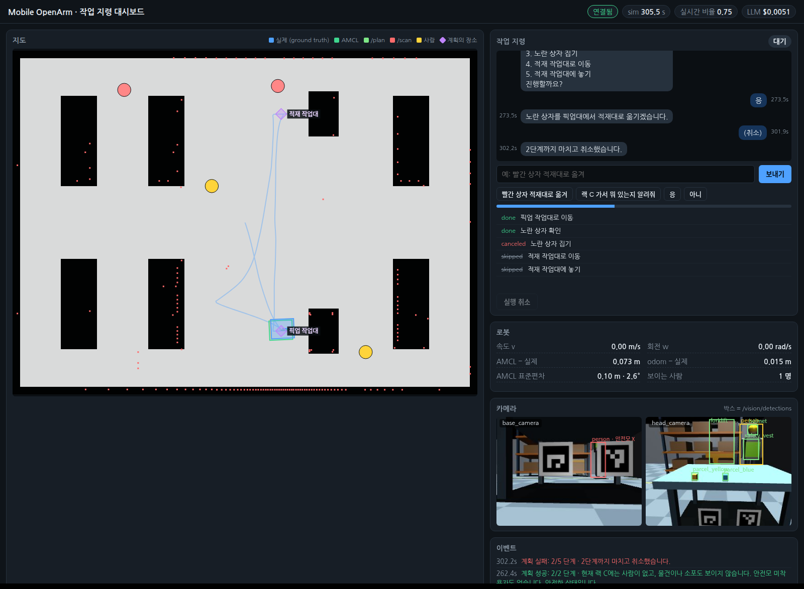{width=1000}

## 3. 코드

### 04 대시보드 불러오기 - server.py 앞부분

```python
# lessons/09_web_dashboard/server.py
HERE = Path(__file__).parent
spec = importlib.util.spec_from_file_location("nav_dashboard", HERE.parent / "04_navigation/dashboard/server.py")
nav_dashboard = importlib.util.module_from_spec(spec)
spec.loader.exec_module(nav_dashboard)          # RobotState (구독 9 개) · make_app (SSE · 지도 · MJPEG)
```

### 작업 지령 상태 - DeskState.__init__ 발췌

```python
# server.py
class DeskState(nav_dashboard.RobotState):
    def __init__(self):
        super().__init__()
        self.plan_client = ActionClient(self, ExecutePlan, "/execute_plan")
        self.task = dict(phase="idle", chat=[], steps=[], feedback=None, result=None, cost=0.0)
        self.goal = None                       # 실행 중인 계획의 goal handle
        self.inbox = queue.Queue()             # 사용자 문장, 하나씩 처리
        self.llm = LLM()
        self.dialog = PlanDialogManager(PlanParser(self.llm), executor=self.execute, speak=self.speak)
        threading.Thread(target=self.work, daemon=True).start()
```

### 로봇의 대답 - DeskState.speak

```python
# server.py
def speak(self, text):
    """PlanDialogManager 의 대답 (되묻기 · 확인 · 결과) 을 로봇 대화 한 줄로."""
    self.chat("robot", text)
    if self.dialog.pending is not None:                  # 확인을 기다리는 계획이 있으면
        self.set_task(phase="confirm", steps=self.step_rows(self.dialog.pending))
```

### 대화 스레드 - DeskState.work

```python
# server.py
def work(self):
    while True:
        text = self.inbox.get()
        self.set_task(phase="thinking")
        try:
            self.dialog.handle(text)                     # LLM 계획 → 되묻기 / 확인 / 실행 (실행이면 끝날 때까지)
        except Exception as e:                           # API 키 · 네트워크 · Task Manager 없음 …
            self.chat("robot", f"오류: {e}")
        ...                                              # 비용 갱신, phase 를 idle 로
```

### 계획 보내기 - DeskState.execute 발췌

```python
# server.py
def execute(self, plan, text):
    self.set_task(phase="running", steps=self.step_rows(plan), feedback=None, result=None)
    done = threading.Event()
    box = {}
    ...
    self.plan_client.send_goal_async(plan.to_msg(utterance=text),
                                     feedback_callback=on_feedback).add_done_callback(on_goal)
    done.wait()                                          # 콜백은 ROS 스레드가 돌린다
```

### 피드백 · 결과 콜백 - DeskState.execute 발췌

```python
# server.py execute (이어서)
def on_feedback(m):
    f = m.feedback
    with self.lock:
        for i, row in enumerate(self.task["steps"]):
            row["status"] = "done" if i < f.step else "active" if i == f.step else "pending"
        self.task["feedback"] = dict(step=f.step, total=f.total, action=f.action, phase=f.phase, detail=f.detail)

def on_result(future):
    box["result"] = future.result().result
    done.set()
```

### 단계 상태 정리 - DeskState.execute 발췌

```python
# server.py execute (이어서)
r = box["result"]
with self.lock:
    for i, row in enumerate(self.task["steps"]):
        if i < r.steps_done:
            row["status"] = "done"
        elif i == r.failed_step:
            row["status"] = "canceled" if self.cancelled else "failed"
        else:
            row["status"] = "skipped"
    self.task["result"] = dict(success=r.success, steps_done=r.steps_done, failed_step=r.failed_step, spoken=r.spoken)
```

### SSE 에 task 싣기 - DeskState.snapshot

```python
# server.py
def snapshot(self):
    s = super().snapshot()                               # 04 의 로봇 상태 (위치 · 스캔 · 검출 …)
    with self.lock:
        s["task"] = dict(self.task, chat=list(self.task["chat"]), steps=[dict(r) for r in self.task["steps"]])
    return s
```

### 지령 받기 - make_app /api/say

```python
# server.py make_app
@app.post("/api/say")
def api_say():
    text = ((request.get_json(silent=True) or {}).get("text") or "").strip()
    if not text:
        return jsonify(ok=False, error="빈 문장"), 400
    if state.task["phase"] in ("thinking", "running"):
        return jsonify(ok=False, error="로봇이 아직 이전 지령을 처리하는 중입니다"), 409
    state.chat("user", text)
    state.inbox.put(text)                                # 바로 응답, 처리는 대화 스레드
    return jsonify(ok=True)
```

### 실행 취소 - make_app /api/task_cancel

```python
# server.py make_app
@app.post("/api/task_cancel")
def api_task_cancel():
    goal = state.goal
    if goal is None:
        return jsonify(ok=False, error="실행 중인 계획 없음"), 409
    state.cancelled = True
    goal.cancel_goal_async()
    state.chat("user", "(취소)")
    return jsonify(ok=True)
```

### 브라우저: 문장 보내기 - desk.js

```javascript
// lessons/09_web_dashboard/static/desk.js
async function say(text) {
  text = text.trim();
  if (!text) return;
  const r = await fetch("/api/say", { method: "POST", headers: { "Content-Type": "application/json" }, body: JSON.stringify({ text }) });
  if (!r.ok) log(`지령 거부: ${(await r.json()).error}`, "bad");
}
$("say").onsubmit = (e) => { e.preventDefault(); say($("text").value); $("text").value = ""; };
$("quick").onclick = (e) => { if (e.target.tagName === "BUTTON") say(e.target.textContent); };
$("task-cancel").onclick = () => fetch("/api/task_cancel", { method: "POST" });
```

### 브라우저: 같은 SSE 에 올라타기 - desk.js 발췌

```javascript
// desk.js: 04 의 app.js 가 만든 es (EventSource) 와 S (최신 상태) 를 그대로 쓴다
es.addEventListener("message", renderTask);
function renderTask() {
  const t = S && S.task;
  if (!t) return;
  $("phase").textContent = PHASE_KO[t.phase] || t.phase;
  const busy = t.phase === "thinking" || t.phase === "running";
  $("send").disabled = busy; $("text").disabled = busy;
  $("task-cancel").disabled = t.phase !== "running";
  ...                                                    // 대화 줄 추가 · 단계 목록 · 진행 막대
}
```

### 브라우저: 지도에 계획의 장소 - desk.js 발췌

```javascript
// desk.js: 04 의 drawMap 을 감싸서 마름모를 덧그린다
const baseDrawMap = drawMap;
drawMap = function () {
  baseDrawMap();
  const t = S && S.task;
  if (!t || !mapImg || !t.steps.length) return;
  ...                                                    // app.js 와 같은 map → canvas 변환 P(x, y)
  t.steps.forEach((st) => {
    ...                                                  // st.goal (base_goal) 에 마름모 + 장소 이름 (어두운 배경 위 글자)
  });
};
```

### 취소를 하위 액션으로 - executor.py on_cancel · call 발췌

```python
# warehouse_lecture/commands/executor.py
def on_cancel(self, _request):
    self.cancel_flag = True                    # call() 이 이 값을 보고 하위 액션(PickPlace · Nav2)을 취소
    return CancelResponse.ACCEPT

def relay(msg):                                # call() 안: 피드백 콜백은 ROS 스레드에서 돈다
    try:
        on_feedback(msg)
    except CommandError:                       # 여기서 던진 "취소됨" 은 executor 로 사라졌다
        self.cancel_flag = True
```

### 스킬 쪽 취소 - pick_place_server.py · nav_client.py 발췌

```python
# warehouse_skills/pick_place_server.py
def on_cancel(self, _request):
    self.nav.cancel_requested = True           # dock · turn · drive · Nav2 대기 루프가 바로 멈춘다
    return CancelResponse.ACCEPT

# warehouse_skills/nav_client.py turn (drive 도 같은 모양)
while self.now() < deadline and time.monotonic() < guard:
    if self.cancel_requested:
        self.stop()
        raise SkillError("turn cancelled")
```

### 해 볼 것

- 빠른 지령 버튼(`static/index.html` 의 `.quick`)에 "파란 상자 적재대로 옮겨" 추가
- 실행 중 [실행 취소] → 단계 목록의 canceled · skipped 와 결과 문장 확인 → 같은 지령을 다시 보내 끝까지 가는지 확인
- `server.py --host 0.0.0.0` 으로 띄우고 같은 네트워크의 휴대폰에서 지령 보내기
