## 1. Final Mission: 문장 하나로 창고 운반 끝까지

### 전체 파이프라인

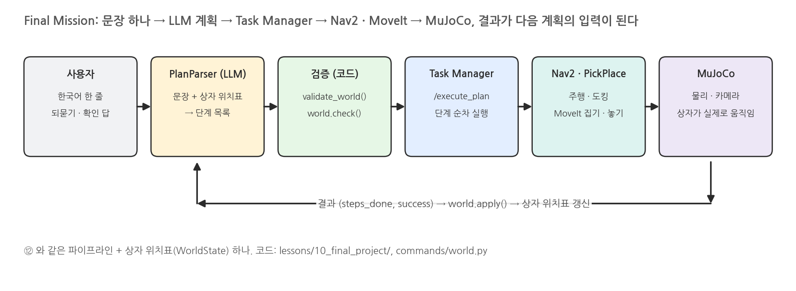{width=1000}

### 왜 상자 위치표가 필요한가

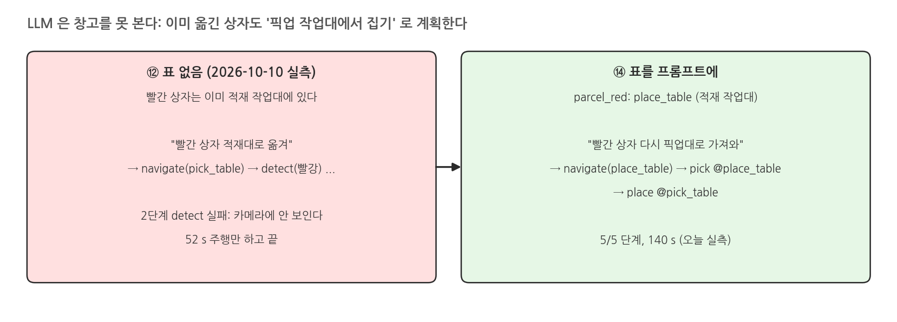{width=1000}

### WorldState: 표 · 검사 · 갱신

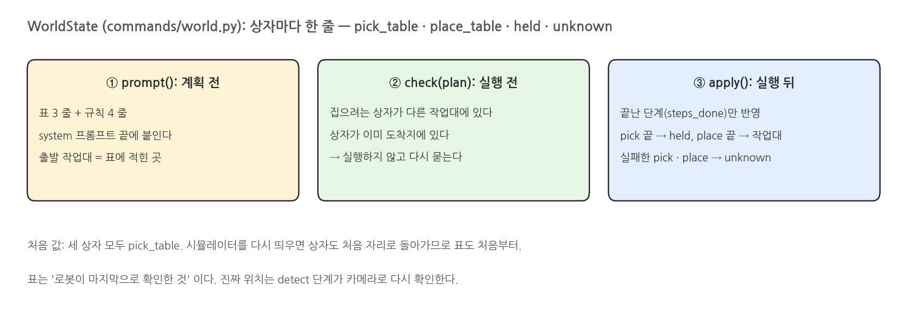{width=1000}

### LLM 은 의도, 코드는 사실

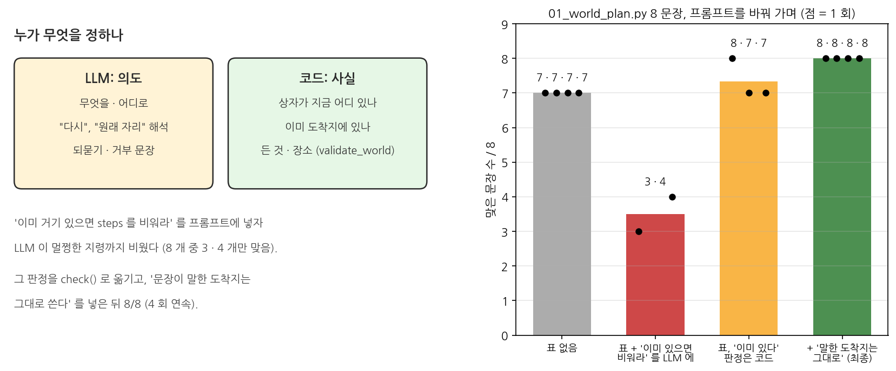{width=1000}

### 시나리오 3 개

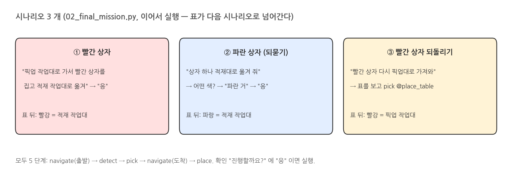{width=1000}

## 2. 실행: lessons/10_final_project

### 터미널: 01_world_plan (시뮬레이터 없이)

```bash
./scripts/mobile_openarm exec python lessons/10_final_project/01_world_plan.py
```

### 실행 결과: 01_world_plan

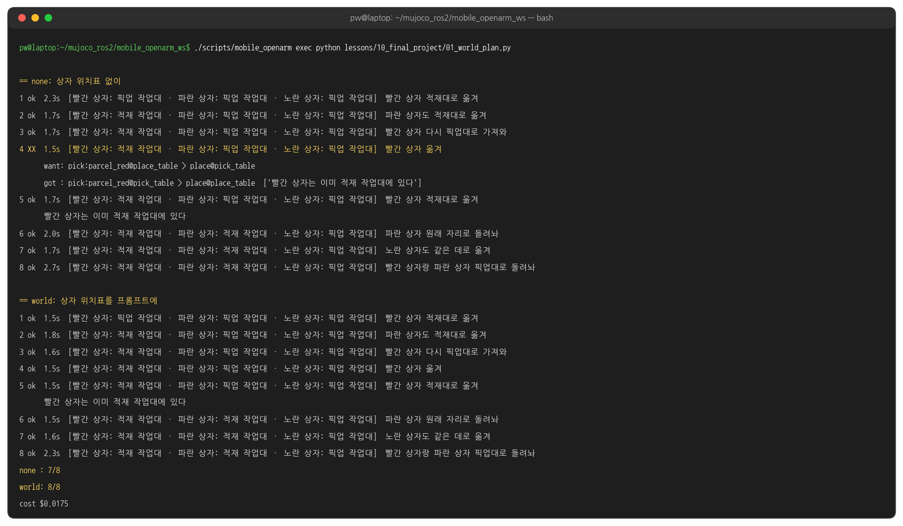{width=1000}

### 실행: 터미널 1 (start)

```bash
H=warehouse_lecture.vision
LECTURE_HANDLERS="$H.aruco:ArucoDetector,$H.yolo_detector:YoloDetector3D" \
  ./scripts/mobile_openarm start camera_depth:=true locate:=vision rviz:=false   # ⑫ 와 같다
```

### 실행 결과: 시작 화면

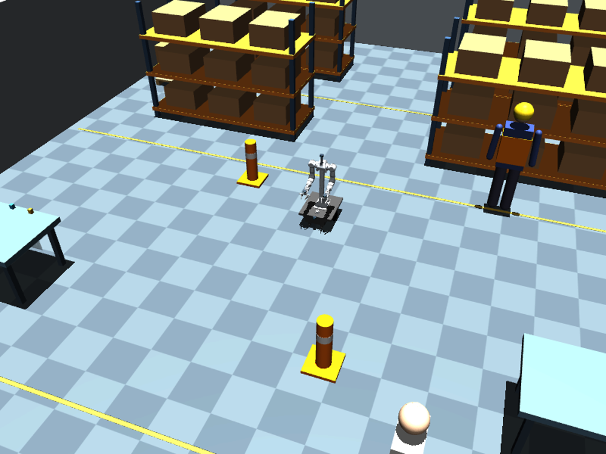{width=1000}

### 실행: 터미널 2 (task_manager)

```bash
./scripts/mobile_openarm exec ros2 run warehouse_lecture task_manager
```

### 실행 결과: 터미널 2

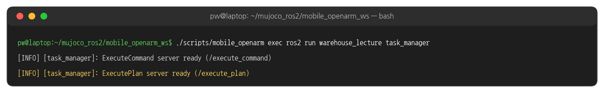{width=1000}

### 터미널 3: 02_final_mission

```bash
./scripts/mobile_openarm exec python lessons/10_final_project/02_final_mission.py               # 시나리오 3 개 이어서
./scripts/mobile_openarm exec python lessons/10_final_project/02_final_mission.py --keyboard    # 직접 입력
```

### 실행 결과: 시나리오 1

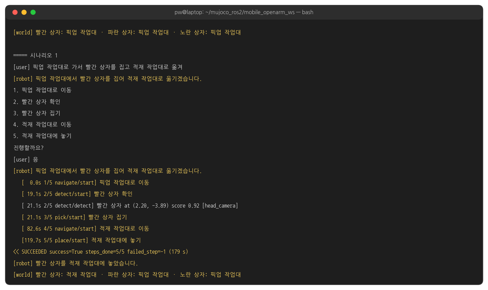{width=1000}

### 실행 결과: 시나리오 2

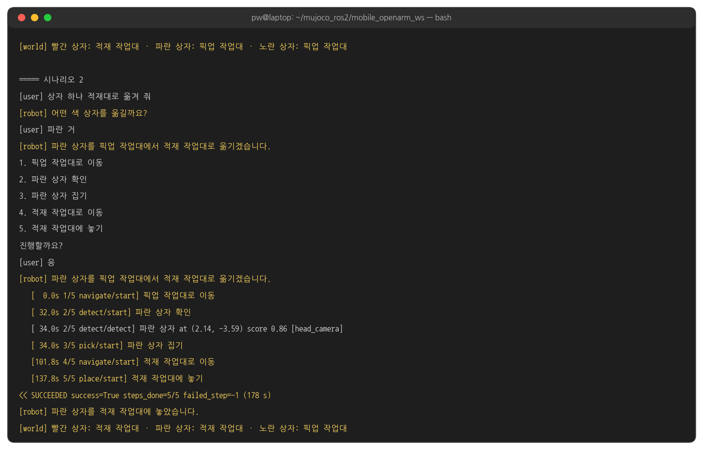{width=1000}

### 실행 결과: 시나리오 3

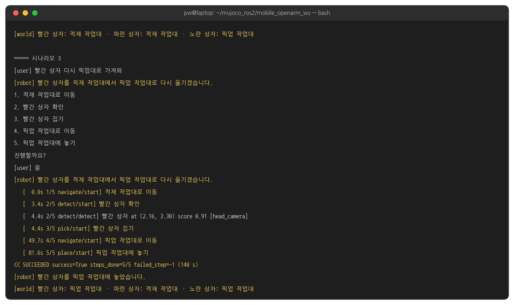{width=1000}

### 세 시나리오의 경로

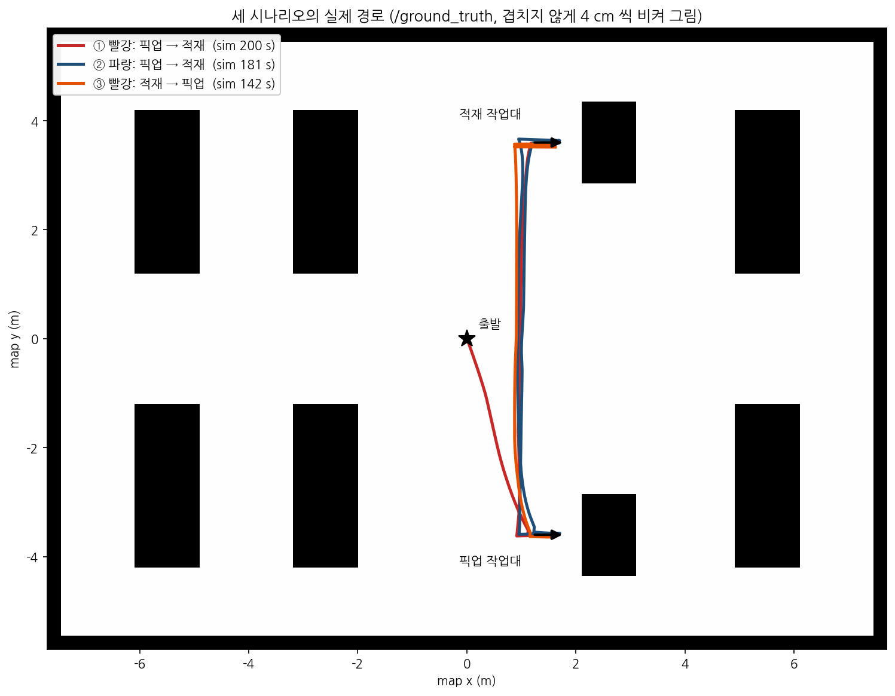{width=1000}

### 장면: 집기와 놓기

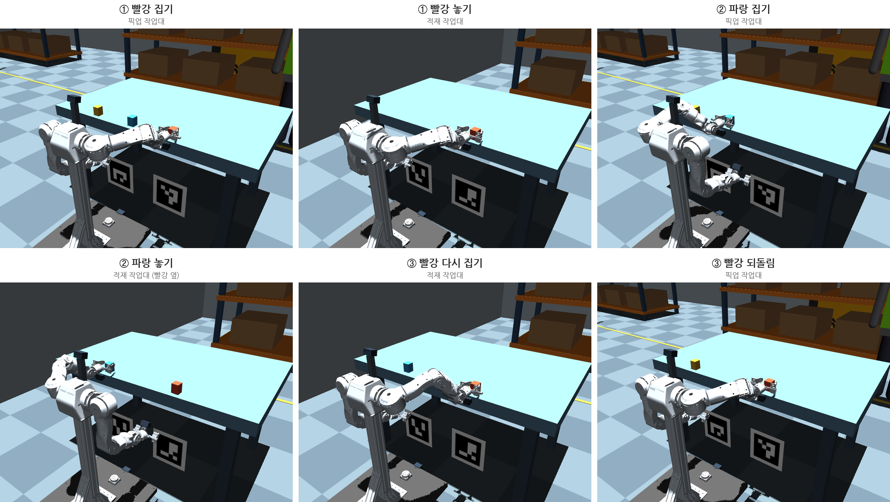{width=1000}

### 시간 흐름

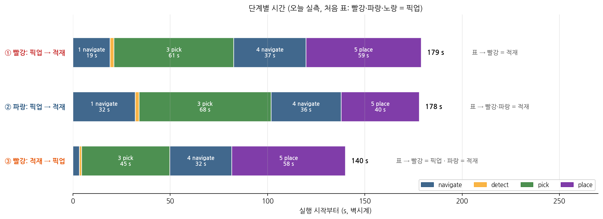{width=1000}

### 터미널: 표가 처음 상태일 때 시나리오 3 만

```bash
./scripts/mobile_openarm exec python lessons/10_final_project/02_final_mission.py --dry-run --scenario 3
```

### 실행 결과: 코드가 실행을 막는다

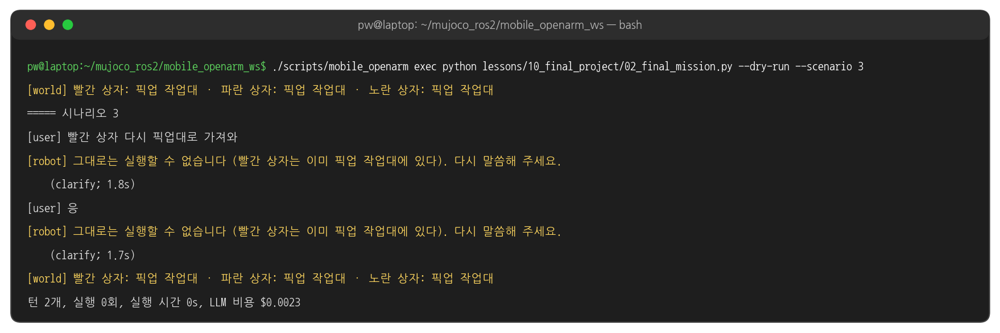{width=1000}

### 끝낼 때: stop

```bash
./scripts/mobile_openarm stop      # 이 워크스페이스의 노드를 모두 종료
```

### 실행 결과: 남은 프로세스가 있으면 start 가 멈춘다

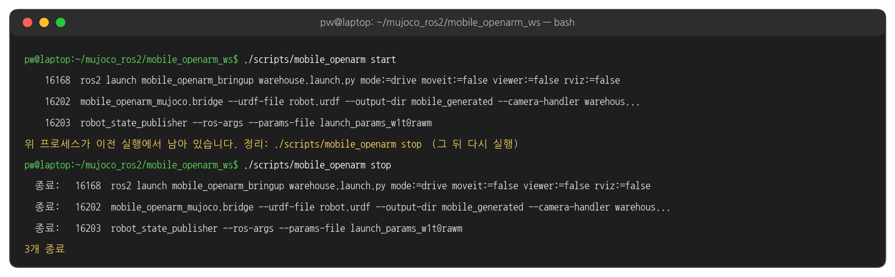{width=1000}

## 3. 코드

### 표를 프롬프트로 - world.py WorldState.prompt 함수

```python
    def prompt(self):
        lines = [f"- {p}({TARGET_KO[p]}): {loc}({self._ko(loc)})" for p, loc in self.parcels.items()]
        return ("현재 상자 위치 (로봇이 마지막으로 확인한 것):\n" + "\n".join(lines) + "\n"
                "상자 위치 규칙 (위의 기본값 pick_table / place_table 보다 우선):\n"
                "- detect · pick 은 그 상자가 지금 있는 작업대(이 표)에서 한다. navigate 도 그 작업대로 간다.\n"
                "- 문장이 도착 작업대를 말하면 그 작업대를 그대로 쓴다. 상자가 이미 거기 있어도 바꾸지 않는다 (그 확인은 프로그램이 한다).\n"
                "- 문장에 도착지가 없거나 '다시', '원래 자리', '돌려놔' 라고만 하면 도착지는 그 상자가 지금 없는 다른 작업대다.\n"
                "- 위치가 unknown 인 상자는 pick_table 에서 찾는다.\n")
```

### system 프롬프트 끝에 붙이기 - plan_parser.py PlanParser.parse 함수 발췌

```python
    def parse(self, text, context=None, world=None):
        system = SYSTEM if world is None else SYSTEM + "\n" + world.prompt()
        messages = [{"role": "system", "content": system}]
        for q, plan in EXAMPLES:
            messages.append({"role": "user", "content": q})
            messages.append({"role": "assistant", "content": plan.model_dump_json()})
        for user, assistant in (context or []):
            messages.append({"role": "user", "content": user})
            messages.append({"role": "assistant", "content": assistant})
        messages.append({"role": "user", "content": text})
        return self.llm.parse(messages, RobotPlan, temperature=0.0, purpose="plan_parse")
```

### 출발 작업대 검사 - world.py WorldState.check 함수 발췌

```python
    def check(self, plan):
        problems, belief = [], dict(self.parcels)
        held = next((p for p, loc in belief.items() if loc == HELD), None)
        origin = {}
        for step in plan.steps:
            if step.action == StepAction.pick:
                loc = belief.get(step.target, UNKNOWN)
                origin[step.target] = loc
                if loc not in (step.location.value, UNKNOWN, HELD):
                    origin[step.target] = "wrong_source"
                    problems.append(f"{TARGET_KO.get(step.target, step.target)}는 {self._ko(loc)}에 있다 "
                                    f"(계획: {self._ko(step.location.value)}에서 집기)")
```

### 이미 도착지에 있나 - world.py WorldState.check 함수 발췌

```python
                # (이어서)
                belief[step.target], held = HELD, step.target
            elif step.action == StepAction.place and held:
                if belief.get(held) == HELD and self.parcels.get(held) == step.location.value:
                    if origin.get(held) == "wrong_source":
                        problems.pop()      # say the simpler thing instead
                    problems.append(f"{TARGET_KO.get(held, held)}는 이미 {self._ko(step.location.value)}에 있다")
                belief[held], held = step.location.value, None
        return problems
```

### 끝난 단계만 반영 - world.py WorldState.apply 함수 발췌

```python
    def apply(self, plan, steps_done, success):
        before = dict(self.parcels)
        held = next((p for p, loc in self.parcels.items() if loc == HELD), None)
        for i, step in enumerate(plan.steps):
            if i < steps_done:
                if step.action == StepAction.pick and step.target in self.parcels:
                    self.parcels[step.target], held = HELD, step.target
                elif step.action == StepAction.place and held:
                    self.parcels[held], held = step.location.value, None
```

### 실패한 단계는 unknown - world.py WorldState.apply 함수 발췌

```python
            # (이어서)
            elif i == steps_done and not success:
                if step.action == StepAction.pick and step.target in self.parcels:
                    self.parcels[step.target] = UNKNOWN
                elif step.action == StepAction.place and held:
                    self.parcels[held] = UNKNOWN
                break
        self.history.append((before, dict(self.parcels)))
        return self.parcels
```

### 계획 → 검사 - dialog.py PlanDialogManager.handle 함수 발췌

```python
        plan = self.parser.parse(utterance, context=self.context, world=self.world)
        problems = plan.validate_world()
        if self.world is not None and not problems:
            problems = self.world.check(plan)
        self._remember(utterance, plan)
        if not plan.steps or problems:
            if plan.steps and problems:   # the plan exists but cannot run: say why, not the LLM's "will do"
                reply = "그대로는 실행할 수 없습니다 (" + "; ".join(problems) + "). 다시 말씀해 주세요."
            else:
                reply = plan.reply or ("; ".join(problems) if problems else "")
```

### 실행 → 표 갱신 - dialog.py PlanDialogManager._execute 함수

```python
    def _execute(self, plan, text):
        if self.executor is None:
            return self._say("execute(dry)", plan.describe(), plan)
        self._say("execute", plan.reply or plan.summary or plan.describe(), plan)
        result = self.executor(plan, text)
        if self.world is not None and result is not None:
            self.world.apply(plan, result.steps_done, result.success)
        spoken = getattr(result, "spoken", None) or str(result)
        return self._say("result", spoken, plan)
```

### 시나리오와 표 하나 - 02_final_mission.py 발췌

```python
SCENARIOS = {
    1: ["픽업 작업대로 가서 빨간 상자를 집고 적재 작업대로 옮겨", "응"],
    2: ["상자 하나 적재대로 옮겨 줘", "파란 거", "응"],
    3: ["빨간 상자 다시 픽업대로 가져와", "응"],
}
    # (main 안)
    world = WorldState()
    dm = PlanDialogManager(PlanParser(llm), executor=execute, speak=speak, world=world)
```

### 시나리오 이어서 실행 - 02_final_mission.py main 함수 발췌

```python
        for n in a.scenario or sorted(SCENARIOS):
            print(f"\n===== 시나리오 {n}")
            dm.context.clear()          # each scenario is a new conversation; the world table carries over
            for text in SCENARIOS[n]:
                print(f"[user] {text}")
                turn(text)
            print(f"[world] {world.describe()}")
```

### 해 볼 것

- `--keyboard` 로 "노란 상자도 적재대로" → "노란 상자 원래 자리로" 를 이어서 보내고 `[world]` 줄 보기
- `01_world_plan.py` 의 `CASES` 에 문장 하나 추가 (예: 세 상자가 모두 적재 작업대일 때 "상자 다 원래대로")
- `world.py` 의 "말한 도착지는 그대로" 규칙 줄을 지우고 `01_world_plan.py --only world` 를 다시 실행해 정확도 비교
