## 0. 시작 전에

### 지원 환경 · 필요한 것 · 소요 시간

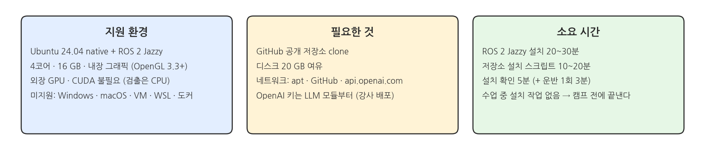{width=1000}

- 지원 환경: Ubuntu 24.04 native + ROS 2 Jazzy · 4코어 · 16 GB · 내장 그래픽이면 충분
- 저장소: https://github.com/PinkWink/pinklab_mobile_openarm_ros2_mujoco

## 1. 환경 설정

### 설치 흐름

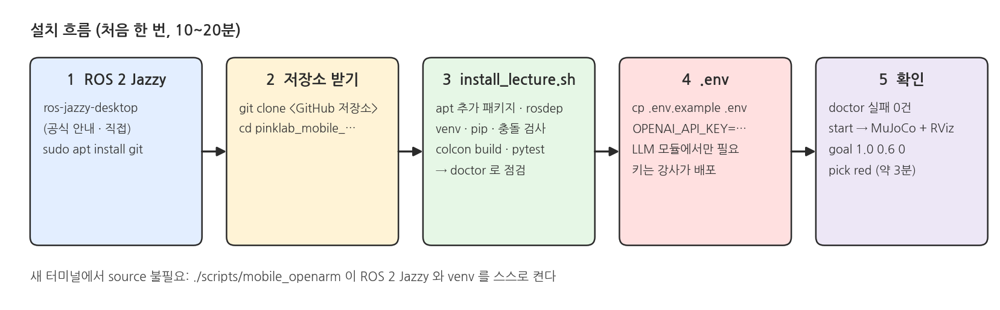{width=1000}

- 다섯 단계를 순서대로 1회만 수행 (10~20분 소요)
- 새 터미널에서 source 불필요 — `./scripts/mobile_openarm ...`이 ROS 2 Jazzy와 venv를 스스로 활성화 (26.11.11 개정)
- 설치 후 `./scripts/mobile_openarm doctor`로 점검 → ❌ 0건이면 수업 준비 완료

### ① ROS 2 Jazzy + 추가 패키지

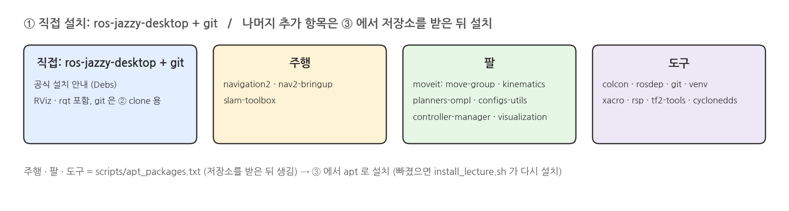{width=1000}

### ① ROS 2 Jazzy + 추가 패키지 설치 명령

- 공식 안내에 따라 `ros-jazzy-desktop` 설치: https://docs.ros.org/en/jazzy/Installation/Ubuntu-Install-Debs.html
- 이어서 git 설치 (② 저장소 받기에 필요)
- 추가 apt 패키지(Nav2 · MoveIt · SLAM 등 24개)는 ③ 에서 저장소를 받은 뒤 설치, `rosdep init/update`는 설치 스크립트가 자동 처리

```bash
sudo apt install git
```

### ② 저장소 받기 → ③ 설치 스크립트

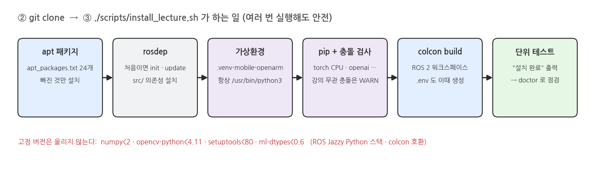{width=1000}

### ③ 설치 스크립트

```bash
git clone https://github.com/PinkWink/pinklab_mobile_openarm_ros2_mujoco.git
cd pinklab_mobile_openarm_ros2_mujoco
grep -v '^#' scripts/apt_packages.txt | xargs sudo apt install -y   # 추가 apt 패키지 24개
./scripts/install_lecture.sh        # sudo 비밀번호를 한 번 묻는다
./scripts/mobile_openarm doctor     # 환경 점검
```

- 수행 순서: apt 패키지 → rosdep → 가상환경 → pip → 충돌 검사 → `colcon build` → 단위 테스트
- 마지막에 "설치 완료" 출력 시 성공

### ③ 설치 스크립트: 실행 결과

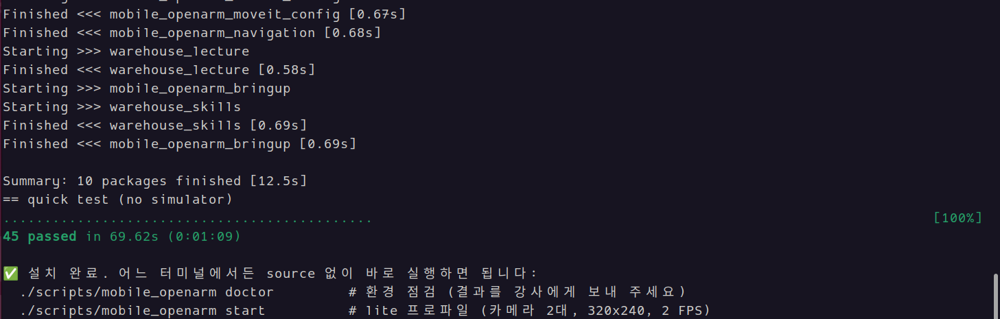{width=1000}

### doctor 실행 결과

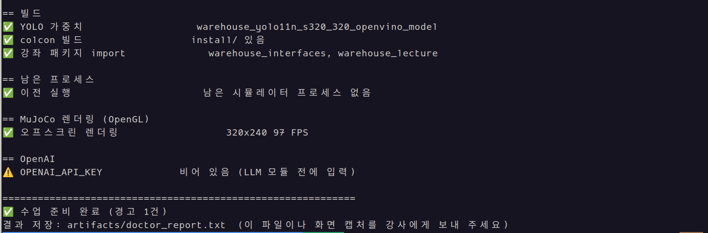{width=1000}

### ③ 설치 스크립트: 주의할 점

- 여러 번 실행해도 안전 — 네트워크 끊김 등으로 멈추면 다시 실행
- conda base가 켜진 터미널도 가능 (venv는 항상 시스템 Python으로 생성)
- 충돌 검사의 `WARN`은 무시 (예: `yt-dlp` ↔ `websockets`), `ERROR`는 강사에게 전달
- 고정 버전(`numpy<2`, `opencv-python<4.11`, `setuptools<80`, `ml-dtypes<0.6`) 업그레이드 금지 — ROS Jazzy · colcon 호환

### install_lecture.sh 가 하는 일

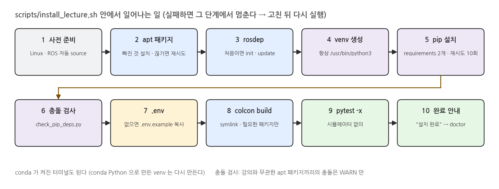{width=1000}

### OpenAI API 키 받는 법

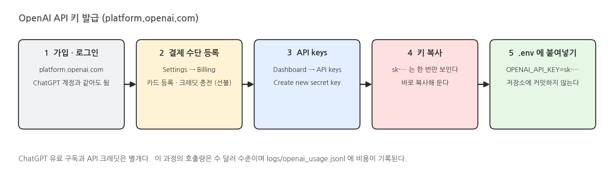{width=1000}

### OpenAI API 키 받는 법: 절차와 링크

- 가입 · 로그인: https://platform.openai.com (ChatGPT 계정 그대로 사용 가능)
- 결제 수단 등록: https://platform.openai.com/settings/organization/billing/overview 에서 카드 등록 후 크레딧 충전
- 키 생성: https://platform.openai.com/api-keys 에서 "Create new secret key" 클릭
- `sk-`로 시작하는 키는 생성 시 한 번만 표시 → 즉시 복사해 보관
- 복사한 키를 `.env`의 `OPENAI_API_KEY=`에 붙여넣기 · 저장소 커밋 금지
- ChatGPT 유료 구독과 API 크레딧은 별개 · 이 과정의 호출량은 수 달러 수준

### ④ OpenAI 키

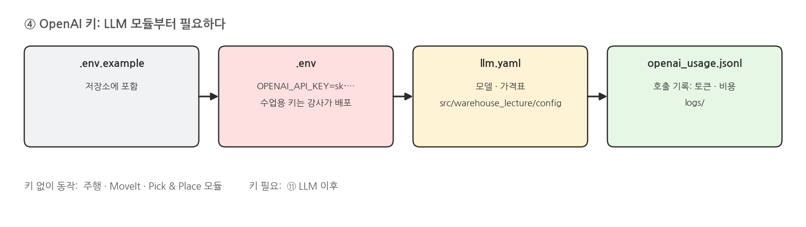{width=1000}

### ④ OpenAI 키 설정 명령

```bash
cp .env.example .env      # OPENAI_API_KEY=sk-...
```

- LLM 모듈부터 필요
- 주행 · MoveIt · Pick & Place 모듈은 키 없이 동작
- 모델 · 가격표: `src/warehouse_lecture/config/llm.yaml` · 호출 기록: `logs/openai_usage.jsonl`

### ros2 명령을 직접 칠 때 (env.sh)

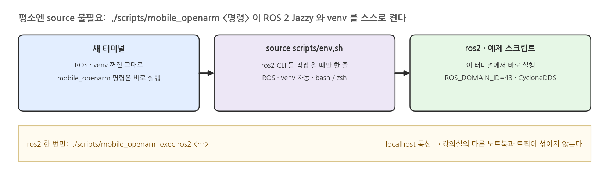{width=1000}

### ros2 CLI를 직접 쓰는 터미널에서

```bash
cd ~/pinklab_mobile_openarm_ros2_mujoco
source scripts/env.sh      # ROS 2 Jazzy · venv 가 꺼져 있으면 자동으로 켠다 (bash · zsh)
```

- `env.sh` 설정 항목: 가상환경 + install 환경 + `ROS_DOMAIN_ID=43` + CycloneDDS(localhost)
- source 안 한 터미널에서도 `./scripts/mobile_openarm <명령>` 바로 사용 가능 (ROS · venv 자동 활성화, ros2 CLI는 `exec ros2 ...`)
- localhost 통신이라 같은 강의실 다른 노트북과 토픽 혼선 없음

### env.sh 가 하는 일

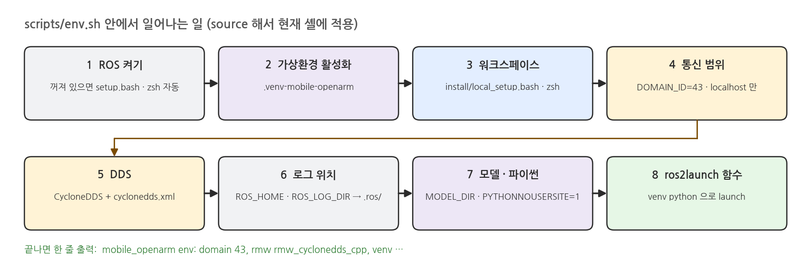{width=1000}

### env.sh 실행 결과

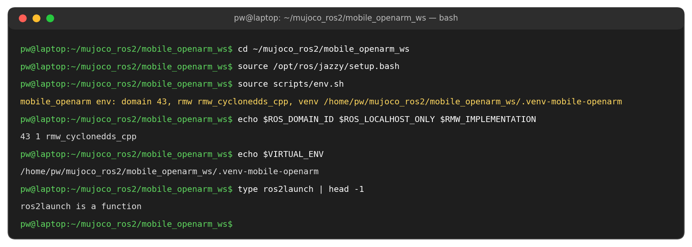{width=1000}

### ⑤ 설치 확인

```bash
./scripts/mobile_openarm doctor          # 약 10초
./scripts/mobile_openarm doctor --api    # .env 에 키를 넣은 뒤: OpenAI API 실제 호출까지 확인
```

- OS · CPU · RAM · 디스크, apt 패키지, venv · Python 패키지 버전, 빌드, MuJoCo 렌더링 속도, OpenAI 키를 ✅/⚠️/❌로 표시
- ❌ 0건이면 준비 완료 · 결과 파일 `artifacts/doctor_report.txt` 또는 화면 캡처를 수업 1주 전까지 강사에게 제출

### ⑤ 설치 확인: 시뮬레이터 실행

```bash
./scripts/mobile_openarm start
```

- 실행 결과 (왼쪽: MuJoCo 창, 오른쪽: RViz2)

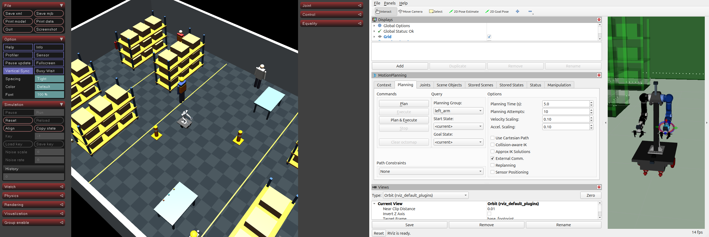{width=1000}

## 2. 실행 구조

### 터미널 두 개

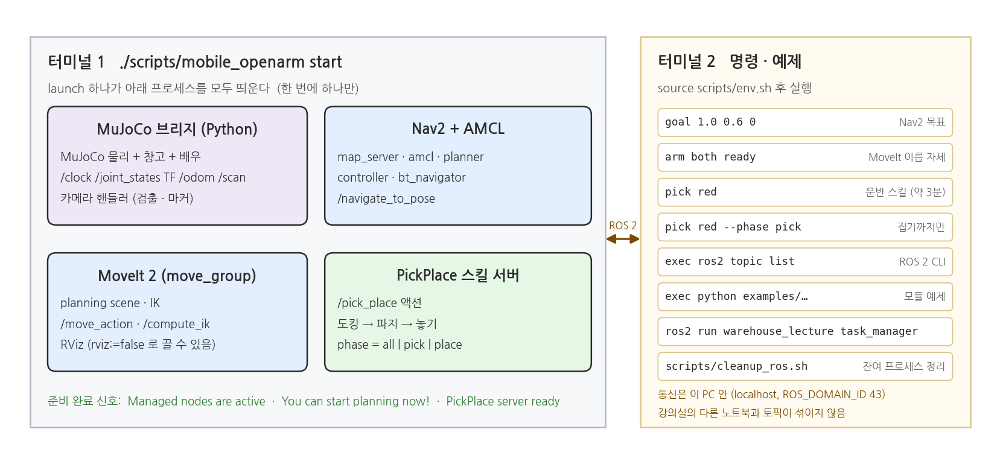{width=1000}

- 터미널 1: `./scripts/mobile_openarm start` — launch 하나로 모든 프로세스 실행
- 터미널 2: 명령과 예제 — `source scripts/env.sh` 후 실행

### wrapper 명령

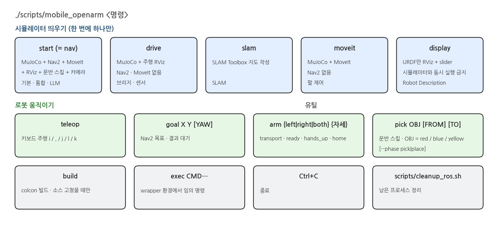{width=1000}

- 시뮬레이터는 한 번에 하나만 실행 (lock 파일로 중복 차단)
- 종료는 Ctrl+C · 남은 프로세스는 `./scripts/cleanup_ros.sh`로 정리

### launch 인자

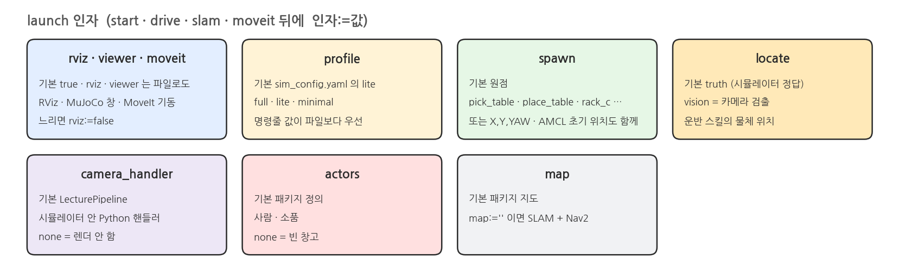{width=1000}

- `start`, `drive`, `slam`, `moveit` 뒤에 `인자:=값` 형식으로 추가
- 기본값은 작업 공간 맨 위 `sim_config.yaml` (`profile: lite`) · 명령줄 인자가 파일보다 우선
- 느리면 7절 '저사양 PC' 참고

### description

- 시뮬레이터 없이 로봇 모델(URDF)만 RViz2에 표시 — Joint · Link · TF 트리 구조 확인용
- 슬라이더 창에서 관절 조작 시 RViz2의 로봇과 TF가 함께 움직임
- 시뮬레이터 실행 중에는 사용 금지 (둘 다 `/joint_states` · `/tf` 발행)

```bash
source /opt/ros/jazzy/setup.bash
source scripts/env.sh
ros2 launch mobile_openarm_description display.launch.py              # RViz2 + 관절 슬라이더
ros2 launch mobile_openarm_description display.launch.py gui:=false   # 슬라이더 없이
# 같은 것: ./scripts/mobile_openarm display
```

### 실행결과

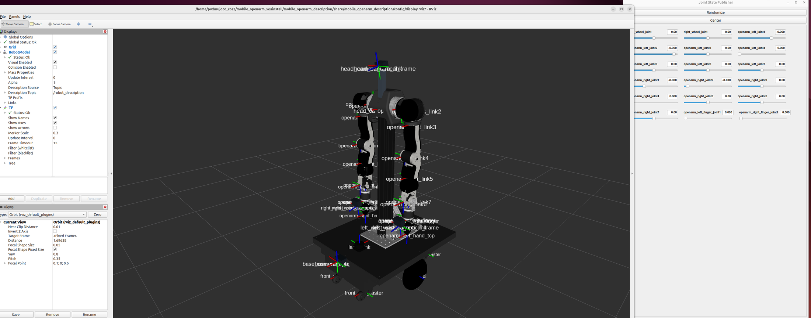{width=1000}

## 3. 창고와 로봇

### 창고 배치도

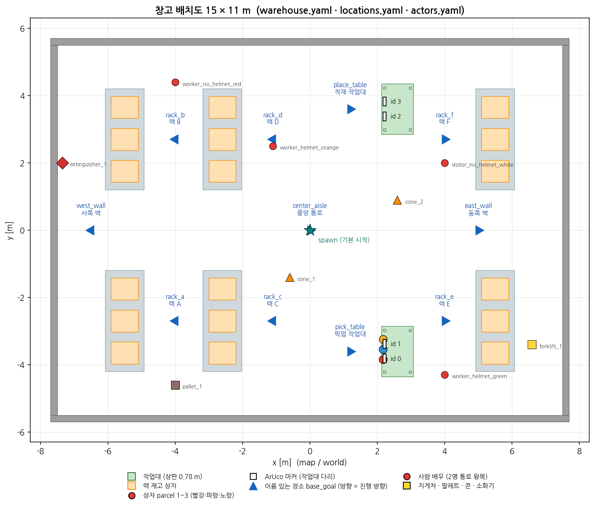{width=1000}

- 15 × 11 m 창고 · 출처: `warehouse.yaml` · `locations.yaml` · `actors.yaml`
- 별 = 기본 시작 위치 · 삼각형 = 이름 있는 장소의 `base_goal`

### 장소 이름 (locations.yaml)

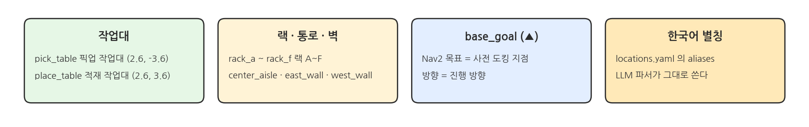{width=1000}

- `pick_table` 픽업 작업대 (2.6, −3.6) · `place_table` 적재 작업대 (2.6, 3.6)
- `rack_a` ~ `rack_f` 랙 A~F · `center_aisle` · `east_wall` · `west_wall`
- 삼각형 = `base_goal` — Nav2 목표이자 사전 도킹 지점
- 한국어 별칭은 LLM 파서가 그대로 사용

### 상자 · 작업대 · 마커

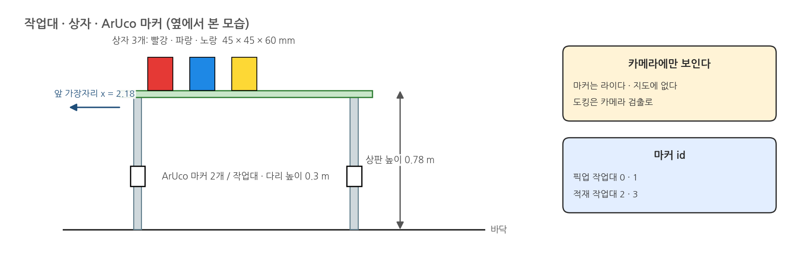{width=1000}

### 배우 (actors.yaml)

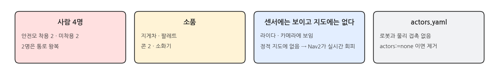{width=1000}

## 4. ROS 2 인터페이스

### 인터페이스 한눈에

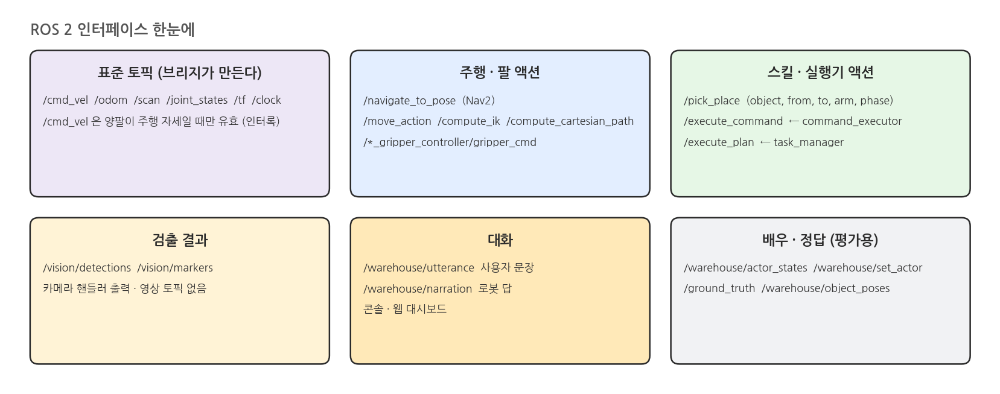{width=1000}

## 5. 자주 수정하는 설정

### 설정 파일 지도 (src/ 아래)

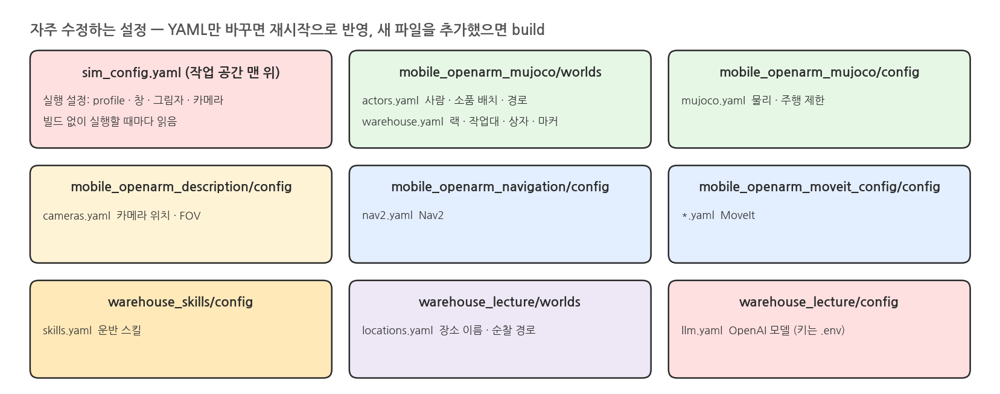{width=1000}

## 6. 문제 해결

### 실행 환경 문제

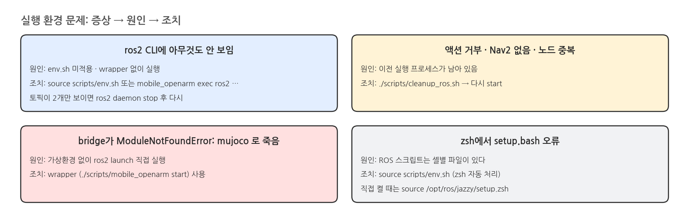{width=1000}

### 동작 · 성능 · 키 문제

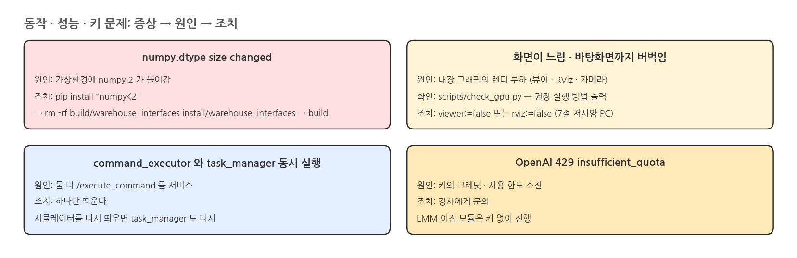{width=1000}

### 설치 문제 (26.11.11 추가)

- **무엇이 문제인지 모를 때**: `./scripts/mobile_openarm doctor`의 ❌ 줄부터 해결
- **pip 의존성 충돌이 있습니다**: `WARN`만 있으면 무시(강의 무관 apt 패키지 충돌). `ERROR` 줄은 강사에게 전달 — `requirements-lecture.txt` 임의 수정 금지
- **apt 다운로드 실패**: 강의실 와이파이 끊김 → `./scripts/install_lecture.sh` 다시 실행 (받은 패키지는 보존)
- **강좌 venv(.venv-mobile-openarm)가 없습니다**: 설치가 중간에 멈춘 경우 → 설치 스크립트 다시 실행
- **이미 받은 저장소를 최신으로**: 저장소 폴더에서 `git pull` 후 설치 스크립트 실행

## 7. 저사양 PC

### 세 가지 프로파일

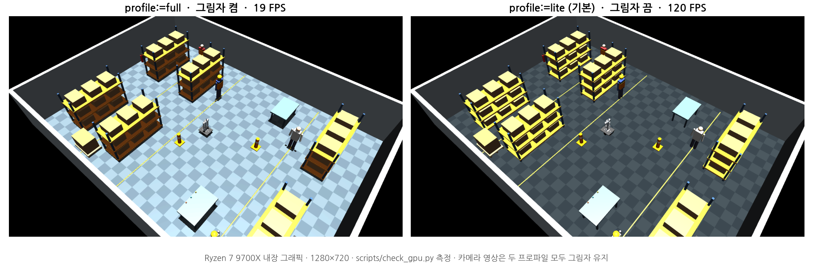{width=1000}

- 무거운 부분은 CPU가 아니라 그래픽: 로봇 메시 270만 삼각형을 조명 3개의 그림자마다 다시 그림
- lite(기본값)는 뷰어 그림자 끔 · minimal은 뷰어의 로봇을 충돌 형상(삼각형 1/23)으로 그리고 카메라 그림자도 끔
- 카메라 영상은 세 프로파일 모두 실제 메시 → 인식 · 도킹 결과는 프로파일과 무관

### 내 PC 렌더링 성능 확인

```bash
source /opt/ros/jazzy/setup.bash
source scripts/env.sh
./scripts/mobile_openarm start      # 처음 한 번 (모델 생성), 창이 뜨면 Ctrl+C
./scripts/mobile_openarm exec python3 scripts/check_gpu.py
```

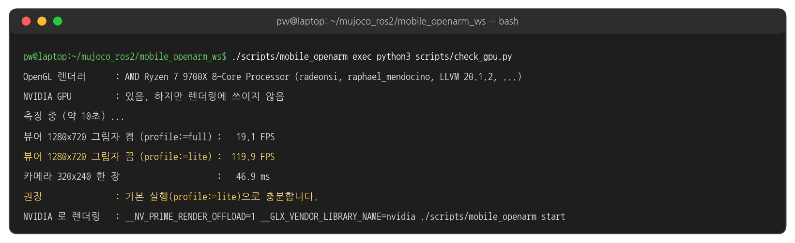{width=1000}

### 설정 파일 sim_config.yaml

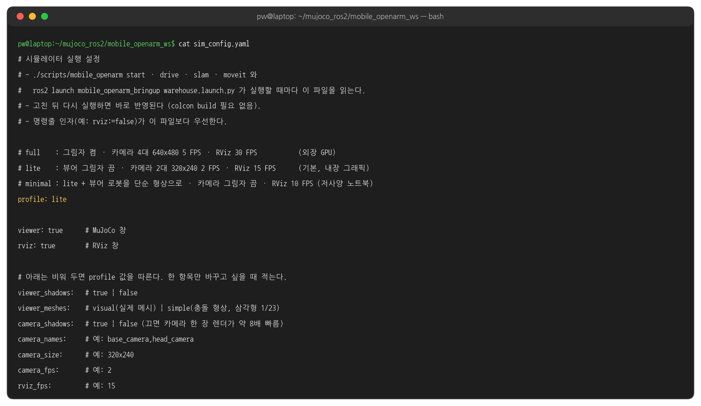{width=1000}

- `./scripts/mobile_openarm`과 `ros2 launch` 모두 실행할 때마다 읽음 → 고친 뒤 빌드 없이 다시 실행
- 우선순위: 명령줄 인자(`rviz:=false`) > `sim_config.yaml` > profile 기본값
- 실행 첫머리 `[sim_config]` 줄에 실제로 적용된 값이 표시됨

### sim_config.yaml 바꿔 실행하기

```bash
sed -i 's/^profile: lite/profile: minimal/' sim_config.yaml     # 편집기로 고쳐도 같음
./scripts/mobile_openarm drive
ros2 launch mobile_openarm_bringup warehouse.launch.py mode:=drive moveit:=false rviz:=false
```

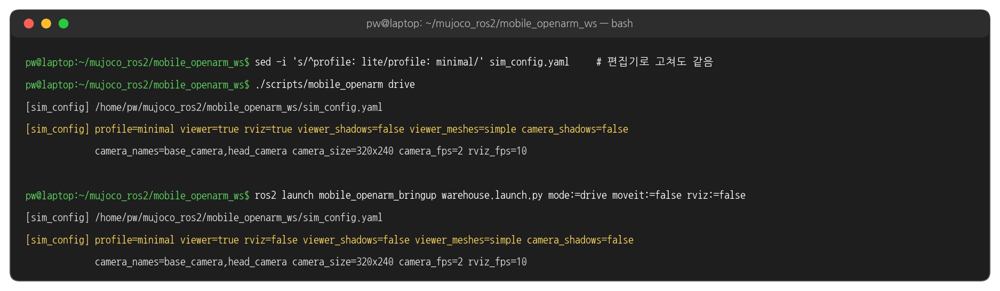{width=1000}

### 더 가볍게 실행하기

```bash
./scripts/mobile_openarm start profile:=minimal     # 이번 실행만 minimal
./scripts/mobile_openarm start viewer:=false        # MuJoCo 창 없이 RViz만
./scripts/mobile_openarm start rviz:=false          # RViz 없이 MuJoCo 창만
./scripts/mobile_openarm drive                      # MoveIt · Nav2 없이 주행만 (Day 1 실습)
```

### 더 가볍게 실행하기: MuJoCo 창 없이 실행한 화면

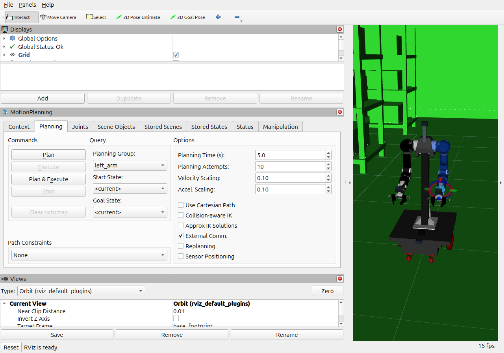{width=1000}
